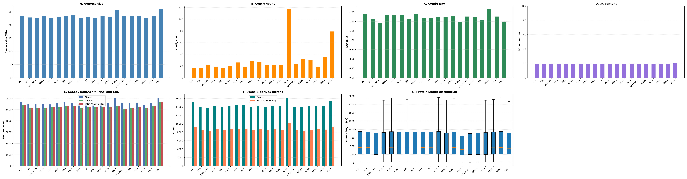
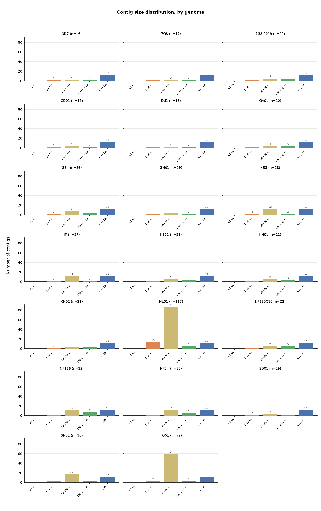
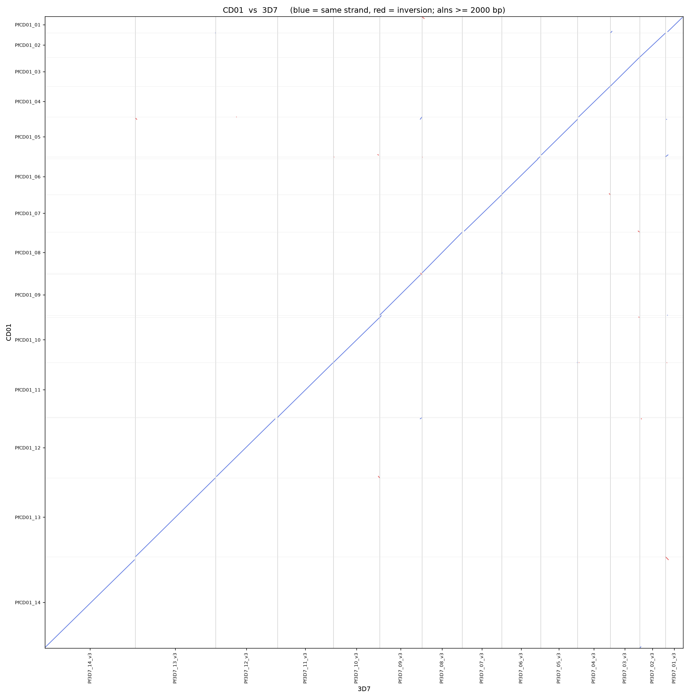
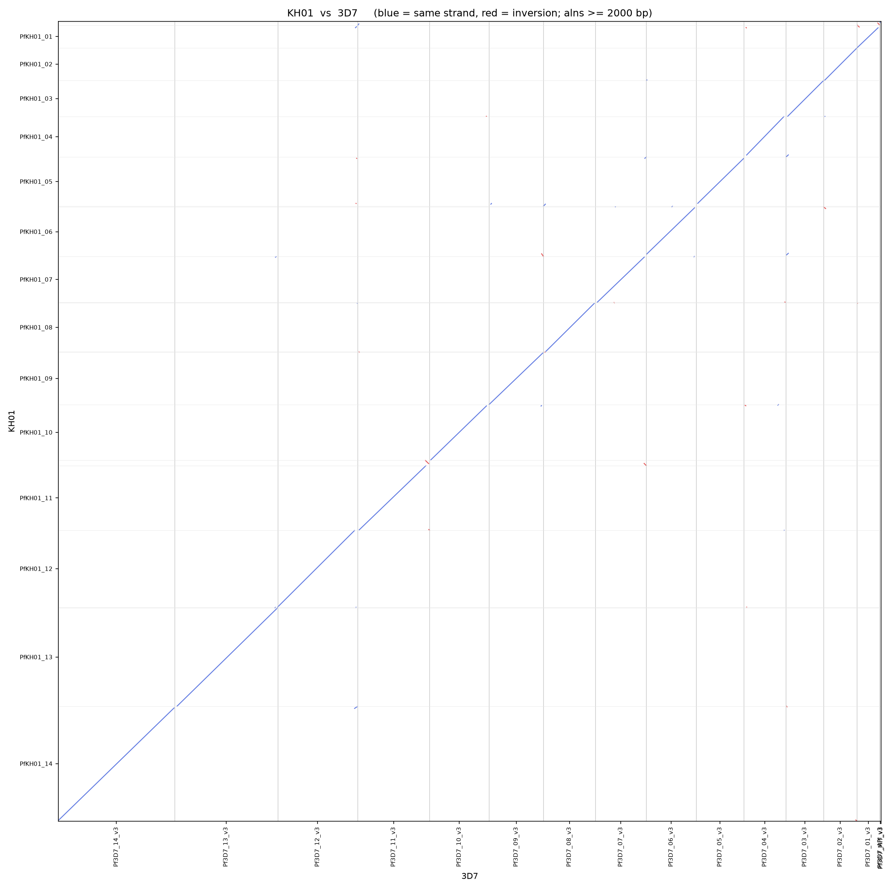
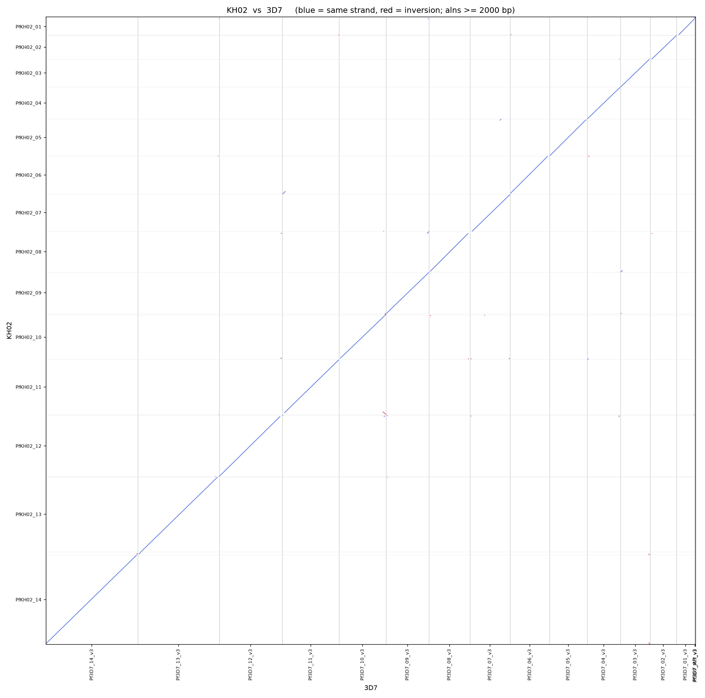
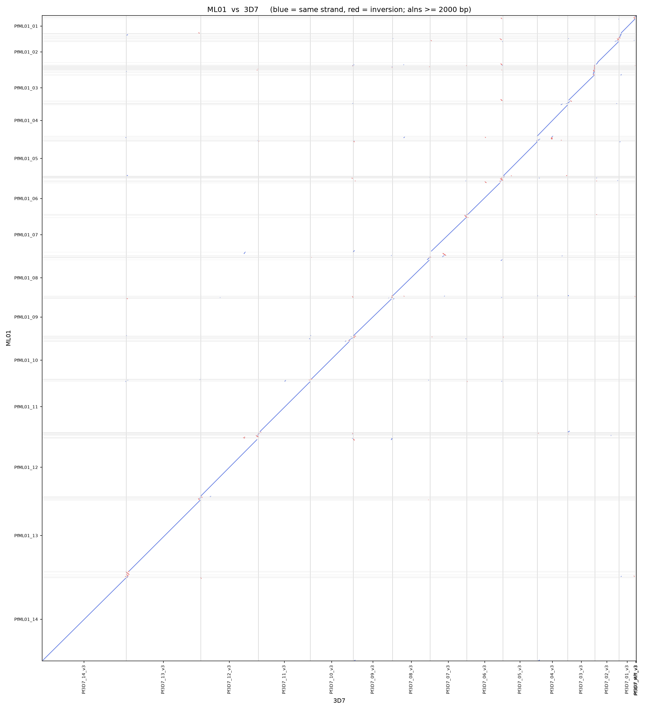
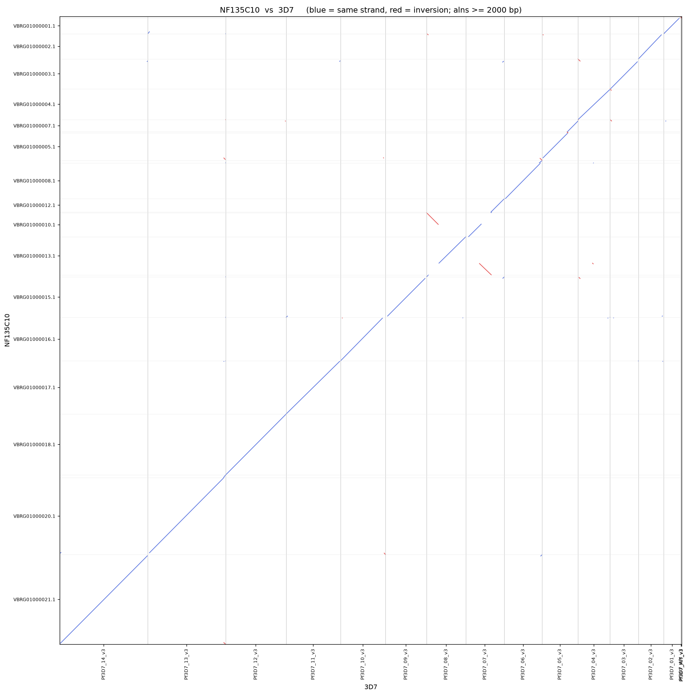
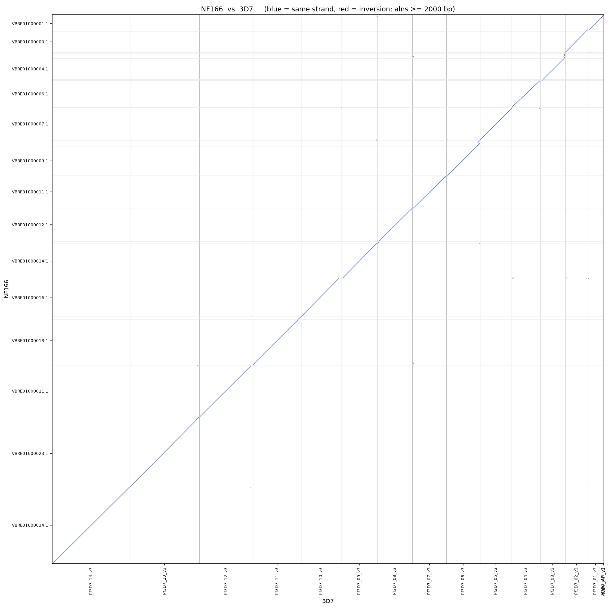
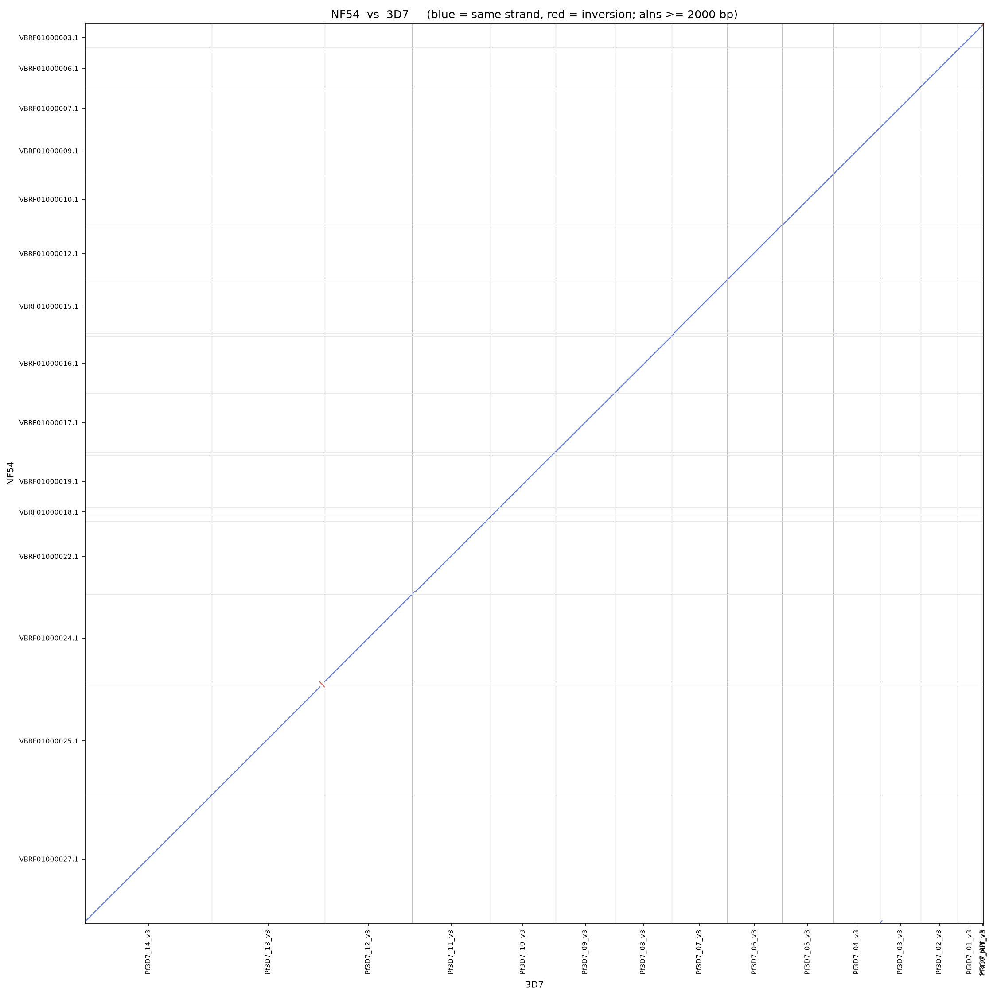

# *Plasmodium falciparum* Pangenome Analysis

This document tracks the execution, parameters, and results of the pangenome analysis for ***Plasmodium falciparum***, following the steps from the [`pangenome_analysis`](https://github.com/VEuPathDB/pangenome-pipeline/blob/main/README.md) pipeline.

---

## Species Biology & Pangenome Considerations

* **The deadliest human malaria parasite.** *Plasmodium falciparum* is an apicomplexan transmitted by *Anopheles* mosquitoes. Its asexual cycle in red blood cells causes the disease.

* **Recent origin from a gorilla parasite.** *P. falciparum* split from *P. praefalciparum*, a gorilla parasite, roughly 40,000–60,000 years ago. This was not a single transfer to humans: there was a long period of co-infection. Around 5,000 years ago the population went through a severe bottleneck, down to ~3,000 individuals. Agriculture then drove the human population up, and with it the pressure on the mosquito vectors to specialise on humans ([Otto et al. 2018, *Nat Microbiol*](https://doi.org/10.1038/s41564-018-0162-2)).

* **Small, extremely AT-rich nuclear genome.** The 3D7 reference is ~23.3 Mb on 14 chromosomes, with ~80.6% AT and ~5,300 protein-coding genes ([Gardner et al. 2002](https://doi.org/10.1038/nature01097)). It has many multigene families and no transposable elements. The parasite also carries two organelle genomes: a ~6 kb mitochondrion and a ~35 kb apicoplast. The extreme AT content and the many low-complexity repeats make alignment and gene prediction harder than in more balanced genomes.

* **Haploid.** The blood stages are haploid. The diploid stage is short (the zygote in the mosquito) and is followed straight away by meiosis. Gene presence/absence and copy number are therefore read directly from each assembly, with no alleles to phase.

* **Conserved core, hypervariable subtelomeres.** Each chromosome has a core region with positionally conserved genes, flanked by subtelomeres that cannot be aligned between isolates ([Otto et al. 2018, *Wellcome Open Res*](https://doi.org/10.12688/wellcomeopenres.14571.1)). The subtelomeres hold most members of the large variant antigen families (*var*, *rifin*, *stevor*), which recombine often and differ in number and sequence between isolates. A synteny-based method resolves the core well. Most accessory genes and paralog clusters are expected in the subtelomeric families, and some of the singletons there may be false positives caused by the poor alignment.

* **Long-read reference assemblies.** [Otto et al. 2018, *Wellcome Open Res*](https://doi.org/10.12688/wellcomeopenres.14571.1) assembled and annotated 15 isolates with PacBio: five laboratory strains (7G8, Dd2, GB4, HB3, IT) and ten recently cultured clinical isolates from Africa and Southeast Asia. Points from that study to bear in mind for this panel:
  * **TG01 and ML01 come from multiple infections**, which explains why they had more singleton genes in a preliminary analysis.
  * **A new CLAG gene cluster** was found.
  * **A new gene on chromosome 11** is present in only a small fraction of ~2,500 field samples. *P. praefalciparum* carries it, so the gene was probably lost in *P. falciparum* rather than gained.

* **Vaccine-trial strains.** [Moser et al. 2020](https://doi.org/10.1186/s13073-019-0708-9) assembled the strains used in whole-sporozoite vaccine trials (NF54, 7G8, NF166.C8, NF135.C10) and found few variants between 3D7 and NF54. 3D7 is a clone of NF54, so these two genomes are expected to be nearly identical.

* **Genomes available.** PlasmoDB has 20 annotated *P. falciparum* genomes, all used here. NCBI has 57 genomes at scaffold level or better, of which 27 are chromosome-level.

---

## Analysis Steps

- [01 – Genome Selection & QC](#01--genome-selection--qc)
- [02 – TE Annotation & Clean Up](#02--te-annotation--clean-up)

---

## 01 – Genome Selection & QC

### Genomes selected (20 genomes with GFF annotations in PlasmoDB release 71)

| Strain / Isolate | Basename | Origin | Assembly published in |
| :--- | :--- | :--- | :--- |
| **3D7** *(Ref)* | `3D7` | Clone of NF54 | [Gardner et al. 2002](https://doi.org/10.1038/nature01097); current version in [Böhme et al. 2019](https://doi.org/10.12688/wellcomeopenres.15194.2) (`GCA_000002765.3`) |
| **NF54** | `NF54` | Laboratory strain, parent of 3D7 | [Moser et al. 2020](https://doi.org/10.1186/s13073-019-0708-9) |
| **NF166.C8** | `NF166` | Guinea | [Moser et al. 2020](https://doi.org/10.1186/s13073-019-0708-9) |
| **NF135.C10** | `NF135C10` | Cambodia | [Moser et al. 2020](https://doi.org/10.1186/s13073-019-0708-9) |
| **7G8** | `7G8` | Brazil | [Otto et al. 2018](https://doi.org/10.12688/wellcomeopenres.14571.1) |
| **7G8 (2019)** | `7G8-2019` | Brazil | [Moser et al. 2020](https://doi.org/10.1186/s13073-019-0708-9) (`GCA_009761555.1`) |
| **Dd2** | `Dd2` | Southeast Asia | [Otto et al. 2018](https://doi.org/10.12688/wellcomeopenres.14571.1) |
| **GB4** | `GB4` | Ghana | [Otto et al. 2018](https://doi.org/10.12688/wellcomeopenres.14571.1) |
| **HB3** | `HB3` | Honduras | [Otto et al. 2018](https://doi.org/10.12688/wellcomeopenres.14571.1) |
| **IT** | `IT` | Brazil | [Otto et al. 2018](https://doi.org/10.12688/wellcomeopenres.14571.1) |
| **CD01** | `CD01` | DR Congo | [Otto et al. 2018](https://doi.org/10.12688/wellcomeopenres.14571.1) |
| **GA01** | `GA01` | Gabon | [Otto et al. 2018](https://doi.org/10.12688/wellcomeopenres.14571.1) |
| **GN01** | `GN01` | Guinea | [Otto et al. 2018](https://doi.org/10.12688/wellcomeopenres.14571.1) |
| **KE01** | `KE01` | Kenya | [Otto et al. 2018](https://doi.org/10.12688/wellcomeopenres.14571.1) |
| **KH01** | `KH01` | Cambodia | [Otto et al. 2018](https://doi.org/10.12688/wellcomeopenres.14571.1) |
| **KH02** | `KH02` | Cambodia | [Otto et al. 2018](https://doi.org/10.12688/wellcomeopenres.14571.1) |
| **ML01** | `ML01` | Mali | [Otto et al. 2018](https://doi.org/10.12688/wellcomeopenres.14571.1) |
| **SD01** | `SD01` | Sudan | [Otto et al. 2018](https://doi.org/10.12688/wellcomeopenres.14571.1) |
| **SN01** | `SN01` | Senegal | [Otto et al. 2018](https://doi.org/10.12688/wellcomeopenres.14571.1) |
| **TG01** | `TG01` | Togo | [Otto et al. 2018](https://doi.org/10.12688/wellcomeopenres.14571.1) |

The 3D7 reference is version 3.0, finished at the Sanger Institute from the 2002 draft. It was corrected and reassembled, and re-annotated genome-wide with community and manual curation.

PlasmoDB has two assemblies of 7G8: `7G8` from Otto et al. 2018 and `7G8-2019` (22.81 Mb) from Moser et al. 2020. Both are kept until the species check and the assembly assessment show how far they differ.

### File organization and renaming

The genome FASTA and GFF of each strain were downloaded from PlasmoDB release 71 and placed in `genomes/` and `gff_originals/`.
```bash
# FASTAs -> genomes/<strain>.fna
cd genomes
for f in PlasmoDB-71_Pfalciparum*_Genome.fasta; do
    n=${f#PlasmoDB-71_Pfalciparum}; n=${n%_Genome.fasta}
    mv "$f" "$n.fna"
done
cd ..

# GFFs -> gff_originals/<strain>.gff3
cd gff_originals
for f in PlasmoDB-71_Pfalciparum*.gff; do
    n=${f#PlasmoDB-71_Pfalciparum}; n=${n%.gff}
    mv "$f" "$n.gff3"
done
cd ..

# genome list, reference first
{ echo 3D7; ls genomes/*.fna | sed 's#.*/##; s/\.fna$//' | grep -vx 3D7; } > genome_order.txt
```

### Assembly & annotation assessment

Run on the cluster on the raw PlasmoDB downloads, 2026-11-17:

```bash
sbatch 01_Genome_Selection_QC/scripts/assess_assemblies.slurm.sh
```

The genomes come from PlasmoDB, so there are no NCBI metadata files and the metadata columns are empty. The proteins were translated from the GFFs.



| Genome | Size (Mb) | Contigs | N50 (Mb) | GC (%) | Genes | mRNAs | Exons per mRNA | Median protein (aa) |
| :--- | ---: | ---: | ---: | ---: | ---: | ---: | ---: | ---: |
| **3D7** *(Ref)* | 23.33 | 16 | 1.69 | 19.34 | 5,720 | 5,389 | 2.61 | 461 |
| 7G8 | 22.83 | 17 | 1.56 | 19.21 | 5,505 | 5,183 | 2.55 | 458 |
| 7G8-2019 | 22.81 | 22 | 1.46 | 19.21 | 5,482 | 5,126 | 2.52 | 451 |
| CD01 | 23.55 | 19 | 1.68 | 19.45 | 5,483 | 5,158 | 2.60 | 452 |
| Dd2 | 22.68 | 16 | 1.66 | 19.19 | 5,461 | 5,209 | 2.56 | 464 |
| GA01 | 23.15 | 20 | 1.67 | 19.31 | 5,551 | 5,224 | 2.56 | 453 |
| GB4 | 23.49 | 26 | 1.57 | 19.36 | 5,637 | 5,335 | 2.55 | 453 |
| GN01 | 23.71 | 19 | 1.70 | 19.46 | 5,600 | 5,298 | 2.58 | 450 |
| HB3 | 22.81 | 28 | 1.59 | 19.21 | 5,461 | 5,186 | 2.57 | 461 |
| IT | 23.18 | 27 | 1.59 | 19.35 | 5,577 | 5,250 | 2.55 | 464 |
| KE01 | 22.79 | 21 | 1.63 | 19.25 | 5,479 | 5,234 | 2.56 | 465 |
| KH01 | 23.27 | 22 | 1.62 | 19.30 | 5,570 | 5,264 | 2.57 | 448 |
| KH02 | 23.12 | 21 | 1.64 | 19.29 | 5,554 | 5,268 | 2.55 | 459 |
| **ML01** | **25.68** | **117** | 1.49 | 19.68 | **6,067** | 5,282 | 2.67 | **397** |
| NF135C10 | 23.51 | 23 | 1.63 | 19.40 | 5,615 | 5,028 | 2.51 | 441 |
| NF166 | 23.28 | 32 | 1.61 | 19.29 | 5,584 | 5,153 | 2.50 | 447 |
| NF54 | 23.40 | 30 | 1.53 | 19.36 | 5,609 | 5,273 | 2.52 | 447 |
| SD01 | 22.75 | 19 | 1.82 | 19.17 | 5,444 | 5,129 | 2.60 | 455 |
| SN01 | 23.50 | 36 | 1.63 | 19.38 | 5,592 | 5,351 | 2.54 | 461 |
| **TG01** | **25.94** | **79** | 1.48 | 19.85 | **6,060** | **5,683** | 2.54 | 426 |

- **All 20 assemblies are near chromosome level.** N50 is 1.46–1.82 Mb and most have 16–36 contigs. 3D7 has 16: the 14 chromosomes plus the mitochondrion and the apicoplast.
- **ML01 and TG01 are the outliers.** They are ~2.5 Mb larger than the others (25.7 and 25.9 Mb vs 22.7–23.7 Mb), have the most contigs (117 and 79) and the most genes (~6,060 vs 5,440–5,720). Both come from multiple infections ([Otto et al. 2018, *Wellcome Open Res*](https://doi.org/10.12688/wellcomeopenres.14571.1)). The extra sequence may be contigs from a second parasite clone, which the contig-redundancy screen will check.
- **ML01 also has the shortest proteins** (median 397 aa vs 426–465 aa) and the largest gap between genes and mRNAs (785, vs 241–587 in the others).
- **Every genome has more genes than mRNAs**, so some genes in every GFF have no mRNA feature.
- **The two 7G8 assemblies are almost the same size** (22.83 and 22.81 Mb) and differ by 57 mRNAs.
- GC content (19.2–19.9%) and exons per mRNA (2.50–2.67) do not differ between genomes.

### Header formatting

Run on the cluster, 2026-11-17:

```bash
sbatch 01_Genome_Selection_QC/scripts/rename_headers_slurm.sh
```

Every FASTA header was trimmed to its first word (e.g. `>Pf3D7_01_v3`). In 10 genomes the cross-check found some sequences that are not in column 1 of the GFF: GA01 (2), GB4 (1), HB3 (4), IT (6), KE01 (1), KH02 (3), ML01 (19), SD01 (2), SN01 (2) and TG01 (5). All of them are unplaced contigs (`_00_` in the name) with no annotated feature. This is not a naming mismatch, because every other sequence of those genomes matched its GFF.

### Species check (whole-genome ANI vs 3D7, `skani`)

Run on the cluster, 2026-11-17:

```bash
sbatch 01_Genome_Selection_QC/scripts/check_species.slurm.sh
```

| Genome | ANI to 3D7 (%) | Aligned fraction |
| :--- | ---: | ---: |
| **3D7** *(Ref)* | 100.00 | 1.00 |
| 7G8-2019 | 99.64 | 0.94 |
| 7G8 | 99.67 | 0.94 |
| CD01 | 99.62 | 0.91 |
| Dd2 | 99.63 | 0.94 |
| GA01 | 99.66 | 0.93 |
| GB4 | 99.53 | 0.92 |
| GN01 | 99.66 | 0.91 |
| HB3 | 99.64 | 0.93 |
| IT | 99.57 | 0.92 |
| KE01 | 99.63 | 0.94 |
| KH01 | 99.59 | 0.92 |
| KH02 | 99.59 | 0.93 |
| ML01 | 99.62 | **0.85** |
| NF135C10 | 99.59 | 0.91 |
| NF166 | 99.62 | 0.92 |
| **NF54** | **99.99** | **0.99** |
| SD01 | 99.64 | 0.94 |
| SN01 | 99.62 | 0.91 |
| TG01 | 99.66 | **0.83** |

- **All 19 genomes are *P. falciparum*** (ANI 99.53–99.99% to 3D7), as expected for genomes from PlasmoDB, a curated database.
- **NF54 is almost identical to 3D7** (99.99% ANI, 99% aligned), as expected for the parent of the 3D7 clone.
- **ML01 and TG01 have the lowest aligned fractions** (0.85 and 0.83 vs 0.91–0.94). This fits their ~2.5 Mb of extra sequence, which does not align to 3D7.

### Contig size profile

Run on the cluster, 2026-11-17 (small contig = < 10 kb):

```bash
sbatch 01_Genome_Selection_QC/scripts/contig_size_profile.slurm.sh
```




- **No contig is shorter than 1 kb.** In every genome 11–12 contigs are ≥ 1 Mb and carry 4,700–5,200 genes.
- **The ~6 kb small contig in 19 genomes is the mitochondrion** (5,967–6,095 bp, with cytochrome b, *cox1*, *cox3* and rRNA genes). 3D7 has 42 genes on it because its GFF annotates the rRNA fragments as 39 ncRNA genes. CD01 has no mitochondrial or apicoplast contig.
- **The other small contigs carry subtelomeric genes or none.** GB4, HB3, IT, KH02 and SD01 each have one extra small contig with no genes. CD01 (1 contig), SN01 (2) and TG01 (2) have small contigs with 1–6 genes. ML01 has 12, 10 of them with genes (21 in total). These genes belong to the subtelomeric families: PfEMP1 (*var*), *rifin*/*stevor*, DnaJ X-domain, SURFIN and the ring-exported proteins REX3/REX4.
- **ML01 and TG01 have many 10–100 kb contigs** (87 and 59, vs 1–18 in the others), carrying 562 and 520 genes (vs 42–183). These contigs hold their ~2.5 Mb of extra sequence. The contig-redundancy screen will check whether they duplicate other parts of the same assembly.

### Synteny analysis (vs reference 3D7)

Run on the cluster, 2026-11-17 (minimap2 `-x asm10`, one dot-plot per genome):

```bash
sbatch 01_Genome_Selection_QC/scripts/synteny_vs_ref.slurm.sh
```

The alignments were then summarised locally on the Mac, from the PAF files:

```bash
python3 01_Genome_Selection_QC/scripts/synteny_report.py \
    01_Genome_Selection_QC/synteny --ref-mb 23.33 \
    --md 01_Genome_Selection_QC/synteny/SYNTENY_REPORT.md \
    --tsv 01_Genome_Selection_QC/synteny/SYNTENY_REPORT.tsv
```

Full per-genome detail: [`SYNTENY_REPORT.md`](01_Genome_Selection_QC/synteny/SYNTENY_REPORT.md) · [`SYNTENY_REPORT.tsv`](01_Genome_Selection_QC/synteny/SYNTENY_REPORT.tsv).

Dot-plots of every genome against 3D7 (blue = same strand, red = inverted):

| | | |
| :---: | :---: | :---: |
| **7G8**<br> | **7G8-2019**<br> | **CD01**<br> |
| **Dd2**<br> | **GA01**<br> | **GB4**<br> |
| **GN01**<br> | **HB3**<br> | **IT**<br> |
| **KE01**<br> | **KH01**<br> | **KH02**<br> |
| **ML01**<br> | **NF135C10**<br> | **NF166**<br> |
| **NF54**<br> | **SD01**<br> | **SN01**<br> |
| **TG01**<br> | | |

| Genome | Query pieces (clean 1:1) | 3D7 covered | Aln identity¹ | Inversion ≥ 20 kb (3D7 chromosome, position) |
| :--- | ---: | ---: | ---: | :--- |
| 7G8-2019 | 22 (17) | 22.7 Mb (97.1%) | 86.2% | – |
| 7G8 | 17 (16) | 22.6 Mb (96.9%) | 86.0% | chr 9, 1.49–1.53 Mb (43 kb) |
| CD01 | 19 (16) | 22.9 Mb (98.1%) | 83.7% | – |
| Dd2 | 16 (15) | 22.5 Mb (96.4%) | 85.8% | chr 11, 0–49 kb (48 kb); chr 7, 1.41–1.43 Mb (24 kb) |
| GA01 | 20 (15) | 22.7 Mb (97.3%) | 84.0% | chr 6, 1.30–1.41 Mb (117 kb) |
| GB4 | 26 (21) | 22.8 Mb (97.5%) | 84.5% | – |
| GN01 | 19 (16) | 23.2 Mb (99.3%) | 83.1% | chr 6, 1.29–1.42 Mb (123 kb) |
| HB3 | 28 (25) | 22.5 Mb (96.6%) | 85.3% | – |
| IT | 27 (22) | 22.5 Mb (96.6%) | 84.1% | chr 3, 18–44 kb (26 kb) |
| KE01 | 21 (19) | 22.6 Mb (96.8%) | 85.8% | – |
| KH01 | 22 (16) | 22.8 Mb (97.8%) | 84.4% | chr 1, 12–62 kb (49 kb); chr 11, 2.02–2.04 Mb (22 kb) |
| KH02 | 21 (18) | 22.6 Mb (96.9%) | 84.8% | – |
| ML01 | 114 (75) | 23.0 Mb (98.6%) | 79.5% | – |
| NF135C10 | 23 (18) | 22.7 Mb (97.3%) | 83.6% | – |
| NF166 | 32 (27) | 22.7 Mb (97.4%) | 85.4% | – |
| **NF54** | 30 (29) | 23.2 Mb (99.6%) | **95.3%** | – |
| SD01 | 19 (17) | 22.5 Mb (96.4%) | 85.9% | – |
| SN01 | 36 (30) | 22.9 Mb (98.2%) | 84.3% | chr 12, 13–46 kb (33 kb) |
| TG01 | 79 (53) | 23.1 Mb (99.2%) | 78.3% | – |

¹ minimap2 gap-compressed identity over aligned regions only. It is lowered by the divergent subtelomeric families; whole-genome ANI (99.5–99.99%) is the real divergence figure.

- **17 of the 19 genomes are collinear with 3D7.** 96–100% of 3D7 is covered in every genome.
- **SD01: chromosome 4 sits inside chromosome 7.** SD01 has no chromosome 4 contig. Its `PfSD01_07` (2.53 Mb) is 3D7 chromosome 7 from 0 to 0.57 Mb, then the whole of chromosome 4 (0.08–1.15 Mb), then the rest of chromosome 7 (0.60–1.44 Mb).
- **NF135C10: chromosomes 7 and 8 swap arms at ~0.5 Mb.** Contig `VBRG01000013.1` joins 3D7 chromosome 7 (0.51–0.96 Mb) to chromosome 8 (0.46–1.47 Mb). Contig `VBRG01000010.1` joins chromosome 7 (0.10–0.58 Mb) to chromosome 8 (0–0.44 Mb).
- **Every inversion ≥ 20 kb is at a chromosome end.** All 9 lie within ~125 kb of a 3D7 chromosome end, in the subtelomeres. GA01 and GN01 share the largest one, at the end of chromosome 6.
- **The other cross-chromosome hits are subtelomeric.** Apart from SD01 and NF135C10, contigs that also align to a second 3D7 chromosome do so with short pieces (≤ 190 kb) at their ends, e.g. GB4 chromosome 11 and SN01 chromosome 14. They reflect the similarity between subtelomeres of different chromosomes, not translocations.
- **ML01 and TG01** have the lowest identity (79.5% and 78.3%) and the most pieces (114 and 79). Their extra small contigs align to chromosome ends.
- **NF54** is almost identical to 3D7 (95.3% identity, 99.6% covered), as in the species check.

### Genomes excluded from the pangenome

Four genomes are excluded, leaving 16 genomes for the pangenome:

| Genome | Reason |
| :--- | :--- |
| **ML01** | Multiple infection ([Otto et al. 2018, *Wellcome Open Res*](https://doi.org/10.12688/wellcomeopenres.14571.1)): ~2.5 Mb of extra sequence in 117 contigs. It also carries contigs of human origin (see the [TE findings](#02--te-annotation--clean-up)). |
| **TG01** | Multiple infection ([Otto et al. 2018, *Wellcome Open Res*](https://doi.org/10.12688/wellcomeopenres.14571.1)): ~2.5 Mb of extra sequence in 79 contigs. |
| **SD01** | Chromosome 4 is assembled inside chromosome 7 (see the [synteny analysis](#synteny-analysis-vs-reference-3d7)). |
| **NF135C10** | Chromosomes 7 and 8 swap arms at ~0.5 Mb (see the [synteny analysis](#synteny-analysis-vs-reference-3d7)). |

### Organelle screen (apicoplast and mitochondrion)

Run on the cluster on the 16 retained genomes, 2026-11-17, with the 3D7 organelle contigs as query:

```bash
# in screen_organelles.slurm.sh
SOURCE_GENOME="3D7"
ORGANELLE_CONTIGS="Pf3D7_API_v3 Pf3D7_MIT_v3"
```

```bash
sbatch 01_Genome_Selection_QC/scripts/screen_organelles.slurm.sh
```

| Genome | Apicoplast contig (length) | Mitochondrion contig (length) |
| :--- | :--- | :--- |
| **3D7** *(Ref)* | `Pf3D7_API_v3` (34,250) | `Pf3D7_MIT_v3` (5,967) |
| 7G8 | `Pf7G8_API` (51,008) | `Pf7G8_MT` (6,094) |
| 7G8-2019 | `CM019770.1` (46,790) | `CM019769.1` (6,094) |
| **CD01** | **absent** | **absent** |
| Dd2 | `PfDd2_API` (34,247) | `PfDd2_MT` (6,094) |
| GA01 | `PfGA01_API` (51,533) | `PfGA01_MT` (6,094) |
| GB4 | `PfGB4_API` (46,656) | `PfGB4_MT` (6,094) |
| GN01 | `PfGN01_API` (34,242) | `PfGN01_MT` (6,094) |
| HB3 | `PfHB3_API` (34,247) | `PfHB3_MT` (6,094) |
| IT | `PfIT_API` (51,087) | `PfIT_MT` (6,094) |
| KE01 | `PfKE01_API` (45,629) | `PfKE01_MT` (6,087) |
| KH01 | `PfKH01_API` (34,248) | `PfKH01_MT` (6,094) |
| KH02 | `PfKH02_API` (50,279) | `PfKH02_MT` (6,095) |
| NF166 | `CM019796.1` (44,463) | `CM019795.1` (6,074) |
| NF54 | `CM019799.1` (45,351) | `CM019798.1` (6,054) |
| SN01 | `PfSN01_API` (43,092) | `PfSN01_MT` (6,093) |

- **15 of the 16 genomes have each organelle as one contig of its own**, covering the whole 3D7 organelle at 99.8–100% identity. No organelle fragment was found inside a nuclear contig.
- **CD01 has neither organelle.** Its assembly contains no apicoplast or mitochondrial sequence.
- **10 of the 15 apicoplast contigs are longer than the 3D7 one** (43–52 kb vs 34 kb). The whole 3D7 apicoplast aligns to each of them. The script calls GA01's (51.5 kb) `in_scaffold` only because of its length.

### Contig redundancy screen

Run on the cluster on the 16 retained genomes, 2026-11-18. `CHROM_MIN_MB` was lowered to 0.5 so that chromosomes 1 (0.64 Mb) and 2 (0.95 Mb) count as chromosome-scale:

```bash
# in contig_redundancy.slurm.sh
CHROM_MIN_MB="0.5"
```

```bash
sbatch 01_Genome_Selection_QC/scripts/contig_redundancy.slurm.sh
sbatch 01_Genome_Selection_QC/scripts/check_redundant_genes.slurm.sh --also-unplaced
```

Full report: [`REPORT.md`](01_Genome_Selection_QC/contig_redundancy/REPORT.md).

17 small contigs in 10 genomes are flagged `small-redundant` (≥ 90% of the contig duplicated in a longer contig of the same assembly). The genes on them were then searched in the rest of the genome (≥ 98% identity, ≥ 90% of the gene covered).

**Removed (13 contigs, 228 kb, 23 genes):** contigs with no genes, or whose genes all have an identical copy elsewhere in the same genome.

| Genome | Contig | Length (bp) | % duplicated in a longer contig | Genes | Genes with an identical copy elsewhere |
| :--- | :--- | ---: | ---: | ---: | ---: |
| GA01 | `PfGA01_00_1` | 15,586 | 100 | 0 | – |
| GA01 | `PfGA01_00_3` | 17,284 | 100 | 0 | – |
| HB3 | `PfHB3_00_0` | 13,275 | 100 | 0 | – |
| HB3 | `PfHB3_00_26` | 10,375 | 99.6 | 0 | – |
| IT | `PfIT_00_5` | 12,211 | 94.1 | 0 | – |
| IT | `PfIT_00_8` | 17,178 | 100 | 0 | – |
| KH02 | `PfKH02_00_3` | 6,708 | 97.7 | 0 | – |
| 7G8-2019 | `VBRD01000009.1` | 32,271 | 95.7 | 7 | 7 |
| GN01 | `PfGN01_00_5` | 24,162 | 100 | 5 | 5 |
| HB3 | `PfHB3_00_14` | 11,586 | 100 | 3 | 3 |
| KH02 | `PfKH02_00_6` | 14,305 | 100 | 2 | 2 |
| SN01 | `PfSN01_00_3` | 21,238 | 99.9 | 5 | 5 |
| NF166 | `VBRE01000025.1` | 31,444 | 99.1 | 1 | 1\* |

\* The copy of this gene on `VBRE01000014.1` is identical in sequence but not annotated as a gene.

**Kept (4 contigs):** they carry variant-family genes (PfEMP1, *rifin*, *stevor*) with no full copy elsewhere in the genome: KH01 `PfKH01_00_26`, NF54 `VBRF01000002.1` and `VBRF01000029.1`, SN01 `PfSN01_00_18`.

### Contig removal

Run on the cluster, 2026-11-18. The genomes and GFFs were first copied to `original_files_copy/`, because the removal rewrites `genomes/` and `gff_originals/` in place:

```bash
mkdir -p original_files_copy
cp -r genomes original_files_copy/genomes
cp -r gff_originals original_files_copy/gff

sbatch 01_Genome_Selection_QC/scripts/drop_contigs_slurm.sh
```

Drop list: [`drop_contigs.txt`](01_Genome_Selection_QC/drop_contigs.txt). 43 contigs were removed:

- **30 organelle contigs** (apicoplast and mitochondrion of the 15 genomes that have them; 1,308 genes);
- **13 redundant contigs** (228 kb, 23 genes; see the [contig redundancy screen](#contig-redundancy-screen)).

---

## 02 – TE Annotation & Clean Up

*P. falciparum* is known to be devoid of transposable elements ([Wells & Feschotte 2020](https://doi.org/10.1146/annurev-genet-040620-022145)). The [TE candidate pipeline](https://github.com/adriludwig/TE-candidate-pipeline) was run anyway, and no TE candidate was confirmed in the manual curation step. The only TE sequences found were human LINEs, on contigs that are clear contamination.

### Findings

**Human contamination in ML01.** The LINEs identified three ML01 contigs of human origin:

| Contig | Length (bp) | Annotated genes |
| :--- | ---: | :--- |
| `PfML01_00_28` | 5,224 | `PfML01_000065900`, `PfML01_000066000` (hypothetical protein, conserved) |
| `PfML01_00_86` | 5,562 | `PfML01_000105200`, `PfML01_000105300` (hypothetical protein, conserved) |
| `PfML01_00_87` | 5,891 | none |

ML01 is excluded from the pangenome (see [genomes excluded](#genomes-excluded-from-the-pangenome)), so these contigs are removed with it.
