# *Plasmodium falciparum* Pangenome Analysis

This document tracks the execution, parameters, and results of the pangenome analysis for ***Plasmodium falciparum***, following the steps from the [`pangenome_analysis`](https://github.com/VEuPathDB/pangenome-pipeline/blob/main/README.md) pipeline.

---

## Species Biology & Pangenome Considerations

* **The deadliest human malaria parasite.** *Plasmodium falciparum* is an apicomplexan transmitted by *Anopheles* mosquitoes. Its asexual cycle in red blood cells causes the disease.

* **Recent origin from a gorilla parasite.** *P. falciparum* split from *P. praefalciparum*, a gorilla parasite, roughly 40,000–60,000 years ago. This was not a single transfer to humans: there was a long period of co-infection. Around 5,000 years ago the population went through a severe bottleneck, down to ~3,000 individuals. Agriculture then drove the human population up, and with it the pressure on the mosquito vectors to specialise on humans ([Otto et al. 2018, *Nat Microbiol*](https://doi.org/10.1038/s41564-018-0162-2)).

* **Small, extremely AT-rich nuclear genome.** The 3D7 reference is ~23.3 Mb on 14 chromosomes, with ~80.6% AT and ~5,300 protein-coding genes ([Gardner et al. 2002](https://doi.org/10.1038/nature01097)). It has many multigene families and no transposable elements. The parasite also carries two organelle genomes: a ~6 kb mitochondrion and a ~35 kb apicoplast. The extreme AT content and the many low-complexity repeats make alignment and gene prediction harder than in more balanced genomes.

* **Haploid.** The blood stages are haploid. The diploid stage is short (the zygote in the mosquito) and is followed straight away by meiosis. Gene presence/absence and copy number are therefore read directly from each assembly, with no alleles to phase.

* **Conserved core, hypervariable subtelomeres.** Each chromosome has a core region with positionally conserved genes, flanked by subtelomeres that cannot be aligned between isolates ([Otto et al. 2018, *Wellcome Open Res*](https://doi.org/10.12688/wellcomeopenres.14571.1)). The subtelomeres hold most members of the large variant antigen families (*var*, *rifin*, *stevor*), which recombine often and differ in number and sequence between isolates. A synteny-based method resolves the core well. Most accessory genes and paralog clusters are expected in the subtelomeric families, and some of the singletons there may be false positives caused by the poor alignment.

* **Long-read reference assemblies.** [Otto et al. 2018, *Wellcome Open Res*](https://doi.org/10.12688/wellcomeopenres.14571.1) assembled and annotated 15 isolates with PacBio: five laboratory strains (7G8, Dd2, GB4, HB3, IT) and ten recently cultured clinical isolates from Africa and Southeast Asia. Points from that study to bear in mind for this panel:
  * **TG01 and ML01 come from multiple infections**, which explains why they had more singleton genes in a preliminary analysis.
  * **A new CLAG gene cluster** was found.
  * **A new gene on chromosome 11** is present in only a small fraction of ~2,500 field samples. *P. praefalciparum* carries it, so the gene was probably lost in *P. falciparum* rather than gained.

* **Vaccine-trial strains.** [Moser et al. 2020](https://doi.org/10.1186/s13073-019-0708-9) assembled the strains used in whole-sporozoite vaccine trials (NF54, 7G8, NF166.C8, NF135.C10) and found few variants between 3D7 and NF54. 3D7 is a clone of NF54, so these two genomes are expected to be nearly identical.

* **Genomes available.** PlasmoDB has 20 annotated *P. falciparum* genomes, all used here. NCBI has 57 genomes at scaffold level or better, of which 27 are chromosome-level.

---

## Analysis Steps

- [01 – Genome Selection & QC](#01--genome-selection--qc)
- [02 – TE Annotation & Clean Up](#02--te-annotation--clean-up)
- [03 – *de novo* Genome Annotation](#03--de-novo-genome-annotation)
- [04 – Protein evidence (InterProScan and PSAURON)](#04--protein-evidence-interproscan-and-psauron)
- [05 – Cross-genome Annotation Integration](#05--cross-genome-annotation-integration)
- [New genes in the reference (3D7)](#new-genes-in-the-reference-3d7)
- [Genes to fix at the end](#genes-to-fix-at-the-end)

---

## 01 – Genome Selection & QC

### Genomes selected (20 genomes with GFF annotations in PlasmoDB release 71)

| Strain / Isolate | Basename | Origin | Assembly published in |
| :--- | :--- | :--- | :--- |
| **3D7** *(Ref)* | `3D7` | Clone of NF54 | [Gardner et al. 2002](https://doi.org/10.1038/nature01097); current version in [Böhme et al. 2019](https://doi.org/10.12688/wellcomeopenres.15194.2) (`GCA_000002765.3`) |
| **NF54** | `NF54` | Laboratory strain, parent of 3D7 | [Moser et al. 2020](https://doi.org/10.1186/s13073-019-0708-9) |
| **NF166.C8** | `NF166` | Guinea | [Moser et al. 2020](https://doi.org/10.1186/s13073-019-0708-9) |
| **NF135.C10** | `NF135C10` | Cambodia | [Moser et al. 2020](https://doi.org/10.1186/s13073-019-0708-9) |
| **7G8** | `7G8` | Brazil | [Otto et al. 2018](https://doi.org/10.12688/wellcomeopenres.14571.1) |
| **7G8 (2019)** | `7G8-2019` | Brazil | [Moser et al. 2020](https://doi.org/10.1186/s13073-019-0708-9) (`GCA_009761555.1`) |
| **Dd2** | `Dd2` | Southeast Asia | [Otto et al. 2018](https://doi.org/10.12688/wellcomeopenres.14571.1) |
| **GB4** | `GB4` | Ghana | [Otto et al. 2018](https://doi.org/10.12688/wellcomeopenres.14571.1) |
| **HB3** | `HB3` | Honduras | [Otto et al. 2018](https://doi.org/10.12688/wellcomeopenres.14571.1) |
| **IT** | `IT` | Brazil | [Otto et al. 2018](https://doi.org/10.12688/wellcomeopenres.14571.1) |
| **CD01** | `CD01` | DR Congo | [Otto et al. 2018](https://doi.org/10.12688/wellcomeopenres.14571.1) |
| **GA01** | `GA01` | Gabon | [Otto et al. 2018](https://doi.org/10.12688/wellcomeopenres.14571.1) |
| **GN01** | `GN01` | Guinea | [Otto et al. 2018](https://doi.org/10.12688/wellcomeopenres.14571.1) |
| **KE01** | `KE01` | Kenya | [Otto et al. 2018](https://doi.org/10.12688/wellcomeopenres.14571.1) |
| **KH01** | `KH01` | Cambodia | [Otto et al. 2018](https://doi.org/10.12688/wellcomeopenres.14571.1) |
| **KH02** | `KH02` | Cambodia | [Otto et al. 2018](https://doi.org/10.12688/wellcomeopenres.14571.1) |
| **ML01** | `ML01` | Mali | [Otto et al. 2018](https://doi.org/10.12688/wellcomeopenres.14571.1) |
| **SD01** | `SD01` | Sudan | [Otto et al. 2018](https://doi.org/10.12688/wellcomeopenres.14571.1) |
| **SN01** | `SN01` | Senegal | [Otto et al. 2018](https://doi.org/10.12688/wellcomeopenres.14571.1) |
| **TG01** | `TG01` | Togo | [Otto et al. 2018](https://doi.org/10.12688/wellcomeopenres.14571.1) |

The 3D7 reference is version 3.0, finished at the Sanger Institute from the 2002 draft. It was corrected and reassembled, and re-annotated genome-wide with community and manual curation.

PlasmoDB has two assemblies of 7G8: `7G8` from Otto et al. 2018 and `7G8-2019` (22.81 Mb) from Moser et al. 2020. Both are kept until the species check and the assembly assessment show how far they differ.

### File organization and renaming

The genome FASTA and GFF of each strain were downloaded from PlasmoDB release 71 and placed in `genomes/` and `gff_originals/`.
```bash
# FASTAs -> genomes/<strain>.fna
cd genomes
for f in PlasmoDB-71_Pfalciparum*_Genome.fasta; do
    n=${f#PlasmoDB-71_Pfalciparum}; n=${n%_Genome.fasta}
    mv "$f" "$n.fna"
done
cd ..

# GFFs -> gff_originals/<strain>.gff3
cd gff_originals
for f in PlasmoDB-71_Pfalciparum*.gff; do
    n=${f#PlasmoDB-71_Pfalciparum}; n=${n%.gff}
    mv "$f" "$n.gff3"
done
cd ..

# genome list, reference first
{ echo 3D7; ls genomes/*.fna | sed 's#.*/##; s/\.fna$//' | grep -vx 3D7; } > genome_order.txt
```

### Assembly & annotation assessment

Run on the cluster on the raw PlasmoDB downloads, 2026-11-17:

```bash
sbatch 01_Genome_Selection_QC/scripts/assess_assemblies.slurm.sh
```

The genomes come from PlasmoDB, so there are no NCBI metadata files and the metadata columns are empty. The proteins were translated from the GFFs.


| Genome | Size (Mb) | Contigs | N50 (Mb) | GC (%) | Genes | mRNAs | Exons per mRNA | Median protein (aa) |
| :--- | ---: | ---: | ---: | ---: | ---: | ---: | ---: | ---: |
| **3D7** *(Ref)* | 23.33 | 16 | 1.69 | 19.34 | 5,720 | 5,389 | 2.61 | 461 |
| 7G8 | 22.83 | 17 | 1.56 | 19.21 | 5,505 | 5,183 | 2.55 | 458 |
| 7G8-2019 | 22.81 | 22 | 1.46 | 19.21 | 5,482 | 5,126 | 2.52 | 451 |
| CD01 | 23.55 | 19 | 1.68 | 19.45 | 5,483 | 5,158 | 2.60 | 452 |
| Dd2 | 22.68 | 16 | 1.66 | 19.19 | 5,461 | 5,209 | 2.56 | 464 |
| GA01 | 23.15 | 20 | 1.67 | 19.31 | 5,551 | 5,224 | 2.56 | 453 |
| GB4 | 23.49 | 26 | 1.57 | 19.36 | 5,637 | 5,335 | 2.55 | 453 |
| GN01 | 23.71 | 19 | 1.70 | 19.46 | 5,600 | 5,298 | 2.58 | 450 |
| HB3 | 22.81 | 28 | 1.59 | 19.21 | 5,461 | 5,186 | 2.57 | 461 |
| IT | 23.18 | 27 | 1.59 | 19.35 | 5,577 | 5,250 | 2.55 | 464 |
| KE01 | 22.79 | 21 | 1.63 | 19.25 | 5,479 | 5,234 | 2.56 | 465 |
| KH01 | 23.27 | 22 | 1.62 | 19.30 | 5,570 | 5,264 | 2.57 | 448 |
| KH02 | 23.12 | 21 | 1.64 | 19.29 | 5,554 | 5,268 | 2.55 | 459 |
| **ML01** | **25.68** | **117** | 1.49 | 19.68 | **6,067** | 5,282 | 2.67 | **397** |
| NF135C10 | 23.51 | 23 | 1.63 | 19.40 | 5,615 | 5,028 | 2.51 | 441 |
| NF166 | 23.28 | 32 | 1.61 | 19.29 | 5,584 | 5,153 | 2.50 | 447 |
| NF54 | 23.40 | 30 | 1.53 | 19.36 | 5,609 | 5,273 | 2.52 | 447 |
| SD01 | 22.75 | 19 | 1.82 | 19.17 | 5,444 | 5,129 | 2.60 | 455 |
| SN01 | 23.50 | 36 | 1.63 | 19.38 | 5,592 | 5,351 | 2.54 | 461 |
| **TG01** | **25.94** | **79** | 1.48 | 19.85 | **6,060** | **5,683** | 2.54 | 426 |

- **All 20 assemblies are near chromosome level.** N50 is 1.46–1.82 Mb and most have 16–36 contigs. 3D7 has 16: the 14 chromosomes plus the mitochondrion and the apicoplast.
- **ML01 and TG01 are the outliers.** They are ~2.5 Mb larger than the others (25.7 and 25.9 Mb vs 22.7–23.7 Mb), have the most contigs (117 and 79) and the most genes (~6,060 vs 5,440–5,720). Both come from multiple infections ([Otto et al. 2018, *Wellcome Open Res*](https://doi.org/10.12688/wellcomeopenres.14571.1)). The extra sequence may be contigs from a second parasite clone, which the contig-redundancy screen will check.
- **ML01 also has the shortest proteins** (median 397 aa vs 426–465 aa) and the largest gap between genes and mRNAs (785, vs 241–587 in the others).
- **Every genome has more genes than mRNAs**, so some genes in every GFF have no mRNA feature.
- **The two 7G8 assemblies are almost the same size** (22.83 and 22.81 Mb) and differ by 57 mRNAs.
- GC content (19.2–19.9%) and exons per mRNA (2.50–2.67) do not differ between genomes.

### Header formatting

Run on the cluster, 2026-11-17:

```bash
sbatch 01_Genome_Selection_QC/scripts/rename_headers_slurm.sh
```

Every FASTA header was trimmed to its first word (e.g. `>Pf3D7_01_v3`). In 10 genomes the cross-check found some sequences that are not in column 1 of the GFF: GA01 (2), GB4 (1), HB3 (4), IT (6), KE01 (1), KH02 (3), ML01 (19), SD01 (2), SN01 (2) and TG01 (5). All of them are unplaced contigs (`_00_` in the name) with no annotated feature. This is not a naming mismatch, because every other sequence of those genomes matched its GFF.

### Species check (whole-genome ANI vs 3D7, `skani`)

Run on the cluster, 2026-11-17:

```bash
sbatch 01_Genome_Selection_QC/scripts/check_species.slurm.sh
```

| Genome | ANI to 3D7 (%) | Aligned fraction |
| :--- | ---: | ---: |
| **3D7** *(Ref)* | 100.00 | 1.00 |
| 7G8-2019 | 99.64 | 0.94 |
| 7G8 | 99.67 | 0.94 |
| CD01 | 99.62 | 0.91 |
| Dd2 | 99.63 | 0.94 |
| GA01 | 99.66 | 0.93 |
| GB4 | 99.53 | 0.92 |
| GN01 | 99.66 | 0.91 |
| HB3 | 99.64 | 0.93 |
| IT | 99.57 | 0.92 |
| KE01 | 99.63 | 0.94 |
| KH01 | 99.59 | 0.92 |
| KH02 | 99.59 | 0.93 |
| ML01 | 99.62 | **0.85** |
| NF135C10 | 99.59 | 0.91 |
| NF166 | 99.62 | 0.92 |
| **NF54** | **99.99** | **0.99** |
| SD01 | 99.64 | 0.94 |
| SN01 | 99.62 | 0.91 |
| TG01 | 99.66 | **0.83** |

- **All 19 genomes are *P. falciparum*** (ANI 99.53–99.99% to 3D7), as expected for genomes from PlasmoDB, a curated database.
- **NF54 is almost identical to 3D7** (99.99% ANI, 99% aligned), as expected for the parent of the 3D7 clone.
- **ML01 and TG01 have the lowest aligned fractions** (0.85 and 0.83 vs 0.91–0.94). This fits their ~2.5 Mb of extra sequence, which does not align to 3D7.

### Contig size profile

Run on the cluster, 2026-11-17 (small contig = < 10 kb):

```bash
sbatch 01_Genome_Selection_QC/scripts/contig_size_profile.slurm.sh
```


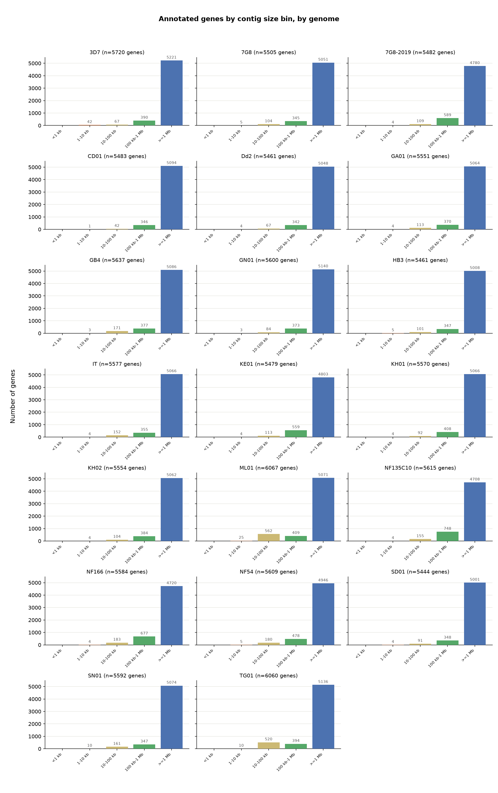

- **No contig is shorter than 1 kb.** In every genome 11–12 contigs are ≥ 1 Mb and carry 4,700–5,200 genes.
- **The ~6 kb small contig in 19 genomes is the mitochondrion** (5,967–6,095 bp, with cytochrome b, *cox1*, *cox3* and rRNA genes). 3D7 has 42 genes on it because its GFF annotates the rRNA fragments as 39 ncRNA genes. CD01 has no mitochondrial or apicoplast contig.
- **The other small contigs carry subtelomeric genes or none.** GB4, HB3, IT, KH02 and SD01 each have one extra small contig with no genes. CD01 (1 contig), SN01 (2) and TG01 (2) have small contigs with 1–6 genes. ML01 has 12, 10 of them with genes (21 in total). These genes belong to the subtelomeric families: PfEMP1 (*var*), *rifin*/*stevor*, DnaJ X-domain, SURFIN and the ring-exported proteins REX3/REX4.
- **ML01 and TG01 have many 10–100 kb contigs** (87 and 59, vs 1–18 in the others), carrying 562 and 520 genes (vs 42–183). These contigs hold their ~2.5 Mb of extra sequence. The contig-redundancy screen will check whether they duplicate other parts of the same assembly.

### Synteny analysis (vs reference 3D7)

Run on the cluster, 2026-11-17 (minimap2 `-x asm10`, one dot-plot per genome):

```bash
sbatch 01_Genome_Selection_QC/scripts/synteny_vs_ref.slurm.sh
```

The alignments were then summarised locally on the Mac, from the PAF files:

```bash
python3 01_Genome_Selection_QC/scripts/synteny_report.py \
    01_Genome_Selection_QC/synteny --ref-mb 23.33 \
    --md 01_Genome_Selection_QC/synteny/SYNTENY_REPORT.md \
    --tsv 01_Genome_Selection_QC/synteny/SYNTENY_REPORT.tsv
```

Full per-genome detail: [`SYNTENY_REPORT.md`](01_Genome_Selection_QC/synteny/SYNTENY_REPORT.md) · [`SYNTENY_REPORT.tsv`](01_Genome_Selection_QC/synteny/SYNTENY_REPORT.tsv).

Dot-plots of every genome against 3D7 (blue = same strand, red = inverted):

| | | |
| :---: | :---: | :---: |
| **7G8**<br> | **7G8-2019**<br>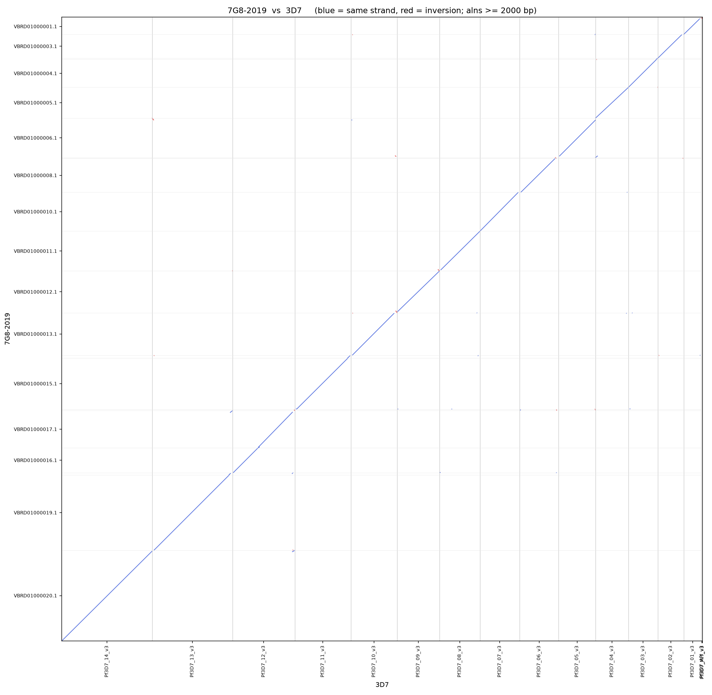 | **CD01**<br> |
| **Dd2**<br>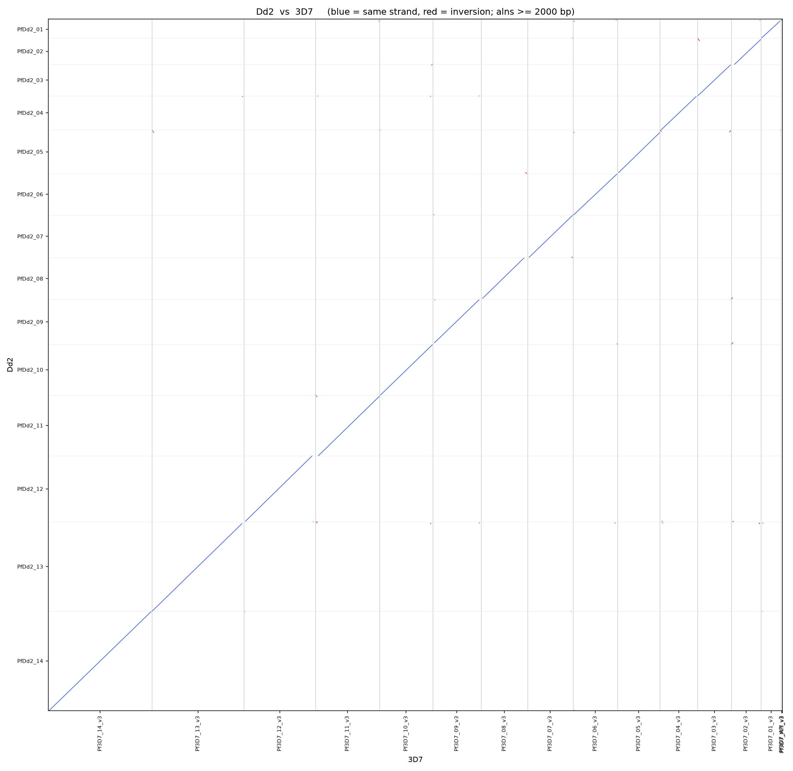 | **GA01**<br> | **GB4**<br> |
| **GN01**<br> | **HB3**<br>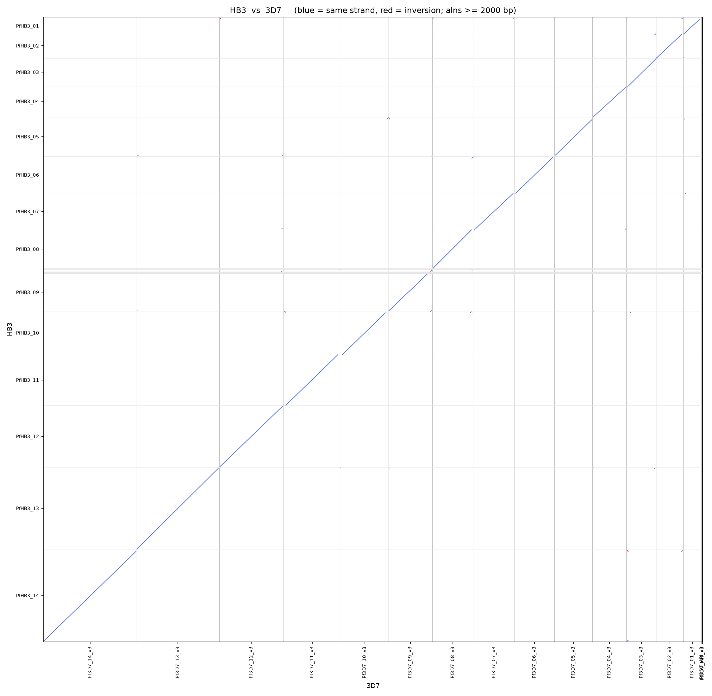 | **IT**<br>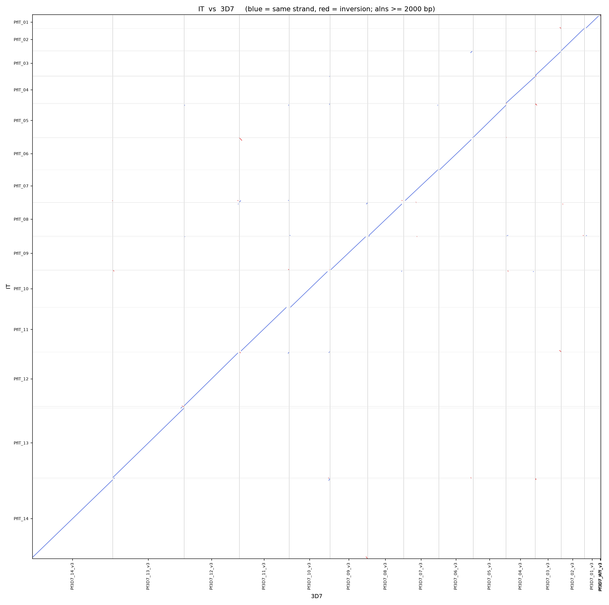 |
| **KE01**<br>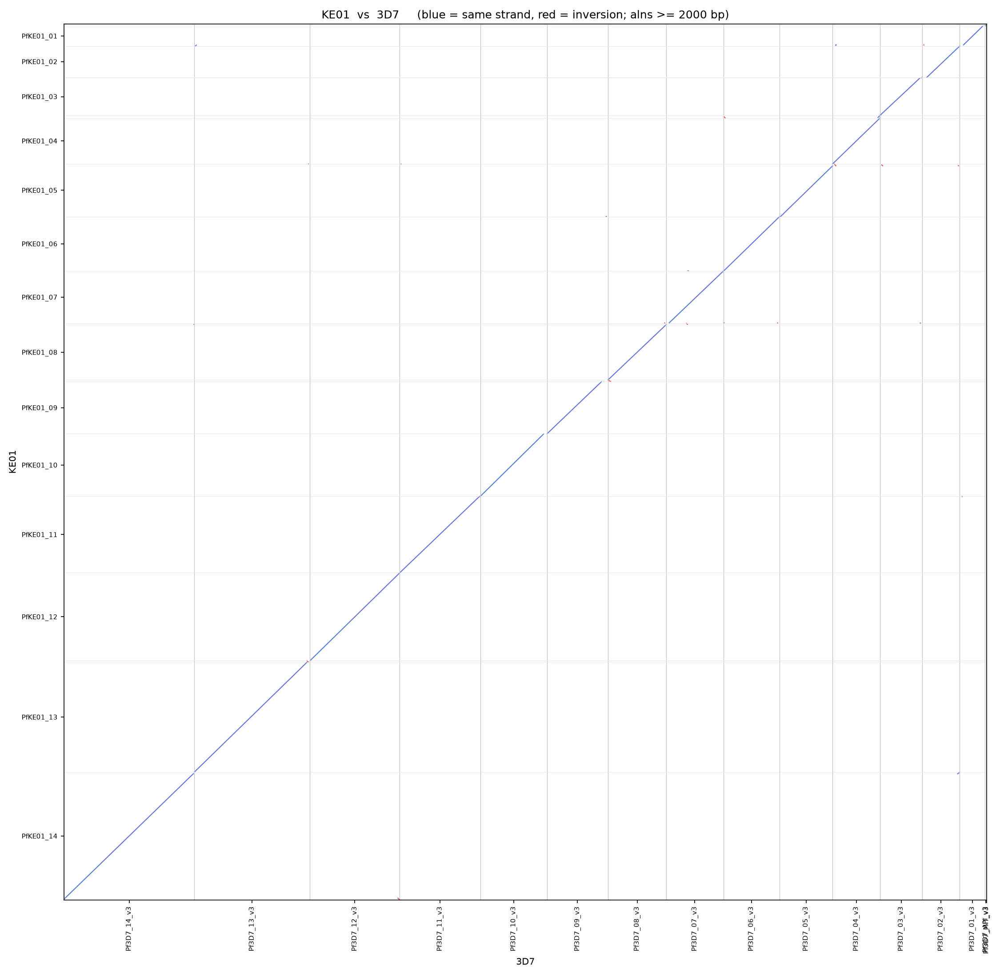 | **KH01**<br> | **KH02**<br> |
| **ML01**<br> | **NF135C10**<br> | **NF166**<br> |
| **NF54**<br> | **SD01**<br>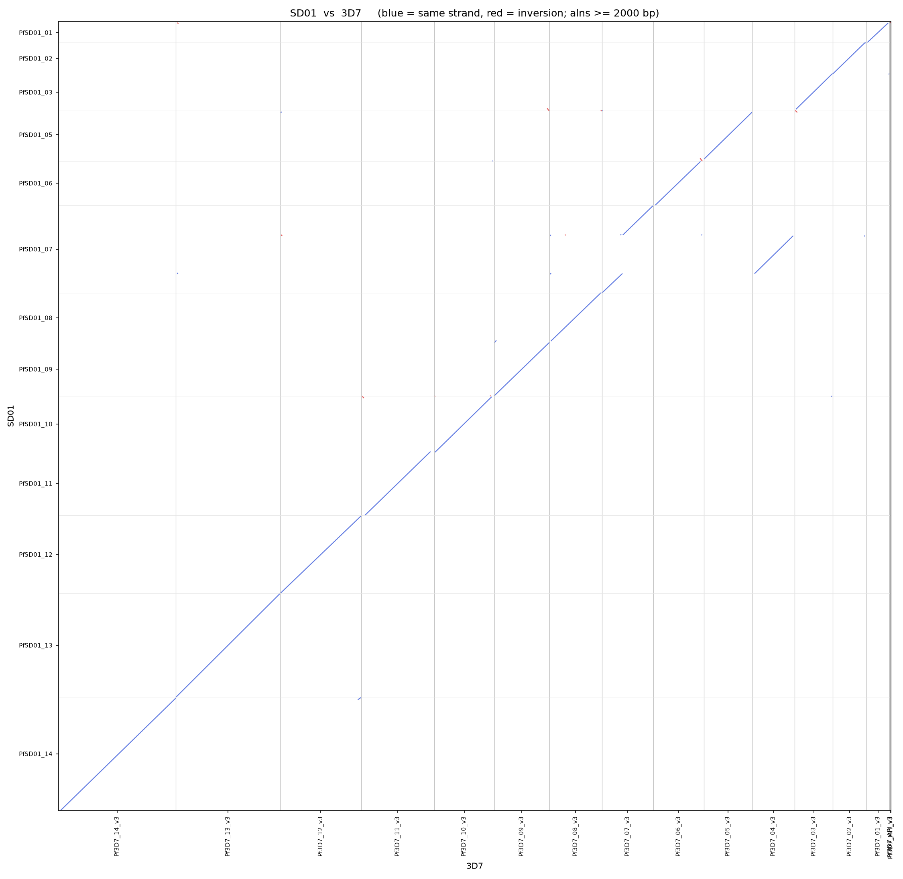 | **SN01**<br>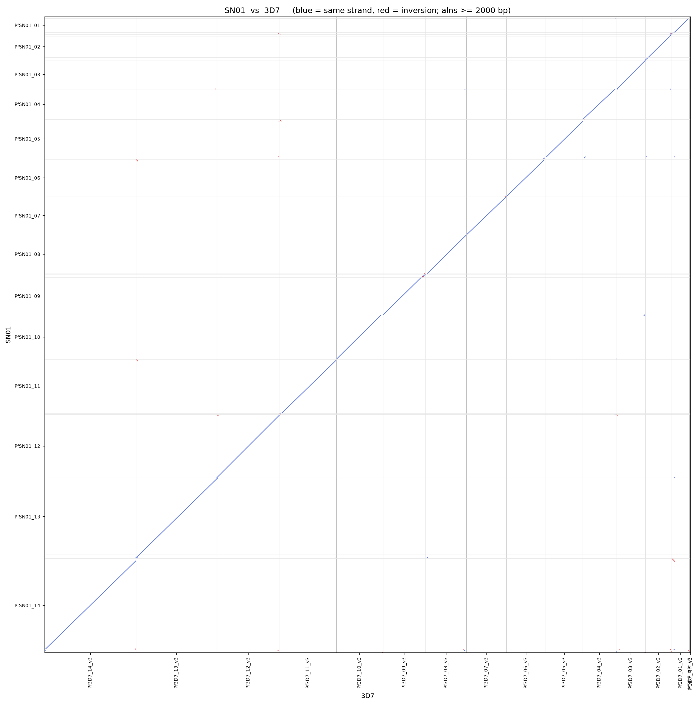 |
| **TG01**<br> | | |

| Genome | Query pieces (clean 1:1) | 3D7 covered | Aln identity¹ | Inversion ≥ 20 kb (3D7 chromosome, position) |
| :--- | ---: | ---: | ---: | :--- |
| 7G8-2019 | 22 (17) | 22.7 Mb (97.1%) | 86.2% | – |
| 7G8 | 17 (16) | 22.6 Mb (96.9%) | 86.0% | chr 9, 1.49–1.53 Mb (43 kb) |
| CD01 | 19 (16) | 22.9 Mb (98.1%) | 83.7% | – |
| Dd2 | 16 (15) | 22.5 Mb (96.4%) | 85.8% | chr 11, 0–49 kb (48 kb); chr 7, 1.41–1.43 Mb (24 kb) |
| GA01 | 20 (15) | 22.7 Mb (97.3%) | 84.0% | chr 6, 1.30–1.41 Mb (117 kb) |
| GB4 | 26 (21) | 22.8 Mb (97.5%) | 84.5% | – |
| GN01 | 19 (16) | 23.2 Mb (99.3%) | 83.1% | chr 6, 1.29–1.42 Mb (123 kb) |
| HB3 | 28 (25) | 22.5 Mb (96.6%) | 85.3% | – |
| IT | 27 (22) | 22.5 Mb (96.6%) | 84.1% | chr 3, 18–44 kb (26 kb) |
| KE01 | 21 (19) | 22.6 Mb (96.8%) | 85.8% | – |
| KH01 | 22 (16) | 22.8 Mb (97.8%) | 84.4% | chr 1, 12–62 kb (49 kb); chr 11, 2.02–2.04 Mb (22 kb) |
| KH02 | 21 (18) | 22.6 Mb (96.9%) | 84.8% | – |
| ML01 | 114 (75) | 23.0 Mb (98.6%) | 79.5% | – |
| NF135C10 | 23 (18) | 22.7 Mb (97.3%) | 83.6% | – |
| NF166 | 32 (27) | 22.7 Mb (97.4%) | 85.4% | – |
| **NF54** | 30 (29) | 23.2 Mb (99.6%) | **95.3%** | – |
| SD01 | 19 (17) | 22.5 Mb (96.4%) | 85.9% | – |
| SN01 | 36 (30) | 22.9 Mb (98.2%) | 84.3% | chr 12, 13–46 kb (33 kb) |
| TG01 | 79 (53) | 23.1 Mb (99.2%) | 78.3% | – |

¹ minimap2 gap-compressed identity over aligned regions only. It is lowered by the divergent subtelomeric families; whole-genome ANI (99.5–99.99%) is the real divergence figure.

- **17 of the 19 genomes are collinear with 3D7.** 96–100% of 3D7 is covered in every genome.
- **SD01: chromosome 4 sits inside chromosome 7.** SD01 has no chromosome 4 contig. Its `PfSD01_07` (2.53 Mb) is 3D7 chromosome 7 from 0 to 0.57 Mb, then the whole of chromosome 4 (0.08–1.15 Mb), then the rest of chromosome 7 (0.60–1.44 Mb).
- **NF135C10: chromosomes 7 and 8 swap arms at ~0.5 Mb.** Contig `VBRG01000013.1` joins 3D7 chromosome 7 (0.51–0.96 Mb) to chromosome 8 (0.46–1.47 Mb). Contig `VBRG01000010.1` joins chromosome 7 (0.10–0.58 Mb) to chromosome 8 (0–0.44 Mb).
- **Every inversion ≥ 20 kb is at a chromosome end.** All 9 lie within ~125 kb of a 3D7 chromosome end, in the subtelomeres. GA01 and GN01 share the largest one, at the end of chromosome 6.
- **The other cross-chromosome hits are subtelomeric.** Apart from SD01 and NF135C10, contigs that also align to a second 3D7 chromosome do so with short pieces (≤ 190 kb) at their ends, e.g. GB4 chromosome 11 and SN01 chromosome 14. They reflect the similarity between subtelomeres of different chromosomes, not translocations.
- **ML01 and TG01** have the lowest identity (79.5% and 78.3%) and the most pieces (114 and 79). Their extra small contigs align to chromosome ends.
- **NF54** is almost identical to 3D7 (95.3% identity, 99.6% covered), as in the species check.

### Genomes excluded from the pangenome

Four genomes are excluded, leaving 16 genomes for the pangenome:

| Genome | Reason |
| :--- | :--- |
| **ML01** | Multiple infection ([Otto et al. 2018, *Wellcome Open Res*](https://doi.org/10.12688/wellcomeopenres.14571.1)): ~2.5 Mb of extra sequence in 117 contigs. It also carries contigs of human origin (see the [TE findings](#02--te-annotation--clean-up)). |
| **TG01** | Multiple infection ([Otto et al. 2018, *Wellcome Open Res*](https://doi.org/10.12688/wellcomeopenres.14571.1)): ~2.5 Mb of extra sequence in 79 contigs. |
| **SD01** | Chromosome 4 is assembled inside chromosome 7 (see the [synteny analysis](#synteny-analysis-vs-reference-3d7)). |
| **NF135C10** | Chromosomes 7 and 8 swap arms at ~0.5 Mb (see the [synteny analysis](#synteny-analysis-vs-reference-3d7)). |

### Organelle screen (apicoplast and mitochondrion)

Run on the cluster on the 16 retained genomes, 2026-11-17, with the 3D7 organelle contigs as query:

```bash
# in screen_organelles.slurm.sh
SOURCE_GENOME="3D7"
ORGANELLE_CONTIGS="Pf3D7_API_v3 Pf3D7_MIT_v3"
```

```bash
sbatch 01_Genome_Selection_QC/scripts/screen_organelles.slurm.sh
```

| Genome | Apicoplast contig (length) | Mitochondrion contig (length) |
| :--- | :--- | :--- |
| **3D7** *(Ref)* | `Pf3D7_API_v3` (34,250) | `Pf3D7_MIT_v3` (5,967) |
| 7G8 | `Pf7G8_API` (51,008) | `Pf7G8_MT` (6,094) |
| 7G8-2019 | `CM019770.1` (46,790) | `CM019769.1` (6,094) |
| **CD01** | **absent** | **absent** |
| Dd2 | `PfDd2_API` (34,247) | `PfDd2_MT` (6,094) |
| GA01 | `PfGA01_API` (51,533) | `PfGA01_MT` (6,094) |
| GB4 | `PfGB4_API` (46,656) | `PfGB4_MT` (6,094) |
| GN01 | `PfGN01_API` (34,242) | `PfGN01_MT` (6,094) |
| HB3 | `PfHB3_API` (34,247) | `PfHB3_MT` (6,094) |
| IT | `PfIT_API` (51,087) | `PfIT_MT` (6,094) |
| KE01 | `PfKE01_API` (45,629) | `PfKE01_MT` (6,087) |
| KH01 | `PfKH01_API` (34,248) | `PfKH01_MT` (6,094) |
| KH02 | `PfKH02_API` (50,279) | `PfKH02_MT` (6,095) |
| NF166 | `CM019796.1` (44,463) | `CM019795.1` (6,074) |
| NF54 | `CM019799.1` (45,351) | `CM019798.1` (6,054) |
| SN01 | `PfSN01_API` (43,092) | `PfSN01_MT` (6,093) |

- **15 of the 16 genomes have each organelle as one contig of its own**, covering the whole 3D7 organelle at 99.8–100% identity. No organelle fragment was found inside a nuclear contig.
- **CD01 has neither organelle.** Its assembly contains no apicoplast or mitochondrial sequence.
- **10 of the 15 apicoplast contigs are longer than the 3D7 one** (43–52 kb vs 34 kb). The whole 3D7 apicoplast aligns to each of them. The script calls GA01's (51.5 kb) `in_scaffold` only because of its length.

### Contig redundancy screen

Run on the cluster on the 16 retained genomes, 2026-11-18. `CHROM_MIN_MB` was lowered to 0.5 so that chromosomes 1 (0.64 Mb) and 2 (0.95 Mb) count as chromosome-scale:

```bash
# in contig_redundancy.slurm.sh
CHROM_MIN_MB="0.5"
```

```bash
sbatch 01_Genome_Selection_QC/scripts/contig_redundancy.slurm.sh
sbatch 01_Genome_Selection_QC/scripts/check_redundant_genes.slurm.sh --also-unplaced
```

Full report: [`REPORT.md`](01_Genome_Selection_QC/contig_redundancy/REPORT.md).

17 small contigs in 10 genomes are flagged `small-redundant` (≥ 90% of the contig duplicated in a longer contig of the same assembly). The genes on them were then searched in the rest of the genome (≥ 98% identity, ≥ 90% of the gene covered).

**Removed (13 contigs, 228 kb, 23 genes):** contigs with no genes, or whose genes all have an identical copy elsewhere in the same genome.

| Genome | Contig | Length (bp) | % duplicated in a longer contig | Genes | Genes with an identical copy elsewhere |
| :--- | :--- | ---: | ---: | ---: | ---: |
| GA01 | `PfGA01_00_1` | 15,586 | 100 | 0 | – |
| GA01 | `PfGA01_00_3` | 17,284 | 100 | 0 | – |
| HB3 | `PfHB3_00_0` | 13,275 | 100 | 0 | – |
| HB3 | `PfHB3_00_26` | 10,375 | 99.6 | 0 | – |
| IT | `PfIT_00_5` | 12,211 | 94.1 | 0 | – |
| IT | `PfIT_00_8` | 17,178 | 100 | 0 | – |
| KH02 | `PfKH02_00_3` | 6,708 | 97.7 | 0 | – |
| 7G8-2019 | `VBRD01000009.1` | 32,271 | 95.7 | 7 | 7 |
| GN01 | `PfGN01_00_5` | 24,162 | 100 | 5 | 5 |
| HB3 | `PfHB3_00_14` | 11,586 | 100 | 3 | 3 |
| KH02 | `PfKH02_00_6` | 14,305 | 100 | 2 | 2 |
| SN01 | `PfSN01_00_3` | 21,238 | 99.9 | 5 | 5 |
| NF166 | `VBRE01000025.1` | 31,444 | 99.1 | 1 | 1\* |

\* The copy of this gene on `VBRE01000014.1` is identical in sequence but not annotated as a gene.

**Kept (4 contigs):** they carry variant-family genes (PfEMP1, *rifin*, *stevor*) with no full copy elsewhere in the genome: KH01 `PfKH01_00_26`, NF54 `VBRF01000002.1` and `VBRF01000029.1`, SN01 `PfSN01_00_18`.

### Contig removal

Run on the cluster, 2026-11-18. The genomes and GFFs were first copied to `original_files_copy/`, because the removal rewrites `genomes/` and `gff_originals/` in place:

```bash
mkdir -p original_files_copy
cp -r genomes original_files_copy/genomes
cp -r gff_originals original_files_copy/gff

sbatch 01_Genome_Selection_QC/scripts/drop_contigs_slurm.sh
```

Drop list: [`drop_contigs.txt`](01_Genome_Selection_QC/drop_contigs.txt). 43 contigs were removed:

- **30 organelle contigs** (apicoplast and mitochondrion of the 15 genomes that have them; 1,308 genes);
- **13 redundant contigs** (228 kb, 23 genes; see the [contig redundancy screen](#contig-redundancy-screen)).

---

## 02 – TE Annotation & Clean Up

*P. falciparum* is known to be devoid of transposable elements ([Wells & Feschotte 2020](https://doi.org/10.1146/annurev-genet-040620-022145)). The [TE candidate pipeline](https://github.com/adriludwig/TE-candidate-pipeline) was run anyway, and no TE candidate was confirmed in the manual curation step. The only TE sequences found were human LINEs, on contigs that are clear contamination.

### Findings

**Human contamination in ML01.** The LINEs identified three ML01 contigs of human origin:

| Contig | Length (bp) | Annotated genes |
| :--- | ---: | :--- |
| `PfML01_00_28` | 5,224 | `PfML01_000065900`, `PfML01_000066000` (hypothetical protein, conserved) |
| `PfML01_00_86` | 5,562 | `PfML01_000105200`, `PfML01_000105300` (hypothetical protein, conserved) |
| `PfML01_00_87` | 5,891 | none |

ML01 is excluded from the pangenome (see [genomes excluded](#genomes-excluded-from-the-pangenome)), so these contigs are removed with it.

---

## 03 – *de novo* Genome Annotation

Not needed: all 16 genomes already have a genome annotation (GFF, from PlasmoDB).

---

## 04 – Protein evidence (InterProScan and PSAURON)

### Protein extraction

Run on the cluster, 2026-11-18. No TEs were found in step 02, so there was no TE filtering and no `gff_cleaned/`: the proteins were extracted from `gff_originals/` (after the contig removal of step 01).

```bash
# in extract_proteins.slurm.sh and update_interpro_in_gff.slurm.sh
GFF_INDIR="gff_originals"
```

```bash
sbatch 04_Protein_evidence/scripts/extract_proteins.slurm.sh
```

### Running InterProScan

Run on the cluster, 2026-11-18/19. With `CHUNK_SIZE=1000`, the manifest has **96 chunks** (6 per genome).

```bash
sbatch 04_Protein_evidence/scripts/build_interpro_manifest.slurm.sh
mkdir -p interpro/logs
N=$(($(wc -l < interpro/interpro_manifest.tsv) - 1))
sbatch --array=1-${N}%20 04_Protein_evidence/scripts/interproscan_array_job.slurm.sh
```

88 chunks finished in 10–25 min each. Eight chunks (3D7 6, 7G8 3, CD01 3 and 4, GA01 2, KH02 6, NF166 2 and 5) stalled
for 10–15 h: on their nodes, only the Java process was left, at about 0% CPU, with no analysis program running under it.

```bash
ssh <node> "ps -u $USER -o etime,pcpu,args --sort=-etime | cut -c1-200"   # node: NODELIST column of squeue
```

A first rerun of the 8 chunks with the same script (output to `interpro/interproscan_rerun`) finished 4 of them (7G8 3,
CD01 3, GA01 2, KH02 6); NF166 chunk 2 was split into 10 pieces of 100 proteins, of which 7 finished. The other 3
chunks and 3 pieces stalled again, at different steps. What made all of them finish was InterProScan's temporary
folder on the node's local disk (`-T`) instead of `temp/` in the project folder on the shared storage:

1. One-off copy of `interproscan_array_job.slurm.sh` in the project folder, with
   `OUT_DIR="interpro/interproscan_rerun"` and `-T` added to the `interproscan.sh` line:
   ```bash
   LOCAL_TMP="${TMPDIR:-/tmp}/ips_${SLURM_JOB_ID}"; mkdir -p "$LOCAL_TMP"
   interproscan.sh -T "$LOCAL_TMP" \
   ```
2. The stuck tasks cancelled (`scancel`) and only those submitted again:
   `sbatch --array=6,22,83 local_interproscan_rerun.slurm.sh`, and the same for the 3 NF166 pieces, whose results were
   then joined into NF166 chunk 2.
3. Each new `chunk_<N>_interproscan.tsv` copied into `interpro/interproscan_results/<genome>/` (`cp -n`); 96 non-empty
   TSVs checked before the merge.
4. `temp/` (4.1 GB, left by the stalled tasks), the rerun folders, the leftover `chunk_*.fasta` in the results folders
   and the one-off scripts deleted.

### Merging the chunk results

```bash
sbatch 04_Protein_evidence/scripts/merge_interpro_job.slurm.sh
```

All 16 genomes have their 6 chunk files (no `WARNING`). Proteins with no hit in any analysis (512–578 per genome) are
reported as `NOTE`.

| Genome | Proteins | With any hit (%) | With ≥ 1 InterPro ID (%) | With ≥ 1 Pfam ID (%) |
| :--- | ---: | ---: | ---: | ---: |
| **3D7** *(Ref)* | 5,356 | 90.1 | 71.2 | 62.1 |
| 7G8 | 5,142 | 89.8 | 71.1 | 61.8 |
| 7G8-2019 | 5,094 | 88.8 | 70.2 | 61.0 |
| CD01 | 5,158 | 89.8 | 71.7 | 62.6 |
| Dd2 | 5,176 | 90.1 | 71.3 | 62.0 |
| GA01 | 5,189 | 90.0 | 71.6 | 62.4 |
| GB4 | 5,301 | 89.9 | 71.5 | 62.3 |
| GN01 | 5,265 | 90.0 | 71.9 | 62.7 |
| HB3 | 5,150 | 90.0 | 71.1 | 61.8 |
| IT | 5,217 | 90.0 | 71.2 | 62.0 |
| KE01 | 5,200 | 90.1 | 71.3 | 62.0 |
| KH01 | 5,231 | 89.8 | 71.5 | 62.6 |
| KH02 | 5,232 | 90.0 | 71.4 | 62.2 |
| NF166 | 5,123 | 89.0 | 70.5 | 61.4 |
| NF54 | 5,241 | 89.0 | 70.4 | 61.5 |
| SN01 | 5,312 | 90.2 | 71.7 | 62.5 |

### Adding the domain evidence to the GFFs

```bash
sbatch 04_Protein_evidence/scripts/update_interpro_in_gff.slurm.sh
```

Reads `gff_originals/` and writes `gff_with_interpro/`, the input of step 05. In every genome, 72.7–73.5% of the CDS
lines received InterPro/Pfam evidence. The PlasmoDB GFFs carried no earlier InterPro/Pfam evidence (0 lines stripped).

### PSAURON on every protein

Run on the cluster, 2026-11-18, one array task per genome, into `psauron/<genome>.csv`. Every protein was scored.

```bash
mkdir -p psauron/logs
N=$(grep -v '^#' genome_order.txt | awk 'NF' | wc -l)
sbatch --array=1-${N} 04_Protein_evidence/scripts/psauron_array_job.slurm.sh
```

| Genome | Proteins | PSAURON score (% of proteins called protein-coding) |
| :--- | ---: | ---: |
| **3D7** *(Ref)* | 5,356 | 94.8 |
| 7G8 | 5,142 | 94.9 |
| 7G8-2019 | 5,094 | 94.2 |
| CD01 | 5,158 | 94.9 |
| Dd2 | 5,176 | 94.8 |
| GA01 | 5,189 | 94.9 |
| GB4 | 5,301 | 94.9 |
| GN01 | 5,265 | 94.9 |
| HB3 | 5,150 | 94.7 |
| IT | 5,217 | 94.9 |
| KE01 | 5,200 | 94.8 |
| KH01 | 5,231 | 95.0 |
| KH02 | 5,232 | 94.8 |
| NF166 | 5,123 | 94.3 |
| NF54 | 5,241 | 94.2 |
| SN01 | 5,312 | 94.7 |

The PSAURON score is 94.2–95.0% in every genome.

---

## 05 – Cross-genome Annotation Integration

### Step 1: Native annotation check

Run on the cluster, 2026-11-19, on `gff_with_interpro/` (the GFFs with the domain evidence of step 04), into
`annotation_check/`.

```bash
sbatch 05_Basket_annotation_integration/scripts/analyze_input_gffs_job.sh
```

**Genes per genome.** 5,094–5,312 protein-coding genes per genome; 70–72% carry InterPro/Pfam evidence in every genome.
3D7 has 5,285 genes for 5,356 proteins because some 3D7 genes have more than one transcript.

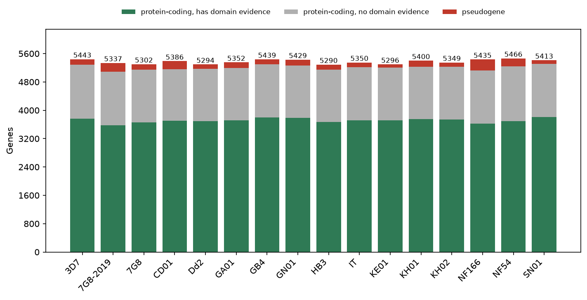

**Gene types.** No gene is unclassified. PlasmoDB files its non-coding genes under `ncRNA_other` (no tRNA or rRNA
category): 95–168 per genome, but only 67–69 in 7G8-2019, NF166 and NF54. Pseudogenes range from 96 (KE01) to 312
(NF166).

| Genome | Protein-coding | With domain | Pseudogene | ncRNA_other | Total genes |
| :--- | ---: | ---: | ---: | ---: | ---: |
| **3D7** *(Ref)* | 5,285 | 3,767 | 158 | 168 | 5,611 |
| 7G8 | 5,142 | 3,664 | 160 | 97 | 5,399 |
| 7G8-2019 | 5,094 | 3,580 | 243 | 69 | 5,406 |
| CD01 | 5,158 | 3,702 | 228 | 97 | 5,483 |
| Dd2 | 5,176 | 3,697 | 118 | 96 | 5,390 |
| GA01 | 5,189 | 3,721 | 163 | 95 | 5,447 |
| GB4 | 5,301 | 3,796 | 138 | 97 | 5,536 |
| GN01 | 5,265 | 3,790 | 164 | 96 | 5,525 |
| HB3 | 5,150 | 3,666 | 140 | 96 | 5,386 |
| IT | 5,217 | 3,718 | 133 | 116 | 5,466 |
| KE01 | 5,200 | 3,715 | 96 | 97 | 5,393 |
| KH01 | 5,231 | 3,747 | 169 | 99 | 5,499 |
| KH02 | 5,232 | 3,741 | 117 | 97 | 5,446 |
| NF166 | 5,123 | 3,619 | 312 | 67 | 5,502 |
| NF54 | 5,241 | 3,695 | 225 | 68 | 5,534 |
| SN01 | 5,312 | 3,813 | 101 | 98 | 5,511 |

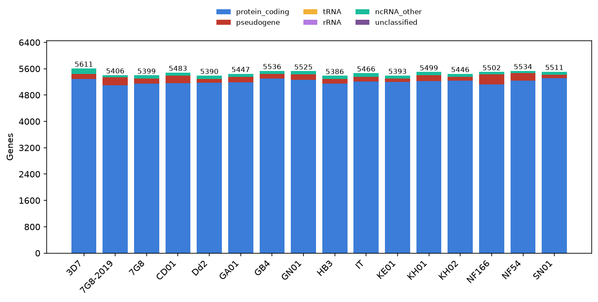

**Whole-gene overlaps** (UTR included). 3D7 has 789 overlapping pairs (787 on opposite strands); every other genome
has 0–4. In 3D7 these are genes whose UTRs touch: with the UTRs left out (CDS/exon extent), 3D7 has 7 pairs. In the
other genomes the count is the same with or without UTRs.

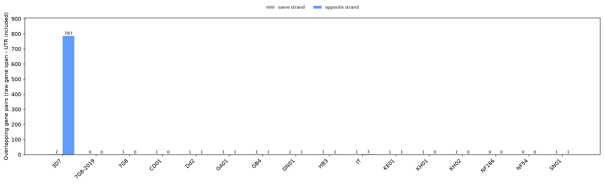

**CDS-to-CDS overlaps.** 0–7 pairs per genome: 3D7 has 7 (6 on opposite strands), IT 4, the others 0–2. Every pair is
minor (< 20% of the smaller gene's CDS); there is no substantial or contained overlap.

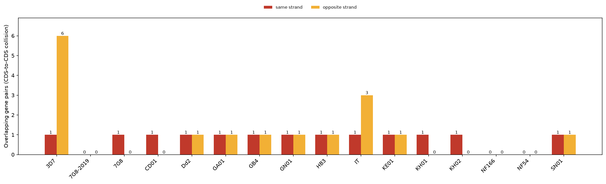

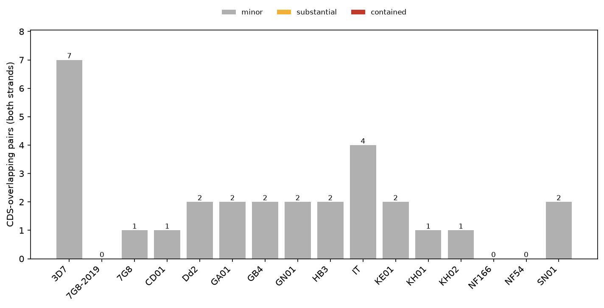

### Step 2: Remove specific genes (skipped)

No manual kill list for this species: no gene was removed before Liftoff, and step 3 reads `gff_with_interpro/`.

### Step 3: Prepare the GFFs for Liftoff

Run on the cluster, 2026-11-19, with `GFF_DIR="gff_with_interpro"`.

```bash
sbatch 05_Basket_annotation_integration/scripts/prepare_for_liftoff_job.sh
```

- **Non-coding genes removed:** all `ncRNA_gene` (67–168 per genome).
- **Pseudogenes** (96–312 per genome) retyped `protein_coding_gene`, so that Liftoff transfers them with the
  protein-coding genes.
- **UTRs removed:** 3D7 is the only genome with UTRs annotated; 8,985 UTR lines were deleted and 4,494 genes shrunk to
  their CDS (4.9 Mb). In the other genomes, 0–4 genes changed by 1–7 bp in total.

### Step 4: Liftoff, all against all

Run on the cluster, 2026-11-19, one array task per source genome: 16 × 15 = **240 pairs**, all complete, no pair failed
(`liftoff_output/tmp/` empty).

```bash
mkdir -p liftoff_output/logs
N=$(grep -c . genome_order.txt)
sbatch --array=1-${N} --exclude=compute29 05_Basket_annotation_integration/scripts/liftoff_all_vs_all.sh
```

Each pair works on its own copy of the two genome FASTAs: Liftoff writes the genome index (`.mmi`) next to the FASTA,
and parallel jobs sharing the files in `genomes/` failed with `OSError: truncated file`. Node `compute29` was excluded:
every job sent there failed at start, with no log (`RaisedSignal:53`).

### Step 5: Basket annotation

[`basket_annotation_job.sh`](https://github.com/VEuPathDB/pangenome-pipeline/blob/main/05_Basket_annotation_integration/README.md#step-5-basket-annotation) groups the genes of all genomes that lie at the same
place into baskets, picks each basket's winner (the panel gene), and writes each genome's models. The reference is
3D7. Run on the cluster on 19 November 2026, mode `prefer_panel_model`, with the step 04 PSAURON scores and the step 01
list of removed contigs:
```bash
mkdir -p basket_annotation/logs
sbatch --export=ALL,ID_PREFIX=Pf,PLOT_LABEL=Pfal,REMOVED_CONTIGS=01_Genome_Selection_QC/drop_contigs.txt:organelle_or_redundant_contig,ORIGINAL_GFF_DIR=original_files_copy/gff \
  05_Basket_annotation_integration/scripts/basket_annotation_job.sh
```

No duplicated IDs, and every gene of every genome's own annotation has a final model or a written reason (gene fate:
0 genes without a record). One 3D7 gene is missing from the final 3D7 GFF (see below). The final GFFs
(`basket_annotation/gff_prefer_panel_model_final/`) go to get_pangenes.

**Panel genes.** 8,392 panel genes: the 5,443 3D7 genes (158 of them pseudogenes) and 2,949 genes not in the 3D7
annotation. 236 baskets have no winner: none of their members passed the filter (228 proteins shorter than 100 aa, 42
low PSAURON, 12 with no valid ORF in any genome). 2 panel genes were removed because they lost an opposite-strand
overlap: PfNF166_110006200 (no domain, valid ORF only in NF166) and PfNF166_120059400 (only in NF166, no domain).

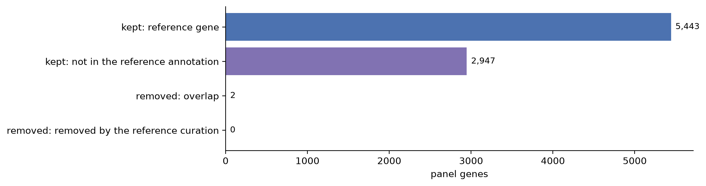

**Genes per genome.** 5,342 (7G8-2019) to 5,495 (GN01) genes per genome. 3D7 has 5,464: 5,442 of its own genes and 22
genes not in its annotation.

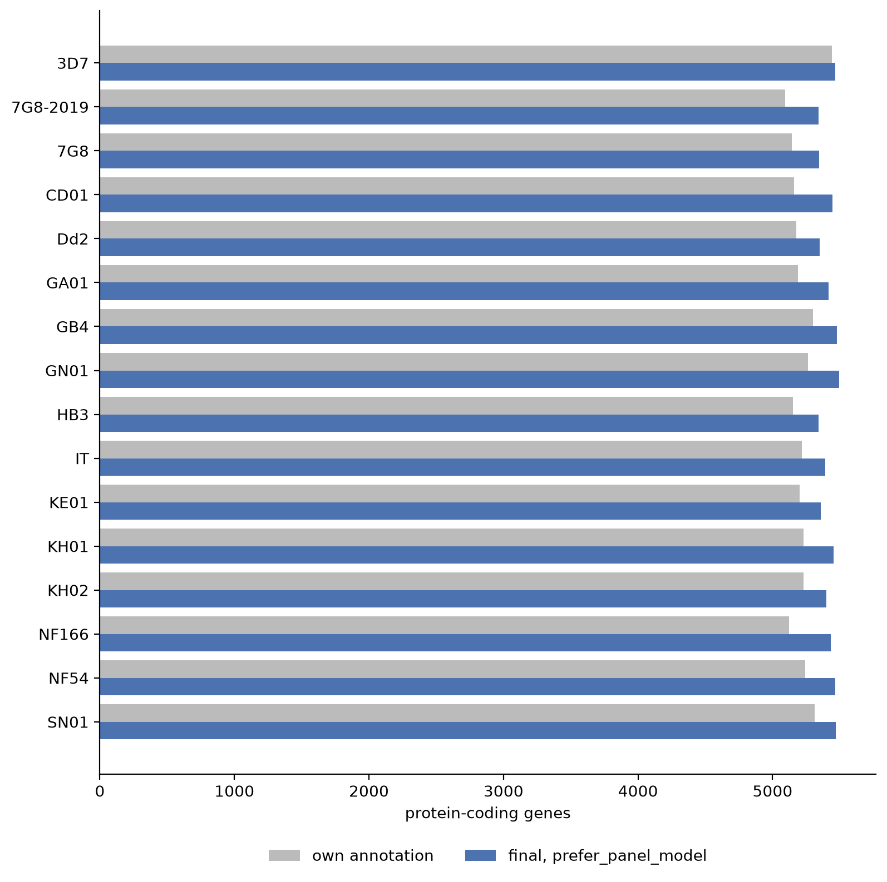

**From each genome's own annotation to the final GFF.** Every strain ends with more genes than in its own annotation:
171 to 379 genes per genome were added where the genome had no gene. The losses are small: 0 to 41 genes per genome on
contigs removed in step 01 (organelle and redundant contigs), 2 to 12 genes annotated in pieces replaced by one model,
3 to 69 eliminated by the quality rules, and 0 to 10 removed at the end of step 05.

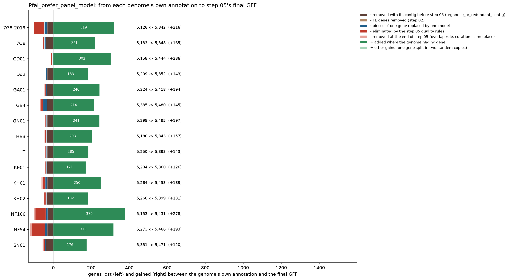

**Genes eliminated by the quality rules.** 269 genes in the 15 genomes besides 3D7; 218 of them are proteins shorter than
100 aa.

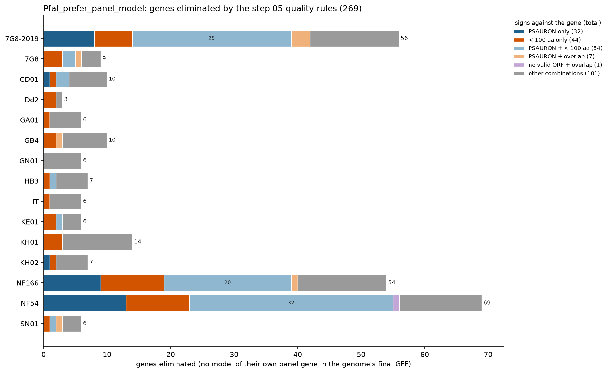

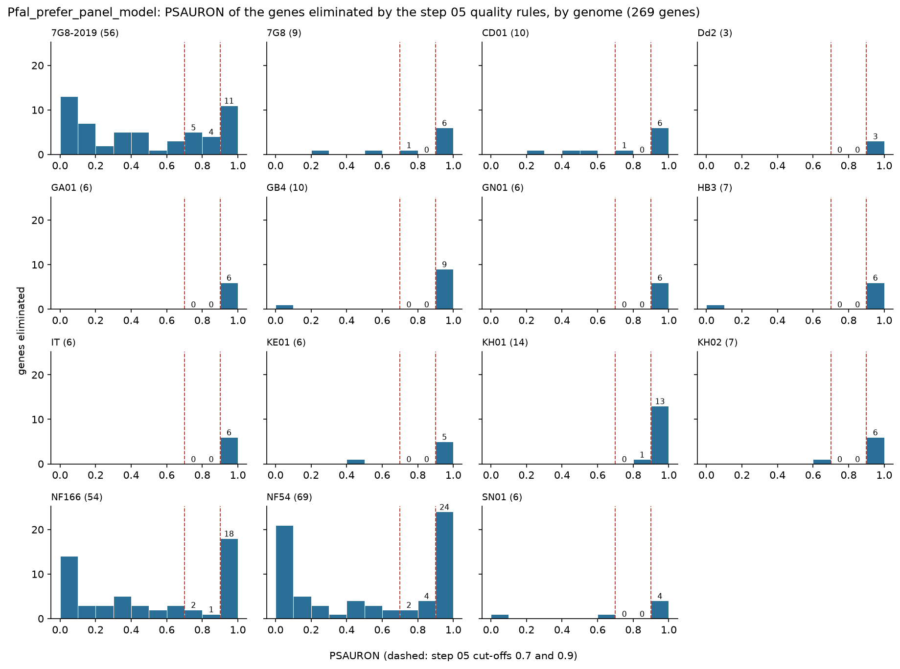

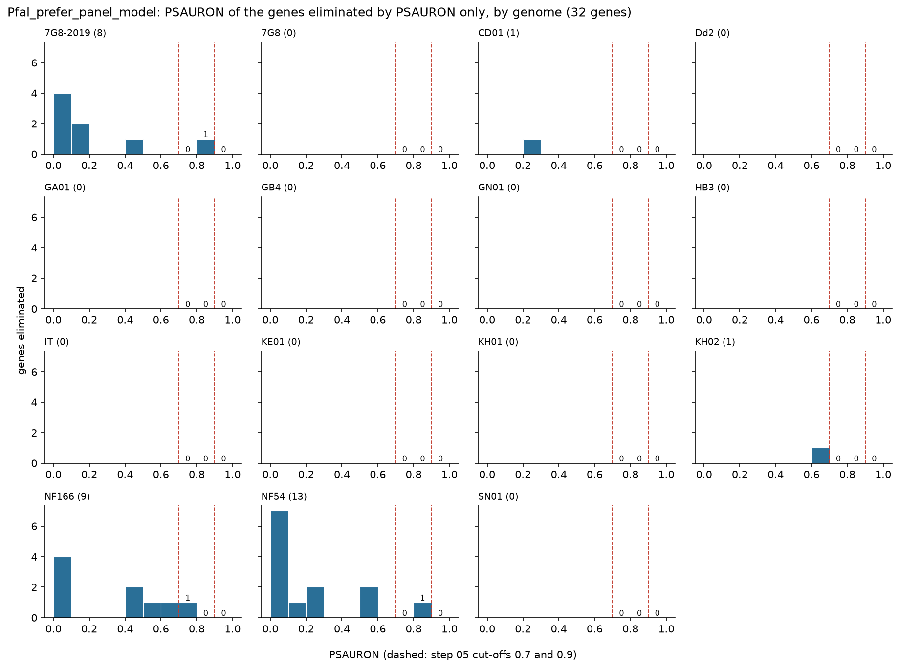

**Where each model comes from.** 4,674 to 4,995 genes per genome take the panel model in place of the genome's own; 23
to 147 fill a place where the genome had no gene; 89 to 239 take another valid model closer to the panel model; 68 to
201 keep their own model as the panel gene's winner, and 1 to 67 keep a divergent own model.

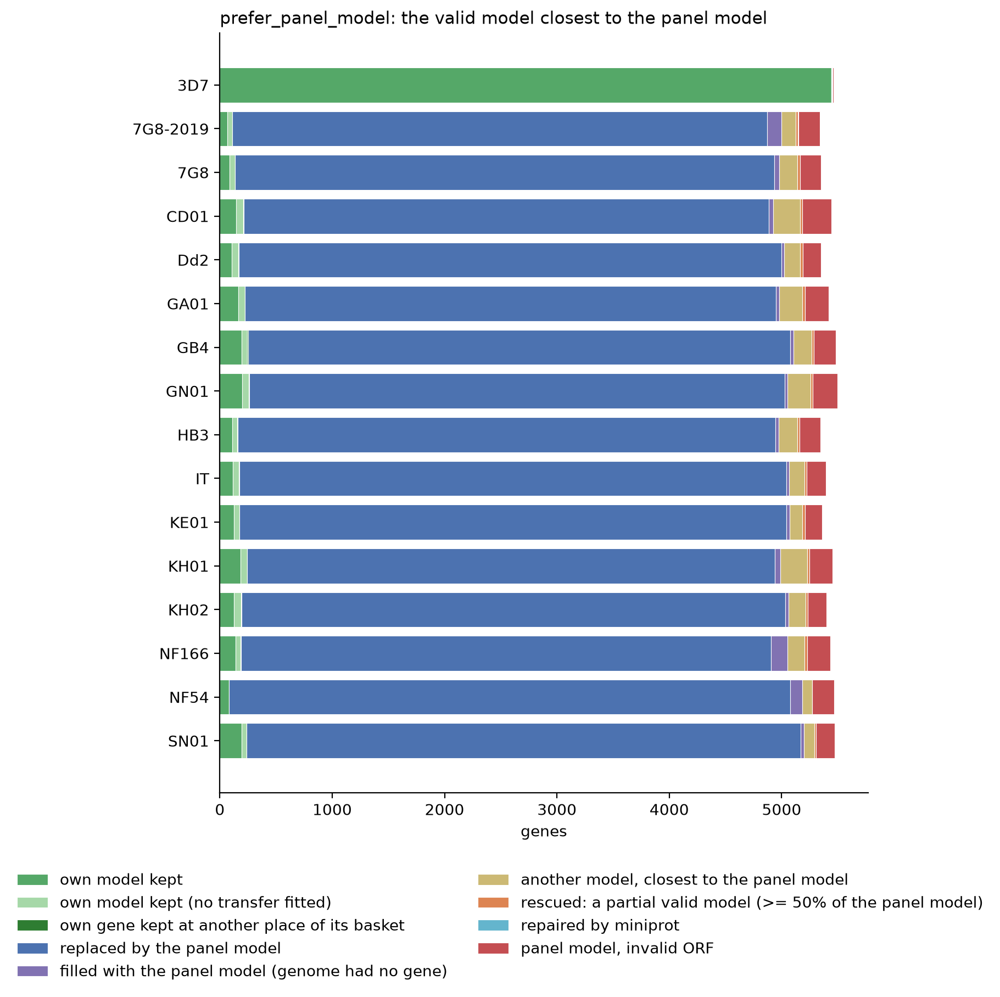

**ORF quality.** 83,553 of the 86,659 genes (96%) have a valid ORF. 50 have an ORF broken by the assembly (an N in the
CDS or near a contig end). 2,835 have an invalid ORF not explained by the assembly, 13 of them in 3D7; most are
frameshifts. miniprot repaired 3.

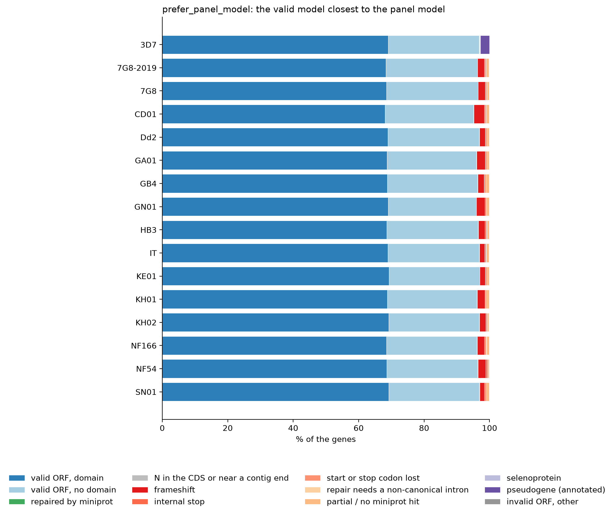

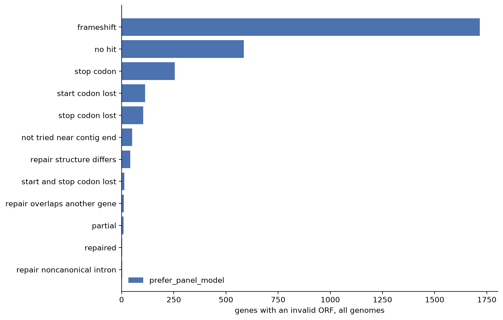

**Tandem arrays.** 3 baskets hold a tandem array.

**A 3D7 gene missing from the final 3D7 GFF.** The check of the reference genes found one missing:
```bash
grep "reference genes written" basket_annotation/logs/*.out
# reference genes written in 3D7: 5442 of 5443; removed on purpose: 0; missing: 1 ['PF3D7_1440200']
```

In the 3D7 annotation, **PF3D7_1440200** (SPP, stromal-processing peptidase) and its neighbour **PF3D7_1440300** (PBGS,
porphobilinogen synthase) share their first two CDS exons (1639477–1639593 and 1639681–1639728); the other four PBGS
exons lie inside an SPP intron. The PBGS CDS span therefore lies entirely inside the SPP CDS span, on the same strand.
The rule "one place, one gene" keeps one model per place: both are 3D7 genes, so the tie was broken by the number of
genomes (PBGS 15, SPP 14), and SPP was dropped. It will be added back to the final GFFs at the end.

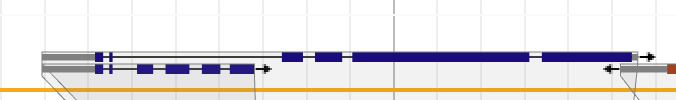


---

## New genes in the reference (3D7)

The 22 genes the pipeline added to 3D7 (`not_in_reference_annotation=True` in the step 05 GFF), checked one by one in
JBrowse with the PlasmoDB RNA-seq tracks. Neighbours: the nearest 3D7 gene on each side ("–": none, the gene is in
the subtelomere).

| Gene | Location | Model from | ORF | Description | Left 3D7 gene | Right 3D7 gene | Verdict |
|---|---|---|---|---|---|---|---|
| Pf1g00001 | Pf3D7_01_v3:25038..25433 (+) | PfNF54_010005300 (filled) | valid | hypothetical protein, conserved | – | PF3D7_0100100 (4077 bp) | Delete. No RNA-seq expression. |
| Pf1g00002 | Pf3D7_01_v3:26114..26693 (+) | PfNF166_020005200 (target_invalid_orf) | invalid | hypothetical protein, conserved | – | PF3D7_0100100 (2817 bp) | Delete. No RNA-seq expression. |
| Pf1g00017 | Pf3D7_01_v3:76931..77266 (-) | PfNF166_000008900 (target_invalid_orf) | invalid | DnaJ domain containing protein, putative | PF3D7_0101400 (122 bp) | PF3D7_0101500 (975 bp) |  |
| Pf1g00380 | Pf3D7_03_v3:33904..34314 (+) | PfNF54_030005200 (filled) | valid | hypothetical protein, conserved | – | PF3D7_0300100 (2651 bp) | Delete. No RNA-seq expression. |
| Pf1g00874 | Pf3D7_04_v3:1183161..1183614 (-) | PfNF166_060036700 (target_invalid_orf) | invalid | hypothetical protein, conserved | PF3D7_0426000 (2935 bp) | – |  |
| Pf1g01209 | Pf3D7_06_v3:60200..62845 (+) | PfNF54_060006300 (filled) | valid | Plasmodium repeat_MYXSPDY, putative | PF3D7_0601400 (7302 bp) | PF3D7_0601500 (2943 bp) | Keep, model to fix. Low RNA-seq; intron junctions inside the single-exon model. |
| Pf1g01368 | Pf3D7_06_v3:722865..723095 (-) | PfNF54_060022400 (filled) | valid | acidic terminal segments, variant surface antigen of PfEMP1 | PF3D7_0617300 (1553 bp) | PF3D7_0617400 (22 bp) | Delete. 3′ UTR of PF3D7_0617400 (var). |
| Pf1g01505 | Pf3D7_06_v3:1302392..1302665 (-) | PfNF166_100043700 (target_invalid_orf) | invalid | Plasmodium repeat_MYXSPDY, putative | PF3D7_0631100 (3019 bp) | PF3D7_0631200 (11143 bp) |  |
| Pf1g01506 | Pf3D7_06_v3:1303437..1305215 (-) | Pf7G8-2_000325700 (target_invalid_orf) | invalid | Plasmodium repeat_MYXSPDY, putative | PF3D7_0631100 (4064 bp) | PF3D7_0631200 (8593 bp) |  |
| Pf1g01525 | Pf3D7_06_v3:1389363..1389871 (-) | PfNF166_090042800 (target_invalid_orf) | invalid | hypothetical protein, conserved | PF3D7_0632800 (6736 bp) | – |  |
| Pf1g01834 | Pf3D7_07_v3:1429835..1430325 (-) | PfNF166_000020400 (target_invalid_orf) | invalid | hypothetical protein, conserved | PF3D7_0733000 (3601 bp) | – |  |
| Pf1g01835 | Pf3D7_08_v3:9499..11575 (-) | Pf7G8-2_000006000 (target_invalid_orf) | invalid | hypothetical protein | – | PF3D7_0800100 (9786 bp) |  |
| Pf1g02162 | Pf3D7_08_v3:1449577..1450158 (-) | PfNF166_000007000 (target_invalid_orf) | invalid | hypothetical protein, conserved | PF3D7_0833500 (6128 bp) | – |  |
| Pf1g02163 | Pf3D7_09_v3:9188..10224 (-) | PfNF166_060037200 (target_invalid_orf) | invalid | hypothetical protein | – | PF3D7_0900100 (9856 bp) |  |
| Pf1g02164 | Pf3D7_09_v3:16390..16848 (+) | PfNF54_090005200 (filled) | valid | hypothetical protein, conserved | – | PF3D7_0900100 (3232 bp) | Delete. No RNA-seq expression. |
| Pf1g02174 | Pf3D7_09_v3:53637..54497 (-) | PfGA01_140005900 (replaced) | valid | acidic terminal segments, variant surface antigen of PfEMP1 | PF3D7_0900700 (2666 bp) | PF3D7_0900900 (577 bp) |  |
| Pf1g02546 | Pf3D7_10_v3:23086..23675 (+) | PfNF166_000007400 (target_invalid_orf) | invalid | hypothetical protein, conserved | – | PF3D7_1000100 (4815 bp) |  |
| Pf1g02933 | Pf3D7_10_v3:1565259..1566537 (-) | PfNF166_100043400 (filled) | valid | hypothetical protein | PF3D7_1038900 (1371 bp) | PF3D7_1039000 (2172 bp) |  |
| Pf1g02937 | Pf3D7_10_v3:1581698..1582711 (-) | PfNF54_100043800 (filled) | valid | Plasmodium repeat_MYXSPDY, putative | PF3D7_1039200 (4707 bp) | PF3D7_1039400 (4441 bp) |  |
| Pf1g02977 | Pf3D7_11_v3:96964..99609 (+) | PfNF54_110007300 (alternative) | valid | Plasmodium repeat_MYXSPDY, putative | PF3D7_1101900 (6090 bp) | PF3D7_1102100 (4691 bp) |  |
| Pf1g03980 | Pf3D7_12_v3:2251737..2252449 (-) | Pf7G8-2_000048900 (target_invalid_orf) | invalid | hypothetical protein, conserved | PF3D7_1255200 (2775 bp) | – |  |
| Pf1g04686 | Pf3D7_13_v3:2895368..2896245 (-) | Pf7G8-2_000248700 (target_invalid_orf) | invalid | hypothetical protein, conserved | PF3D7_1373500 (3028 bp) | – |  |

---

## Genes to fix at the end

Genes to correct in the final GFFs ([step 08](https://github.com/VEuPathDB/pangenome-pipeline/blob/main/08_Final_GFF/README.md)).

| Genome | Gene | Problem | Fix | Found in |
|---|---|---|---|---|
| 3D7 | PF3D7_1440200 (SPP) | Missing from the final 3D7 GFF: shares its first two CDS exons with PF3D7_1440300 (PBGS), and only one gene is kept per place | Add back the 3D7 model | [Step 05, step 5](#step-5-basket-annotation) |
