# *Toxoplasma gondii* Pangenome Analysis

This document tracks the execution, parameters, and results of the pangenome analysis for ***Toxoplasma gondii***, following the steps from the [`pangenome_analysis`](../../README.md) pipeline.

---

## Species Biology & Pangenome Considerations

* **Obligate intracellular apicomplexan, extremely broad host range.** *Toxoplasma gondii*
  infects essentially any warm-blooded animal as an intermediate host (asexual tachyzoite /
  bradyzoite stages); the sexual cycle — and the only stage where genetic recombination can
  occur — happens exclusively in the gut of felids (cats), the definitive host.

* **No transposable elements.** A systematic apicomplexan-wide mobilome screen
  ([Rodriguez & Makalowski, 2022](https://doi.org/10.3390/genes13050887), using
  RepeatModeler, RepeatMasker, LTRpred, MGEScan and TEclass — largely the same toolkit this
  pipeline's [TE candidate pipeline](../../02_TE_annotation_Clean_Up/README.md)
  uses) found **no bona fide TEs in *T. gondii*, nor in its closest relatives** *Hammondia*,
  *Neospora*, and *Sarcocystis* (the whole family came back negative; *Cryptosporidium* too).
  TEs are present elsewhere in Apicomplexa (*Eimeria*, some *Babesia*/*Theileria* species,
  *Ascogregarina*, *Gregarina*), so this is a real, lineage-specific absence, not a detection
  failure. Their own RepeatModeler runs *did* produce candidate repeat families for
  *Toxoplasma* — on curation these turned out to be conserved host genes or low-complexity
  regions, not TEs. What repetitive DNA *T. gondii* genuinely has is tandem/satellite repeat
  (the TGR1A/1E/2/4 and ABGTg7/ABGTg8.2 families), concentrated in subtelomeres — not mobile
  elements. **Implication for [step 02](#02--te-annotation--clean-up):** expect the curated
  TE library to end up small or empty, and most TE candidates to fail curation.

* **Organellar DNA (NUMT/NUPT) insertion into the nuclear genome is massive, ongoing, and
  strain-variable.**
  [Namasivayam et al. (2023)](https://doi.org/10.1073/pnas.2308569120) found **>11,000
  organellar DNA insertions totalling >1 Mb** in the compact 65 Mb *T. gondii* nuclear
  genome — nuclear mitochondrial DNA (NUMTs) and nuclear plastid/apicoplast DNA (NUPTs) —
  continuously acquired and a significant source of **intraspecific** variation, i.e. it
  differs from strain to strain within the panel, not just between *T. gondii* and its
  organelle. **Implication for [step 01](#01--genome-selection--qc):** the
  [organelle screen](../../01_Genome_Selection_QC/README.md#10-organelle-screen)
  should expect to find many more, and more scattered, organellar fragments in the nuclear
  assemblies than the single small NUMT seen in the Afum panel — most will be small fragments
  genuinely embedded in nuclear contigs (real nuclear DNA — keep, per the existing
  fragment-vs-whole-organelle-contig rule) rather than a handful of whole-organelle contigs
  to drop, so this step will likely need more manual judgment call volume here than for Afum.
  Also, unlike a fungus, *T. gondii* carries **two organelles to screen** — mitochondrion
  *and* apicoplast (a relict, non-photosynthetic plastid retained by most Apicomplexa) — both
  need their own contig/fragment identified before the
  [organelle screen](../../01_Genome_Selection_QC/README.md#10-organelle-screen)
  can be run.

* **Population structure is clonal despite an obligate sexual cycle.** Type I, II and III
  are the three dominant clonal lineages across Europe and North America; South American and
  African isolates are far more genetically diverse ("atypical") and don't fit the three-type
  scheme. The clonality is explained by **self-mating**: a single strain can complete both
  micro- and macro-gametogenesis and fertilize itself in the cat gut, so true out-crossing
  only happens when a cat is co-infected with two distinct strains
  ([Wendte et al., 2010](https://doi.org/10.1371/journal.pgen.1001261)). This panel's
  reference, **ME49, is Type II**; the panel also includes Type I (**GT1**, **RH-88**) and
  Type III (**VEG**), alongside several atypical South American / African isolates — so
  lineage-associated loci (see next point) will be well represented.

* **ROP5 — a tandemly duplicated virulence locus whose copy number differs between the
  lineages in this panel.** ROP5 is a cluster of tandemly duplicated, polymorphic rhoptry
  pseudokinases: **6 copies in Type I and Type III, 11 copies in Type II** (this panel's
  reference, ME49, is Type II). Deleting the whole cluster attenuates an otherwise
  highly-virulent strain — it's a major, causal driver of the mouse-virulence differences
  between lineages ([Behnke et al., 2011](https://doi.org/10.1073/pnas.1015338108)). A plain
  presence/absence pangene matrix will read this as ordinary gene gain/loss; it's a
  tandem-array copy-number difference at one locus. `GET_PANGENES` collinearity should help
  place the copies, but review this locus by hand rather than trusting the matrix alone —
  same caveat as the efflux-transporter / BGC loci noted for Afum. **ROP** (rhoptry), **GRA**
  (dense granule) and **SRS** (surface antigen) are comparably large, fast-evolving secreted
  effector families worth the same scrutiny — telling paralogs from orthologs across such an
  expanded family is where synteny-based calls are least reliable.

* **Haploid, like Afum, but the transient diploid stage is obligate-in-cat, not
  incidental.** Tachyzoites and bradyzoites (everything outside the cat) are haploid — clean
  presence/absence and copy-number calls, no allele phasing needed, same as the fungal panels
  in this project. The zygote formed after fertilization in the cat gut is briefly diploid
  before meiosis produces haploid sporozoites; none of the assemblies in this panel are from
  that transient stage.

[↑ Back to top](#analysis-steps)

---

## Analysis Steps

- [01 – Genome Selection & QC](#01--genome-selection--qc)
- [02 – TE Annotation & Clean Up](#02--te-annotation--clean-up)
- [03 – *de novo* Genome Annotation](#03--de-novo-genome-annotation)
- [04 – InterProScan](#04--interproscan)
- [05 – Cross-genome Annotation Integration](#05--cross-genome-annotation-integration)
- [06 – GET_PANGENES](#06--get_pangenes)
- [07 – Post-GET_PANGENES Adjusting](#07--post-get_pangenes-adjusting)
- [08 – Pangenome Visualisation](#08--pangenome-visualisation)
- [Redundancy check on the final panel](#redundancy-check-on-the-final-panel)
- [09 – Redundant Contig Removal](#09--redundant-contig-removal)

---

## 01 – Genome Selection & QC


### Genomes selected (15 genomes with available GFF annotations in ToxoDB / VEuPathDB)
(*Info retrieved with Claude - need review)
| Source | Accession / Identifier | Strain / Isolate | Assembly Name | Assembly Level | Total Size (Mb) | Scaffolds / Chromosomes | Scaffold N50 (Mb) | BUSCO Genomic (%) | Protein-Coding Genes | Total Genes | Clade / Lineage & Origin |
| :--- | :--- | :--- | :--- | :--- | :--- | :--- | :--- | :--- | :--- | :--- | :--- |
| **ToxoDB** | `GCA_000250965.2` | **ARI** | `TGARI v2` | Scaffold | 64.67 Mb | 2,723 | 2.27 Mb | 98.5% | 9,958 | 10,148 | Clade / Haplogroup XII (USA) |
| **ToxoDB** | `GCA_000256705.2` | **CAST** | `TGCAST v2` | Scaffold | 64.89 Mb | 2,661 | 2.65 Mb | 99.3% | 9,497 | 9,697 | Castells isolate, human congenital (USA) |
| **ToxoDB** | `GCA_000338675.2` | **COUG** | `TGCOUG_v2` | Scaffold | 64.97 Mb | 105 (4,205) | 2.59 Mb | 99.3% | 9,869 | 10,042 | Cougar isolate, Haplogroup XI (Canada) |
| **ToxoDB** | `GCA_000224905.2` | **FOU** | `TGFOU1v02` | Scaffold | 64.50 Mb | 2,869 | 1.44 Mb | 97.0% | 10,117 | 10,297 | Atypical Amazonian clade (French Guiana) |
| **ToxoDB** | `GCA_000325525.2` | **GAB2-2007-GAL-DOM2** | `TGGABGALDOM2_v2.1` | Scaffold | 63.54 Mb | 2,481 | 1.73 Mb | 97.0% | 9,136 | 9,296 | African isolate (Gabon) |
| **ToxoDB** | `GCA_000149715.2` | **GT1** | `TGGT1` | Chromosome (14) | 65.04 Mb | 14 (1,601) | 2.73 Mb | 99.3% | 8,460 | 8,637 | **Type I** (Virulent reference; Goat, USA) |
| **ToxoDB** | `GCA_000224865.2` | **MAS** | `TGMAS1 v2` | Scaffold | 63.29 Mb | 2,180 | 0.98 Mb | 98.3% | 10,005 | 10,176 | Atypical isolate (Massachusetts, USA) |
| **ToxoDB** | `GCF_000006565.2` | **ME49** *(Ref)* | `TGA4` | Chromosome (14) | 65.63 Mb | 14 (2,276) | 4.97 Mb | 99.6% | 8,140 | 8,778 | **Type II** (Primary Reference; Sheep, USA) |
| **ToxoDB** | `GCA_000224885.2` | **p89** | `TGP89A v02` | Scaffold | 64.13 Mb | 2,150 | 1.60 Mb | 98.5% | 9,701 | 9,874 | Haplogroup IX (Pig, USA) |
| **ToxoDB** | `GCA_013099955.1` | **RH-88** | `tgrh88` | Chromosome (13) | 67.02 Mb | 13 (196) | 6.69 Mb | 99.3% | 8,316 | 8,654 | **Type I** (Virulent lab strain; Sabin 1939) |
| **ToxoDB** | `GCA_000224805.2` | **RUB** | `TGRUB v2` | Scaffold | 64.93 Mb | 2,424 | 2.21 Mb | 98.7% | 10,027 | 10,213 | Rubin isolate, Haplogroup V (USA) |
| **ToxoDB** | `GCA_000224825.2` | **TgCatBr9** | `TGCATBR9_v2` | Scaffold | 64.58 Mb | 2,452 | 1.51 Mb | 97.2% | 9,834 | 10,007 | Atypical South American (Cat, Brazil) |
| **ToxoDB** | `GCA_000256725.2` | **TgCatPRC2** | `TGCATPRC2 v2` | Scaffold | 64.16 Mb | 3,060 | 1.49 Mb | 98.9% | 10,121 | 10,300 | Asian isolate (Cat, China) |
| **ToxoDB** | `GCA_000224845.2` | **VAND** | `TGVAND v2` | Scaffold | 64.24 Mb | 2,137 | 1.73 Mb | 99.1% | 9,255 | 9,426 | Vandewalle, Atypical Amazonian (French Guiana) |
| **ToxoDB** | `GCA_000150015.2` | **VEG** | `TGVEG` | Chromosome (14) | 64.47 Mb | 14 (1,340) | 3.77 Mb | 99.3% | 8,410 | 8,563 | **Type III** (Non-virulent in mice; AIDS patient, USA) |

### Sequencing technology & SRA runs

| Strain / Isolate | Assembly Accession | BioProject | BioSample | Sequencing Tech & Platform | Assembly Method | Long-Read / Medium-Read Runs (PacBio / 454) | Short-Read Runs (Illumina / Sanger) |
| :--- | :--- | :--- | :--- | :--- | :--- | :--- | :--- |
| **RH-88** | `GCA_013099955.1` | `PRJNA279557` | `SAMN12710240` | PacBio RS II SMRT | HGAP v3 | `SRR11430644` (PacBio SMRT, ~3.08 Gb) | - |
| **ME49** *(Ref)* | `GCF_000006565.2` | `PRJNA28893` | `SAMN00255192` | Roche 454 GS FLX Titanium + Sanger | Celera Assembler v1.92 | `SRR173013`, `SRR173023`, `SRR173027`, `SRR173028` (454) | `SRR350746` (Illumina RNA-seq) |
| **GT1** | `GCA_000149715.2` | `PRJNA16727` | `SAMN02953654` | Sanger + Illumina GA II | Newbler v2.6 | - | `SRR516419` (Illumina WGS), `SRR350745` (RNA-seq), Sanger runs (`SRR9418208-20`) |
| **VEG** | `GCA_000150015.2` | `PRJNA19097` | `SAMN01081685` | Illumina GA II + Sanger | Newbler v2.6 | - | `SRR516406` (Illumina GA II WGS) |
| **ARI** | `GCA_000250965.2` | `PRJNA71477` | `SAMN02953804` | Roche 454 Titanium + Illumina GA II | Newbler v2.5.3 | `SRR350747`, `SRR350748`, `SRR350749` (454 WGS) | `SRR350724` (Illumina GA II) |
| **CAST** | `GCA_000256705.2` | `PRJNA61553` | `SAMN00736208` | Roche 454 Titanium + Illumina GA II | Newbler v2.6 | 454 Titanium (JCVI) | `SRR350735` (Illumina GA II) |
| **COUG** | `GCA_000338675.2` | `PRJNA71479` | `SAMN02953803` | Roche 454 Titanium + Illumina GA II | Newbler v2.6 | `SRR350750`, `SRR350751`, `SRR350752` (454 WGS) | `SRR350733` (Illumina GA II) |
| **FOU** | `GCA_000224905.2` | `PRJNA61561` | `SAMN02953791` | Roche 454 Titanium + Illumina GA II | Newbler v2.5.3 | `SRR118423`, `SRR118424`, `SRR118425` (454 WGS) | `SRR094466` (Illumina GA II) |
| **GAB2-2007-GAL-DOM2** | `GCA_000325525.2` | `PRJNA80767` | `SAMN02953812` | Roche 454 Titanium + Illumina GA II | Newbler v2.6 | `SRR515158`, `SRR515159`, `SRR515972-75` (454) | `SRR516046` (Illumina GA II) |
| **MAS** | `GCA_000224865.2` | `PRJNA61545` | `SAMN02953790` | Roche 454 Titanium + Illumina GA II | Newbler v2.5.3 | `SRR094425`, `SRR094426`, `SRR114860-61`, `SRR187754` (454) | `SRR094469` (Illumina GA II) |
| **p89** | `GCA_000224885.2` | `PRJNA61547` | `SAMN02953792` | Roche 454 Titanium + Illumina GA II | Newbler v2.5.3 | `SRR094411`, `SRR094412`, `SRR173026` (454 WGS) | `SRR094468` (Illumina GA II) |
| **RUB** | `GCA_000224805.2` | `PRJNA61119` | `SAMN02898938` | Roche 454 Titanium + Illumina GA II | Newbler v2.5.3 | `SRR173015`, `SRR173016`, `SRR173017`, `SRR173020`, `SRR173025` (454) | `SRR350720` (Illumina GA II) |
| **TgCatBr9** | `GCA_000224825.2` | `PRJNA61549` | `SAMN02953794` | Roche 454 Titanium + Illumina GA II | Newbler v2.5.3 | `SRR350756`, `SRR350757`, `SRR350758` (454 WGS) | `SRR350728` (Illumina GA II) |
| **TgCatPRC2** | `GCA_000256725.2` | `PRJNA80769` | `SAMN02953811` | Roche 454 Titanium + Illumina GA II | Newbler v2.6 | `SRR515129`, `SRR515130`, `SRR515131`, `SRR515132` (454) | `SRR516208` (Illumina GA II) |
| **VAND** | `GCA_000224845.2` | `PRJNA60839` | `SAMN02898923` | Roche 454 Titanium + Illumina GA II | Newbler v2.5.3 | `SRR173018`, `SRR173019`, `SRR173022`, `SRR173024` (454) | `SRR094467` (Illumina GA II) |

### Genomes excluded (no structural annotation / GFF available in ToxoDB)

| Strain / Isolate | Accession | Reason for Exclusion |
| :--- | :--- | :--- |
| **CtCo5** | Unannotated in ToxoDB (No GFF / 0 genes) |
| **RH 2016** | Unannotated in ToxoDB (No GFF / 0 genes) |
| **strain ME49sc**  | Unannotated scaffold set (No GFF / 0 genes) |
| **TgCATBr5**  | Unannotated in ToxoDB (No GFF / 0 genes) |

### File organization and renaming

```bash
# FASTAs -> genomes/<strain>.fna
cd genomes
for f in ToxoDB-71_Tgondii*_Genome.fasta; do
    n=${f#ToxoDB-71_Tgondii}; n=${n%_Genome.fasta}
    mv "$f" "$n.fna"
done
cd ..
```

```bash
# GFFs -> gff_originals/<strain>.gff3
cd gff_originals
for f in ToxoDB-71_Tgondii*.gff; do
    n=${f#ToxoDB-71_Tgondii}; n=${n%.gff}
    mv "$f" "$n.gff3"
done
cd ..
```
### Header formatting & renaming

```bash
sbatch 01_Genome_Selection_QC/scripts/rename_headers_slurm.sh
```

### Species check (whole-genome ANI vs ME49, `skani`)

```bash
sbatch 01_Genome_Selection_QC/scripts/check_species.slurm.sh
```

All 14 genomes are *T. gondii* — **ANI 98.7–99.7 %** to ME49, aligned fraction 0.93–0.98,
every genome `same_species`. No contamination or wrong-species assemblies. Full table:
[`species_check.tsv`](01_Genome_Selection_QC/species_check/species_check.tsv).

| Strain | ANI to ME49 (%) | | Strain | ANI to ME49 (%) |
| :--- | ---: | --- | :--- | ---: |
| ARI | 99.68 | | MAS | 98.83 |
| VEG | 99.34 | | RH88 | 98.79 |
| TgCatPRC2 | 99.22 | | VAND | 98.75 |
| COUG | 99.15 | | FOU | 98.74 |
| GAB2-2007-GAL-DOM2 | 99.00 | | p89 | 98.74 |
| GT1 | 98.94 | | RUB | 98.74 |
| CAST | 98.85 | | TgCATBr9 | 98.74 |

### Contig size profile

```bash
sbatch 01_Genome_Selection_QC/scripts/contig_size_profile.slurm.sh
```

**34,066 sub-10kb contigs across the panel** — 93–99% of each genome's contig count for every
strain except one. **RH88 is the outlier**: only 62 sub-10kb contigs out of 197 total (32%),
against thousands for every other genome (2,030–4,205, 93–99%). RH88 is a visibly cleaner
assembly than the rest of the panel.

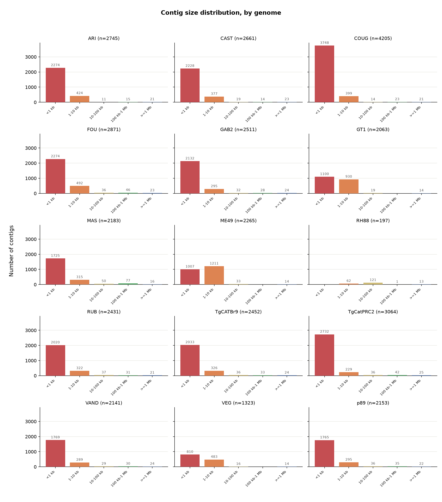

These small contigs are **not gene-free** — ME49 alone has 504 genes (84
protein_coding/pseudogene) sitting on its 2,218 sub-10kb contigs; every other non-RH88 genome
has 120–309 genes (120–281 protein_coding/pseudogene) on its small contigs too. RH88 has only
5 genes (1 protein_coding/pseudogene) on its 62 small contigs. So this panel can't be treated
as "small = safe to drop by default" — some of this is likely real accessory/fragmented
sequence, not just adapter/contamination junk, and needs the organelle and contamination
screens (and probably manual inspection) before any of it is removed.

**Protein-coding genes that a blanket ≤10kb drop would eliminate** (2,388 total across the
panel, from [`contig_size_profile/small_contig_genes.tsv`](01_Genome_Selection_QC/contig_size_profile/small_contig_genes.tsv)):

| Genome | protein_coding genes | | Genome | protein_coding genes |
| :--- | ---: | --- | :--- | ---: |
| GT1 | 281 | | VAND | 131 |
| FOU | 258 | | GAB2 | 120 |
| COUG | 205 | | VEG | 120 |
| ARI | 187 | | ME49 | 84 |
| TgCATBr9 | 178 | | RH88 | 1 |
| MAS | 176 | | | |
| p89 | 174 | | | |
| RUB | 166 | | | |
| CAST | 159 | | | |
| TgCatPRC2 | 148 | | | |

Of these 2,388, only 289 are the known SRS/ROP/GRA/RON/AP2/MIC virulence-family genes and
~636 look like organelle-genome genes (ribosomal proteins, RNA polymerase, cytochrome —
apicoplast/mitochondrial signatures); the remainder are ordinary genes with no specific
justification for dropping other than contig size alone.


### Synteny analysis (vs reference ME49)

Whole-genome alignments were generated with `minimap2 -x asm10` and plotted with `plot_dotplot.py`:

```bash
sbatch 01_Genome_Selection_QC/scripts/synteny_vs_ref.slurm.sh
```

| Assembly / Strain | Synteny Dotplot vs ME49 | Assembly / Strain | Synteny Dotplot vs ME49 |
| :--- | :---: | :--- | :---: |
| **ARI** (`GCA_000250965.2`) |  | **CAST** (`GCA_000256705.2`) |  |
| **COUG** (`GCA_000338675.2`) |  | **FOU** (`GCA_000224905.2`) |  |
| **GAB2-2007-GAL-DOM2** (`GCA_000325525.2`) |  | **GT1** (`GCA_000149715.2`) |  |
| **MAS** (`GCA_000224865.2`) |  | **p89** (`GCA_000224885.2`) |  |
| **RH-88** (`GCA_013099955.1`) | 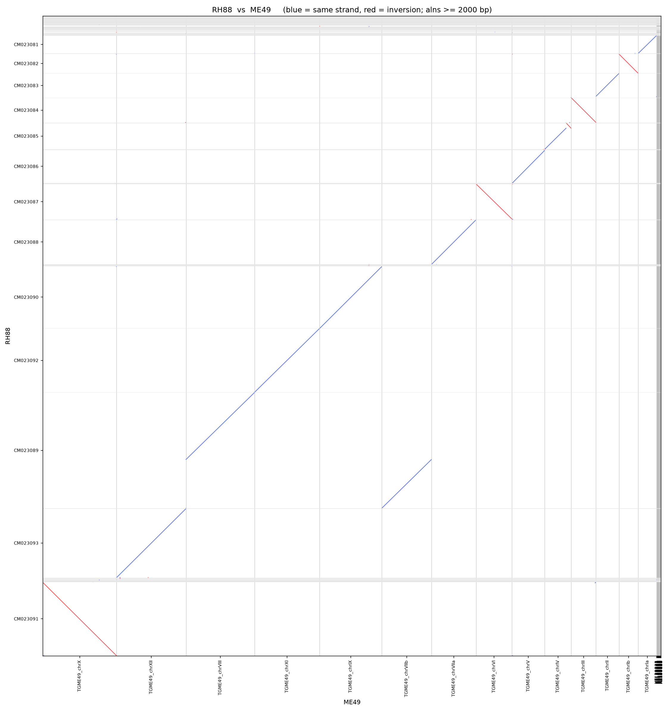 | **RUB** (`GCA_000224805.2`) | 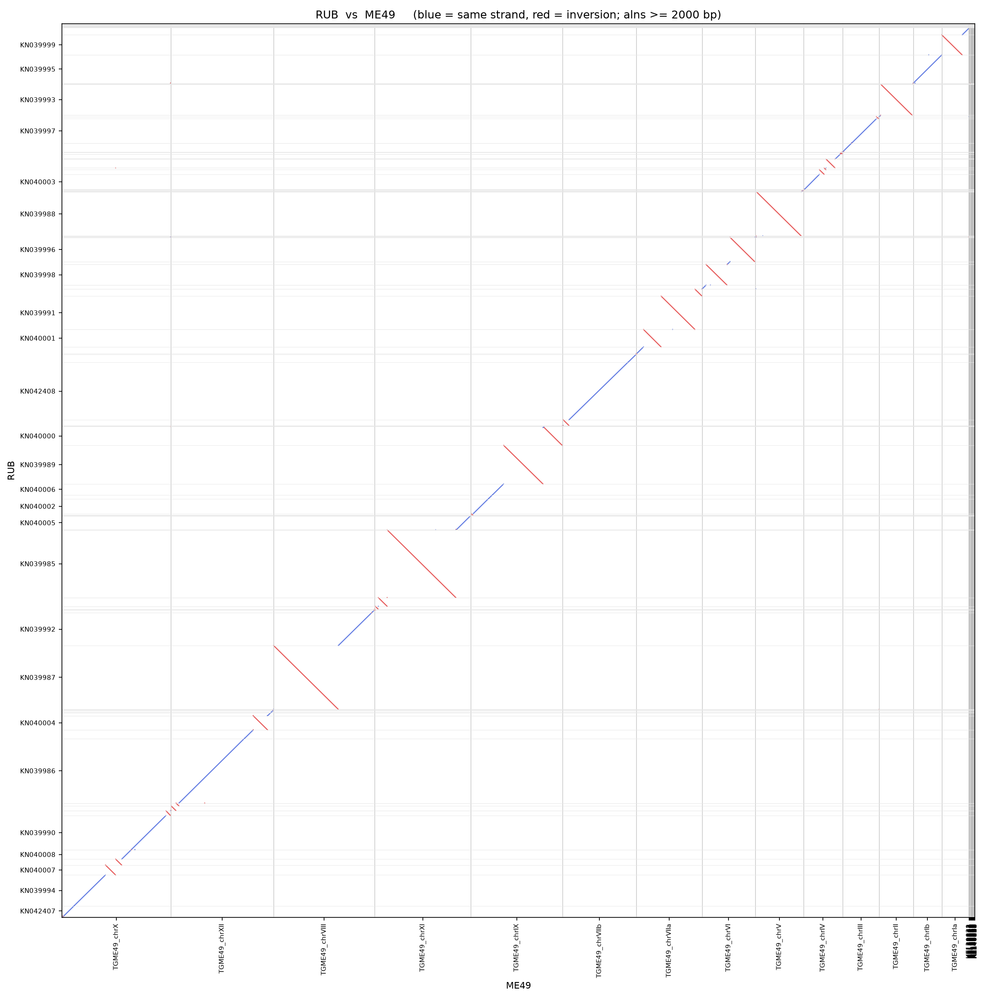 |
| **TgCatBr9** (`GCA_000224825.2`) |  | **TgCatPRC2** (`GCA_000256725.2`) |  |
| **VAND** (`GCA_000224845.2`) |  | **VEG** (`GCA_000150015.2`) |  |

#### Quantitative summary

Recomputed from the PAF alignments (alignments ≥ 2 000 bp) with orientation correction (each
query contig is first assigned its own dominant orientation, so only blocks running *against
their own contig* count as inversions — the raw red in a scaffold dot-plot is mostly the
arbitrary orientation of independent scaffolds, not biology):

```bash
python 01_Genome_Selection_QC/scripts/synteny_report.py \
    01_Genome_Selection_QC/synteny --ref-mb 65.63 \
    --md 01_Genome_Selection_QC/synteny/SYNTENY_REPORT.md \
    --tsv 01_Genome_Selection_QC/synteny/SYNTENY_REPORT.tsv
```

Full per-strain detail (every inversion block and cross-chromosome scaffold, with
coordinates): [`SYNTENY_REPORT.md`](01_Genome_Selection_QC/synteny/SYNTENY_REPORT.md) ·
[`SYNTENY_REPORT.tsv`](01_Genome_Selection_QC/synteny/SYNTENY_REPORT.tsv).

| Strain | Lineage / origin | Query pieces (clean 1:1) | ME49 covered | Aln identity¹ | Inversion ≥ 20 kb | Verdict |
| :--- | :--- | ---: | ---: | ---: | :--- | :--- |
| **ARI** | HG XII, USA | 123 (121) | 62.3 Mb (94.9 %) | 91.9 % | – | Collinear, 1:1 |
| **CAST** | Castells, HG XI-like, USA | 120 (116) | 62.2 Mb (94.7 %) | 83.1 % | chrIX ~69 kb | Collinear, 1:1 |
| **COUG** | Cougar, HG XI, Canada | 130 (127) | 62.3 Mb (94.9 %) | 87.0 % | – | Collinear, 1:1 |
| **FOU** | Atypical Amazonian, Fr. Guiana | 197 (186) | 61.7 Mb (94.1 %) | 82.4 % | – | Collinear, 1:1 |
| **GAB2-2007-GAL-DOM2** | African, Gabon | 127 (119) | 62.1 Mb (94.7 %) | 86.8 % | – | Collinear, 1:1 |
| **GT1** | **Type I**, goat, USA | 518 (512) | 62.6 Mb (95.4 %) | 85.1 % | – | Collinear, 1:1 (contiguous asm: 1.7 % rev) |
| **MAS** | Atypical, Massachusetts | 256 (250) | 61.3 Mb (93.4 %) | 83.7 % | – | Collinear, 1:1; 2 scaffolds tile a chromosome junction |
| **RH-88** | **Type I**, lab (Sabin 1939) | 169 (78) | 62.9 Mb (95.8 %) | 83.3 % | chrIV ~515 kb | 13-chromosome assembly — one scaffold joins ME49 chrVIIb + chrVIII |
| **RUB** | Rubin, HG V, USA | 154 (139) | 62.1 Mb (94.6 %) | 82.1 % | chrIX ~69 kb | Collinear, 1:1 |
| **TgCatBr9** | Atypical S. American, Brazil | 164 (153) | 61.9 Mb (94.3 %) | 82.5 % | – | Collinear, 1:1 |
| **TgCatPRC2** | Asian (Chinese 1), China | 165 (155) | 62.1 Mb (94.6 %) | 88.7 % | chrIX ~72 kb | Collinear, 1:1 |
| **VAND** | Atypical Amazonian, Fr. Guiana | 158 (150) | 62.0 Mb (94.5 %) | 83.1 % | chrIX ~69 kb | Collinear, 1:1 |
| **VEG** | **Type III**, non-virulent, USA | 249 (241) | 62.6 Mb (95.4 %) | 88.5 % | – | Collinear, 1:1 (contiguous asm: 1.0 % rev) |
| **p89** | HG IX, pig, USA | 171 (164) | 61.9 Mb (94.4 %) | 82.8 % | – | Collinear, 1:1 |

¹ minimap2 gap-compressed identity, aligned regions only — structurally low because divergent
repeat families partially align; genome-wide **ANI (98.7–99.7 %)** is the real divergence figure.

#### Findings (*Info retrieved with Claude - need review)

- **Universal collinearity.** All 14 dot-plots are a single clean diagonal staircase: 1:1
  correspondence with the 14 ME49 chromosomes, **no translocations and no arm-scale
  inversions** in any lineage (I/II/III, HG V/IX/XI/XII, African, atypical
  Amazonian/South-American/Asian). *T. gondii* has a very stable karyotype.
- **The red in the scaffold plots is orientation, not biology.** After per-contig
  orientation correction the inverted signal is ≈ 0 for every scaffold assembly. The three
  contiguous assemblies give the honest figure: **GT1 1.7 % reverse, VEG 1.0 %, RH88 27 %**
  (RH88 inflated by whole chromosomes assembled in reverse — chrX, chrVI, chrIII, chrIb).
- **One recurrent real inversion:** a **~70 kb inverted block near the end of ME49 chrIX
  (~4.97–5.05 Mb)** in **CAST, RUB, VAND and TgCatPRC2** — an inversion polymorphism shared
  across several lineages; absent from ARI/COUG/GT1/VEG/FOU/GAB2/p89/TgCatBr9.
- **RH-88** carries a **~515 kb inversion at chrIV:2.17–2.69 Mb** (RH88 only) and is
  assembled as **13 chromosomes**, with scaffold **CM023089** joining ME49 **chrVIIb (~5 Mb)
  + chrVIII (~7 Mb)** end to end — treat as an assembly/nomenclature difference to confirm.
- **Recurrent chrIII ↔ chrX segment (~80–85 kb):** the scaffold covering ME49 chrX also
  carries ~80 kb aligning to chrIII in ARI, CAST, COUG, MAS and RH88 → a **segmental
  duplication in the ME49 reference itself**, not a per-strain event.
- **~5–6 % of ME49 is uncovered in every strain** (3.0–4.3 Mb), consistently: subtelomeres,
  tandem gene-family arrays (*SRS/SAG*, *ROP/RON*, *AP2*), and ME49 reference gaps — not
  strain-specific loss. Implication: `GET_PANGENES` collinearity evidence is reliable
  genome-wide; subtelomeric family calls are the least certain.

> **Label note — GAB2.** `species_check.tsv` lists this isolate as `GAB2`, while the synteny
> files and tables use `GAB2-2007-GAL-DOM2`; same genome (`GCA_000325525.2`). The synteny
> folder also holds a redundant `GAB2_vs_ME49.{paf,png}` identical to
> `GAB2-2007-GAL-DOM2_vs_ME49.{paf,png}` — safe to delete.

### Short contig removal — arbitrary ≤10kb cutoff (done)

Decided to drop every contig <10kb from every genome, panel-wide, as a blanket length cutoff
rather than a per-contig evidence check (blastn-based screening was tried and dropped — see
step 02 for why the underlying contamination concern is real). This is an **arbitrary**
cutoff: it knowingly discards the [2,388 protein-coding genes](#contig-size-profile) on those
contigs (including 289 known virulence-family genes), accepted as the cost of a simple,
panel-wide rule.

Script (Tgondii-only, not part of the general pipeline template):
[`01_Genome_Selection_QC/scripts/drop_short_contigs.slurm.sh`](01_Genome_Selection_QC/scripts/drop_short_contigs.slurm.sh).
**Already run** (before step 04). One run does everything: builds the drop list, backs up every
affected genome's FASTA + GFF (untouched copy in
`01_Genome_Selection_QC/backup_before_short_contig_drop/`, the only way back if needed),
writes the gene-cost summary (`01_Genome_Selection_QC/dropped_genes_summary.tsv`), then
rewrites `genomes/`/`gff_originals/` in place — no separate confirmation step. Check: none of
the 3,089 genes listed in `contig_size_profile/small_contig_genes.tsv` (across all 15 genomes)
is present in the GFFs used from step 04 onward.

Command that was run:
```bash
sbatch 01_Genome_Selection_QC/scripts/drop_short_contigs.slurm.sh
```

[↑ Back to top](#analysis-steps)

---

## 02 – TE Annotation & Clean Up

### 02.1 TE Candidate Discovery Pipeline

The TE candidate pipeline was run on the 15 *T. gondii* genomes:

```bash
bash 02_TE_annotation_Clean_Up/slurm/run_pipeline_slurm.sh
```

**Output:** **106 non-redundant candidate TE consensus sequences** across the panel
(`all_MCHelper_curated_sequences_NR.cdhit80.fa`); **25 of those** pass the RepBase/TE-peptide
filter (`final_potential_new_TEs.fa`).

### 02.2 TE-Aid — visual validation of the candidates

Ran TE-Aid (coverage plot / self dot-plot / ORFs / hits to known TE proteins) on the
**unfiltered non-redundant set**, `final_TE_candidates_after_MCHelper/all_MCHelper_curated_sequences_NR.cdhit80.fa`
— not the RepBase/peptide-filtered `final_potential_new_TEs.fa` — to also see the candidates
that filter would have dropped (e.g. solo-LTR-only families) before curating into the final
library:

```bash
sbatch 02_TE_annotation_Clean_Up/scripts/run_te_aid.slurm.sh
```

(`INPUT_FASTA`/`OUTDIR` in the script set to the `all_MCHelper_curated_sequences_NR.cdhit80.fa`
pair, not the default.)

**Output:** `te_aid_all_MCHelper_NR_cdhit80/` — one folder per candidate with its TE-Aid figure,
plus `te_aid_run_summary.tsv` (candidate · genome it ran against · status).

### 02.3 Manual curation of TE candidates

All 106 TE candidates retrieved by the pipeline were manually inspected using the TE-Aid
figures and compared against RepBase/known TE databases.

#### Findings

- **No bona fide *T. gondii* transposable elements were identified.** Consistent with the
  published apicomplexan mobilome literature (Rodriguez & Makalowski, 2022), the curated
  TE library ended up empty of genuine *T. gondii* TEs. 

- **Human L1 LINE elements detected as apparent TE candidates in multiple strains,
  including the reference genome ME49.** **5 of the 106 candidates** (all discovered in the
  ME49 assembly: `rnd-1_family-14/20/31/36/56`) showed the hallmarks of bona fide LINEs
  (TE-Aid coverage profile, ORF structure, hits to known RT domains) — but database comparison
  identified them as **human L1 (LINE-1) consensus sequences**. Their presence in multiple genomes (they are in short contigs <10 kb) including ME49 indicates
  **human host-cell DNA contamination** (most likely from the cell-culture system used to
  propagate the parasite) present in several assemblies of the panel — confirming the panel
  does carry contigs of contamination origin, not just fragmented real sequence.

[↑ Back to top](#analysis-steps)

---

## 03 – *de novo* Genome Annotation

**Not needed.** All 15 strains in the panel already have gene annotation.

[↑ Back to top](#analysis-steps)

---

## 04 – InterProScan

### Running InterProScan

`interpro_manifest.tsv` for this panel (15 genomes, `CHUNK_SIZE=1000`): **150 total chunks**.
Submit the array job with:
```bash
mkdir -p interpro/logs
N=$(($(wc -l < interpro/interpro_manifest.tsv) - 1))
sbatch --array=1-${N}%20 04_InterProScan/scripts/interproscan_array_job.slurm.sh
```
(currently 150, but always recomputed from the manifest, not hardcoded - see
[`04_InterProScan/README.md`](../../04_InterProScan/README.md) for why).

Protein extraction ran on `gff_originals/` (this species has no `gff_cleaned/`). The array job
**finished**: all 150 chunks completed (each chunk's `.out` ends with
`Finished <genome> chunk <N>`).

### Merging the chunk results

Combines the per-chunk InterProScan output into one lookup table per genome
(`interpro/interpro_lookup/`) and checks completeness:
```bash
sbatch 04_InterProScan/scripts/merge_interpro_job.slurm.sh
```
A protein reported as absent from the chunk output is a `NOTE`, not an error: InterProScan only
writes a row when it finds a hit, so it is a protein with no domain hits. Only a missing chunk
file (`WARNING`) means the results are incomplete.

### Adding the domain evidence to the GFFs

Writes the `InterPro:`/`PFAM:` evidence into the `Dbxref=` of each CDS line, reading
`gff_originals/` (`GFF_INDIR` is set to that in this species' copy of the script) and writing
new GFFs to `gff_with_interpro/` (the input is never modified):
```bash
sbatch 04_InterProScan/scripts/update_interpro_in_gff.slurm.sh
```
`gff_with_interpro/` is the input for step 05.

[↑ Back to top](#analysis-steps)

---

## 05 – Cross-genome Annotation Integration

### Step 1: Native annotation check

Run **once**, after [step 04](#04--interproscan), on `gff_with_interpro/` (the GFFs with the
domain evidence written in), so that the domain columns and plots are real. Output folder for
this run: `annotation_check_with_interpro/`.
```bash
sbatch 05_Cross-genome_annotation_integration/scripts/analyze_input_gffs_job.sh
```
(`GFF_DIR="gff_with_interpro"` is the script's default; for the run above `OUT_DIR` was set to
`annotation_check_with_interpro`. Full description of every output file:
[general README](../../05_Cross-genome_annotation_integration/README.md#step-1-native-annotation-check).)

**Genes per genome** - 8,000 to 10,000 protein-coding genes per genome, split by whether the
gene carries InterPro/PFAM evidence (56-62% do, in every genome, so no genome stands out
as missing domain annotation). ME49 is the only genome with pseudogenes (24, red sliver on top).


**Gene types** - every gene category found. Nearly everything is protein-coding; the rest are
non-coding RNA genes (`ncRNA_other`, 144-334 per genome; RH88 has the most at 334), 147 tRNA
genes in VEG only, and 24 pseudogenes in ME49. No genome has unclassified genes.


**CDS-to-CDS overlaps** - gene pairs whose coding sequences actually overlap, split by strand.
Most genomes have 1-22 pairs; ME49 (33), TgCATBr9 (29) and VEG (27) have the most.
The whole-gene overlap (UTR included) is much larger in ME49 (672 pairs, mostly opposite-strand
UTR-only), which is why the CDS-level count is the one that matters.


**Overlap severity** - the same pairs by how much of the smaller gene's CDS is covered:
minor (< 20%), substantial (20-80%), contained (>= 80%). Every genome except RH88 has some
contained pairs; TgCATBr9 and VEG have the most (20 and 16). The pair list with descriptions,
sizes and `has_domain` is `cds_overlapping_pairs.tsv`.


Also in that folder: `03_gene_overlap_counts.png` (whole-gene overlap, UTR included),
`04_core_overlap_counts.png` (CDS/exon extent only), and the tables
(`gene_biotype_counts.tsv`, `overlap_counts.tsv`, `feature_attribute_table.tsv`, one
`<genome>_gene_classification.tsv` per genome).

The overlaps are kept (see below); this check is what showed which genes to look at.

### Genes removed before Liftoff (kill-list filter)

Genes with overlapping CDS are **kept** (not enough evidence to say which are wrong - most look
like gene-model errors, not false genes). The only genes removed are 5 *ME49* protein-coding
genes whose CDS lies entirely inside one of 5 pseudogenes (same strand, no other gene overlaps
those pseudogenes). The pseudogenes are confirmed as correct and are **kept**; the overlapping
genes are removed. Listed in `kill_list_manual.tsv` (project root):

| Removed gene | Description | Overlaps pseudogene | Overlap (bp) |
|---|---|---|---|
| `TGME49_242250` | rhoptry kinase family protein ROP19B | `TGME49_500106` | 1533 |
| `TGME49_224780` | SAG-related sequence SRS40B | `TGME49_500133` | 657 |
| `TGME49_220950` | hypothetical protein | `TGME49_500154` | 1015 |
| `TGME49_321710` | Kinase-like \| domain-containing protein | `TGME49_500317` | 965 |
| `TGME49_321700` | Kinase-like \| domain-containing protein | `TGME49_500405` | 800 |

Removing them (40 GFF lines including their exons/transcripts) is done by
[`remove_genes_from_gff_job.sh`](../../05_Cross-genome_annotation_integration/README.md#step-2-remove-specific-genes-from-the-gffs-optional-manual-kill-list),
reading `gff_with_interpro/` and writing every genome to `gff_curated/` (genomes without an
entry in the list are copied unchanged):
```bash
sbatch 05_Cross-genome_annotation_integration/scripts/remove_genes_from_gff_job.sh
```
`kill_list_manual.tsv` has no header, one gene per line: `genome<TAB>gene_id`
(e.g. `ME49	TGME49_242250`). Run this step **before** "Prepare the GFFs for Liftoff" below.

### Prepare the GFFs for Liftoff

[`prepare_for_liftoff_job.sh`](../../05_Cross-genome_annotation_integration/README.md#step-3-prepare-the-gffs-for-liftoff)
reads `gff_curated/` and writes to `gff_for_liftoff/`: genes reduced to their coding sequence
(no UTRs), protein-coding genes and pseudogenes unified to `protein_coding_gene`, and the
non-coding RNA genes given a different type (`ncRNA_gene`, `tRNA_gene`) so Liftoff - which only
transfers the types in `liftoff_feature_types.txt` - does not copy them onto other genomes. Each
genome keeps its own non-coding genes. This is what goes into Liftoff:
```bash
sbatch 05_Cross-genome_annotation_integration/scripts/prepare_for_liftoff_job.sh
```

Result (`gff_for_liftoff/prepare_for_liftoff_report.tsv`; `liftoff_feature_types.txt` contains
only `protein_coding_gene`). Per genome: transcripts processed, UTR lines deleted, exons
clipped or deleted to the coding extent, genes resized, and total bp cut from gene spans:

| Genome | Transcripts | UTR lines deleted | Exons clipped | Exons deleted | Genes resized | bp trimmed |
|---|---|---|---|---|---|---|
| ME49 | 8115 | 15384 | 13465 | 687 | 7507 | 11047634 |
| ARI | 9771 | 737 | 736 | 1 | 735 | 3608 |
| CAST | 9338 | 545 | 543 | 1 | 543 | 14698 |
| COUG | 9664 | 741 | 740 | 0 | 740 | 2084 |
| FOU | 9859 | 683 | 682 | 1 | 681 | 2783 |
| GAB2 | 9016 | 379 | 378 | 1 | 378 | 4803 |
| GT1 | 8179 | 85 | 83 | 2 | 80 | 6054 |
| MAS | 9829 | 701 | 701 | 0 | 701 | 2316 |
| p89 | 9527 | 581 | 581 | 0 | 581 | 2083 |
| RH88 | 8315 | 46 | 26 | 19 | 22 | 30467 |
| RUB | 9861 | 718 | 716 | 2 | 716 | 2994 |
| TgCATBr9 | 9656 | 586 | 584 | 2 | 581 | 12112 |
| TgCatPRC2 | 9973 | 885 | 884 | 1 | 884 | 2236 |
| VAND | 9124 | 417 | 417 | 0 | 416 | 642 |
| VEG | 8296 | 0 | 89 | 0 | 89 | 1606 |

*ME49* carries by far the most UTR annotation (15,384 lines, 11 Mb removed from gene spans); the
other genomes have only a few hundred UTR lines or fewer. *VEG* has no UTR lines at all, but 89
of its exons extended past the CDS and were clipped.

Gene types changed (only where the type had to change):

| Genome | From | To | Genes |
|---|---|---|---|
| ME49 | `pseudogene` | `protein_coding_gene` | 24 |
| VEG | `gene` | `protein_coding_gene` | 8296 |
| VEG | `gene` | `tRNA_gene` | 147 |

The 24 *ME49* pseudogenes keep `ebi_biotype=pseudogene` on their gene line, so they stay
identifiable. All other genomes already used `protein_coding_gene`/`ncRNA_gene`, so nothing was
retyped there; their non-coding genes (`ncRNA_gene`, 144-334 per genome) are already outside
the type list Liftoff transfers.

### Liftoff (all-against-all)

[`liftoff_all_vs_all.sh`](../../05_Cross-genome_annotation_integration/README.md#step-4-liftoff)
lifts every genome's prepared annotation (`gff_for_liftoff/`) onto every other genome's
FASTA (`genomes/`) - 15 genomes, so 210 pairs. Run as one job per source genome:
```bash
mkdir -p liftoff_output/logs
sbatch --array=1-15 05_Cross-genome_annotation_integration/scripts/liftoff_all_vs_all.sh
```
Results go to `liftoff_output/polished/`, job logs to `liftoff_output/logs/`. Resubmitting skips pairs that are already done.

### Build each genome's final annotation

[`build_final_annotation_basic.sh`](../../05_Cross-genome_annotation_integration/README.md#step-5-build-each-genomes-final-annotation)
builds one annotation per genome anchored on its own coordinates. The reference is ME49 (first line
of `genome_order.txt`). The layers are the reference's confident transfers (`main`), then the
genome's own annotation from `gff_for_liftoff/` - which is where its non-coding genes come back in -
then the other genomes' good transfers (`good_<genome>`), then everything left (`rescued_<genome>`).
Run after all Liftoff jobs have finished, one job per genome:
```bash
mkdir -p expanded_annotation/logs
sbatch --array=1-15 05_Cross-genome_annotation_integration/scripts/build_final_annotation_basic.sh
```
Results: `expanded_annotation/<genome>_final_annotation.gff`, job logs in `expanded_annotation/logs/`.

[↑ Back to top](#analysis-steps)

---

### Step 6: Built annotation check

QC on the raw build output, before [step 7](../../05_Cross-genome_annotation_integration/README.md#step-7-final-annotation-if-using-step-5-pre-get_pangenes)'s
filter runs. Output folder: `final_annotation_qc_plots/`.
```bash
mkdir -p final_annotation_qc_plots/logs
sbatch 05_Cross-genome_annotation_integration/scripts/plot_final_annotation_qc_job.sh
```
(Full description of every output file:
[general README](../../05_Cross-genome_annotation_integration/README.md#step-6-built-annotation-check-if-using-step-5).)

**Gene counts** - each genome's final build has 9,249-9,933 protein-coding genes, well above
its own original annotation (8,000-10,000), since genes are being pulled in from every other
genome too.

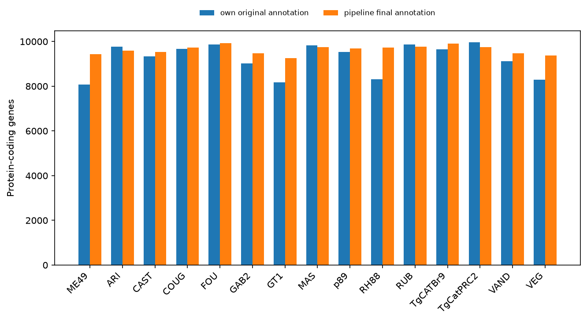

**Extra copies** - RH88 (179) and ME49 (61) stand out; every other genome has 14 or fewer.

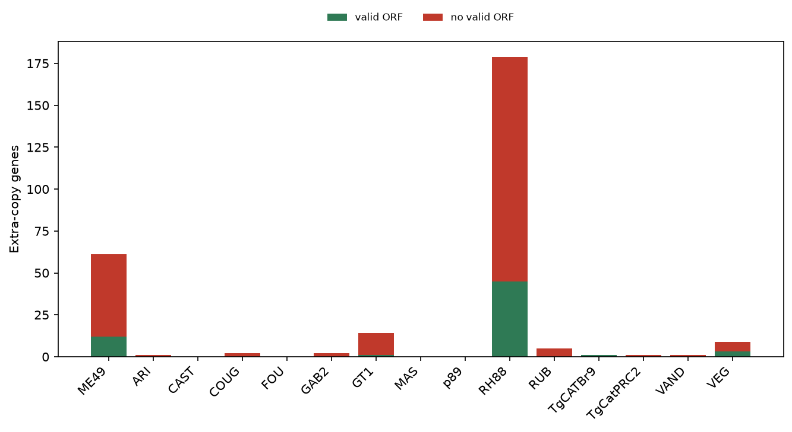

**CDS-overlap severity** - 8,222 CDS-overlapping pairs across the panel, split minor/substantial/contained.

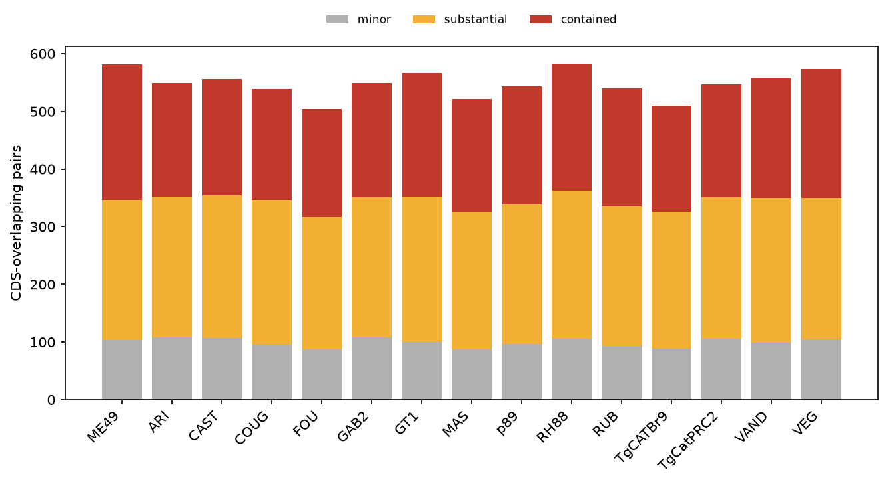

**Source composition** - where each genome's final genes came from (`main`/original/`good_*`/`rescued_*`).

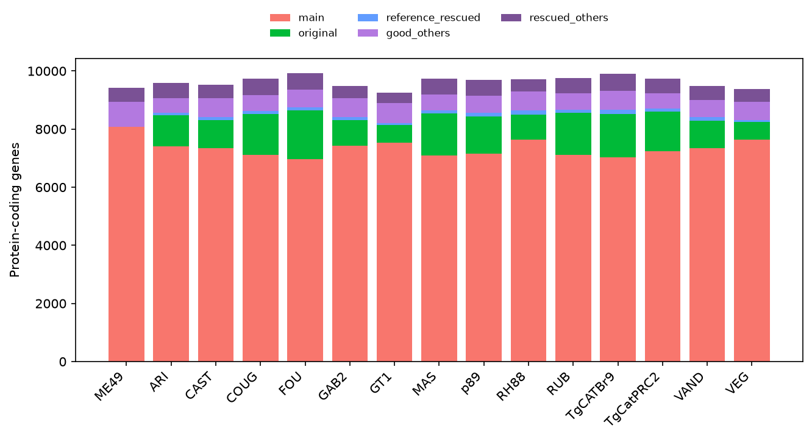

**Overlap strand** - the same 8,222 pairs, split by strand instead of severity: only **13 are
same-strand** (the ones that "shouldn't normally happen"), the other **8,209 are
opposite-strand**. Same-strand pairs are rare enough on this panel to review by hand, one by one.

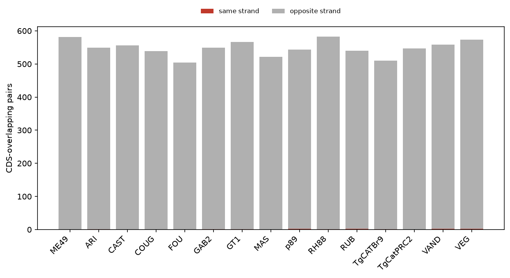

**Overlap domain support** - of the 8,222 pairs, only **29 have InterPro/PFAM domain evidence on
both genes**, **5,008 on exactly one**, and **3,185 on neither**. These counts use protein
domains only; the 7a filter also counts a specific description as evidence (see below).

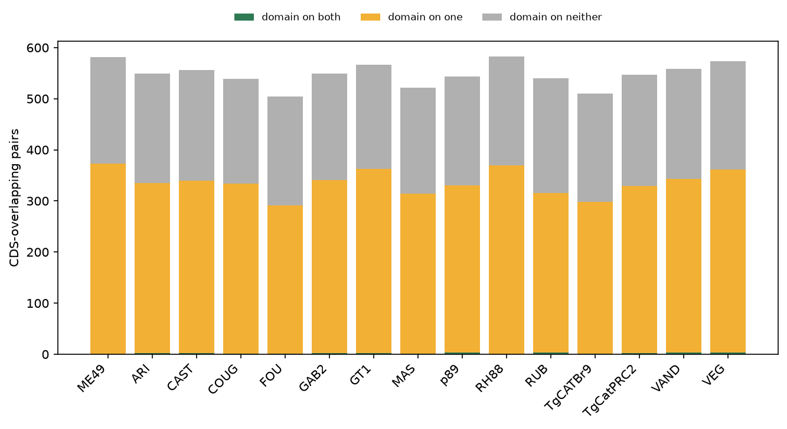

**Pairs by case** - the 8,222 pairs of the raw build, by whether each gene is `main` and whether
it carries a protein domain:

| # | Case | Pairs |
|---|---|---:|
| 1 | `main` × `main` | 237 |
| 2 | `main` × other, other **has** a domain | 18 |
| 3 | `main` × other, other has **no** domain | 6,368 |
| 4 | other × other, **one** has a domain | 420 |
| 5 | other × other, **both** have a domain | 13 |
| 6 | other × other, **neither** has a domain | 1,166 |

Case 6 - 1,166 pairs, 954 distinct genes: 99.6% opposite-strand, 113 `minor` severity, 63.5%
"hypothetical protein" on both sides.

Also in that folder: `summary.tsv` (the numbers behind every plot above), `extra_copy_genes.tsv`
(every extra-copy gene, with description/location/domain/valid-ORF), `cds_overlapping_pairs.tsv`
(every pair above, one row each) and `overlap_domain_summary.tsv` (the domain-support numbers
above, per genome).

[↑ Back to top](#analysis-steps)

### Filtering — 7a pre-filter (done)

Ran [`filter_final_annotation.py`](05_Cross-genome_annotation_integration/scripts/filter_final_annotation.py)
on all 15 genomes (rule details in the
[general README](../../05_Cross-genome_annotation_integration/README.md#7a-filter-drop-unsupported-genes-before-get_pangenes)).
Output: `filtered_annotation/<genome>_final_annotation_filtered.gff` - `gene`-typed, IDs
renumbered `Tg<strain-index>g<00001, ...>`, original ID kept in `original_ID=`.

**Overlap rule** - when two genes' CDSs overlap, 7a looks at "has evidence" (a protein domain
**or** a specific description):

| Gene A | Gene B | Result |
|---|---|---|
| `main` | `main` | Keep both |
| `main` | has evidence | Keep both |
| `main` | no evidence | Drop B, subject to the panel check |
| has evidence | no evidence | Drop B, subject to the panel check |
| has evidence | has evidence | Keep both |
| no evidence | no evidence | Drop the gene with fewer `good_<genome>` transfers panel-wide (tie: the shorter CDS) |

Panel check: a gene present in 2 genomes or fewer is dropped; a gene present in more genomes is
dropped only if it has a qualifying overlap in at least 2 of them. The verdict is per gene ID, so
a dropped gene leaves every genome.

| Genome | n_original | n_kept | n_removed | % removed |
|---|---:|---:|---:|---:|
| ME49 | 9,425 | 8,690 | 735 | 7.8% |
| ARI | 9,583 | 8,922 | 661 | 6.9% |
| CAST | 9,530 | 8,867 | 663 | 7.0% |
| COUG | 9,728 | 9,084 | 644 | 6.6% |
| FOU | 9,933 | 9,318 | 615 | 6.2% |
| GAB2 | 9,478 | 8,850 | 628 | 6.6% |
| GT1 | 9,249 | 8,655 | 594 | 6.4% |
| MAS | 9,744 | 9,151 | 593 | 6.1% |
| p89 | 9,686 | 9,063 | 623 | 6.4% |
| RH88 | 9,724 | 8,907 | 817 | 8.4% |
| RUB | 9,763 | 9,130 | 633 | 6.5% |
| TgCATBr9 | 9,911 | 9,277 | 634 | 6.4% |
| TgCatPRC2 | 9,747 | 9,131 | 616 | 6.3% |
| VAND | 9,478 | 8,855 | 623 | 6.6% |
| VEG | 9,380 | 8,749 | 631 | 6.7% |

**What was removed.** Of the 9,710 genes removed across the 15 genomes:
- 6,264 (64.5%) overlapped a reference-derived (`main`) gene and had no evidence themselves;
- 2,597 (26.7%) were `rescued_` genes with Liftoff coverage below 0.5;
- 380 (3.9%) overlapped another non-`main` gene, neither with evidence (the one with fewer good
  transfers was dropped);
- 297 (3.1%) overlapped a gene with evidence and had none;
- 172 (1.8%) were extra copies with no valid ORF.

Before and after filtering, per genome, from
[`plot_filter_qc_job.sh`](05_Cross-genome_annotation_integration/scripts/plot_filter_qc_job.sh)
(`filter_qc_plots/`, numbers in its `summary.tsv`):

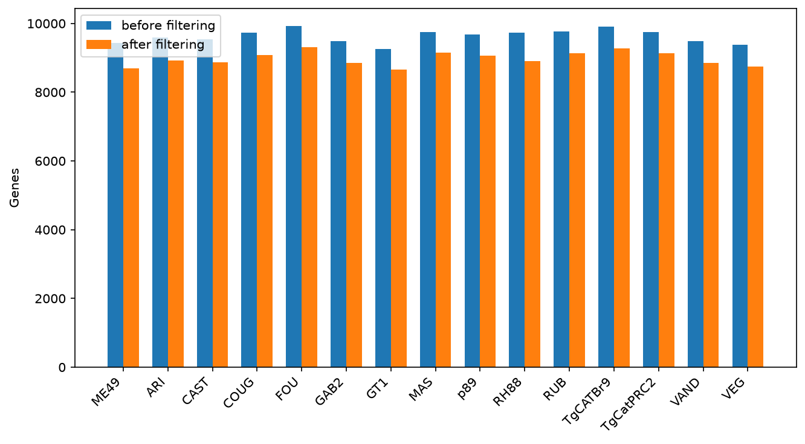

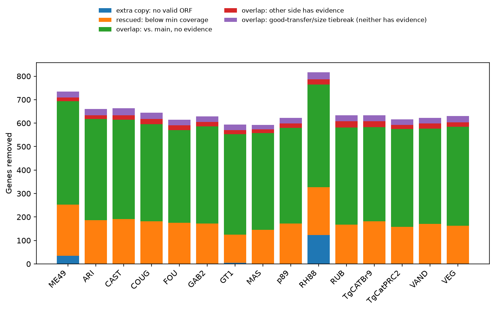

RH88 has the most genes removed (817) and ME49 the second most (735). The extra copies fall from 179
to 41 in RH88 and from 61 to 9 in ME49; in the other genomes they were 14 or fewer and are at most 2
after filtering.

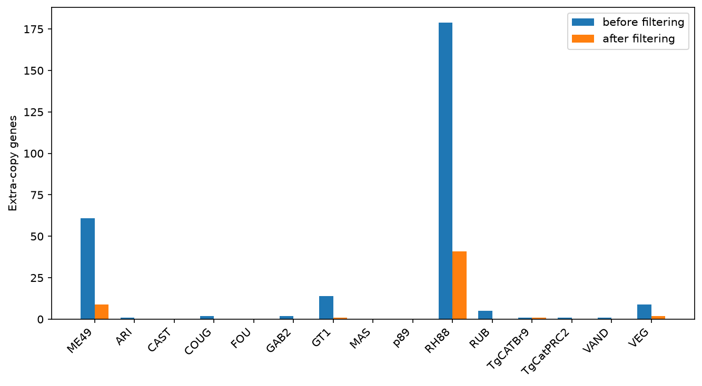

CDS-overlapping gene pairs drop from 476-552 per genome to 67-77, and the pairs where one gene is
contained in the other from 184-234 to 9-15. The ones left are the overlaps the rules keep on
purpose: small overlaps at a gene's end, and pairs where both genes have evidence.

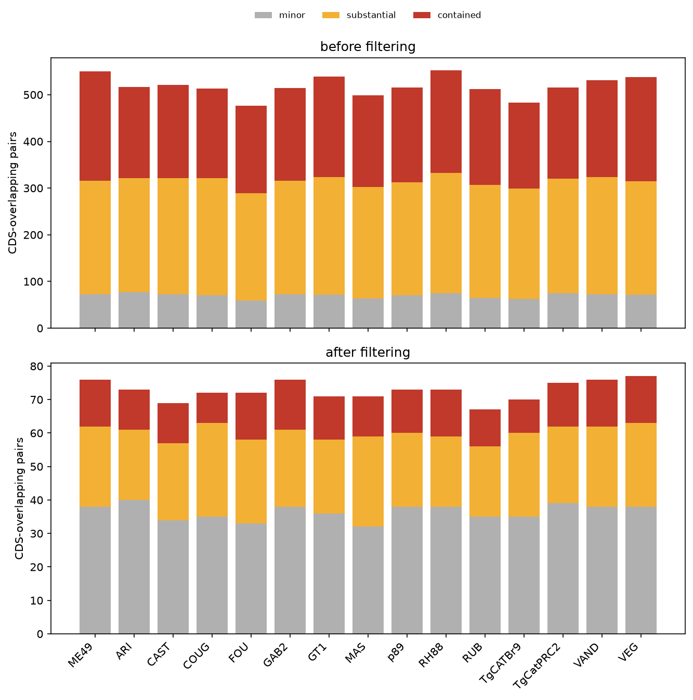

Which layer each gene comes from (`main`, the genome's own annotation, `good_` and `rescued_`
transfers):

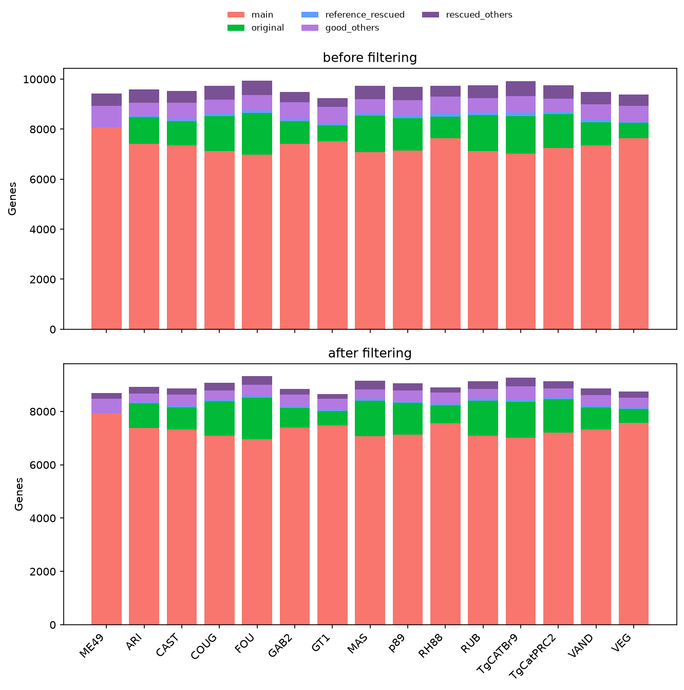

### Filtering — 7b no pre-filter / tag (done)

Ran [`tag_final_annotation.py`](05_Cross-genome_annotation_integration/scripts/tag_final_annotation.py)
on all 15 genomes (rule details in the
[general README](../../05_Cross-genome_annotation_integration/README.md#7b-no-filtering-tag-decide-after-get_pangenes)).
Nothing removed - same `gene`-typing/ID-renumbering as 7a, plus an `intersect=` tag on every
gene recording what it overlaps (`NA`/`with_main`/`with_other_with_domain`/`with_other_no_domain`).
Output: `tagged_annotation/<genome>_final_annotation_tagged.gff` + `<genome>_intersect_pairs.tsv`.

| Genome | n_total | NA | with_main | with_other_with_domain | with_other_no_domain |
|---|---:|---:|---:|---:|---:|
| ME49 | 9,425 | 8,408 | 546 | 2 | 469 |
| ARI | 9,583 | 8,621 | 440 | 25 | 497 |
| CAST | 9,530 | 8,559 | 429 | 24 | 518 |
| COUG | 9,728 | 8,772 | 400 | 37 | 519 |
| FOU | 9,933 | 9,034 | 347 | 47 | 505 |
| GAB2 | 9,478 | 8,519 | 443 | 15 | 501 |
| GT1 | 9,249 | 8,251 | 470 | 20 | 508 |
| MAS | 9,744 | 8,812 | 397 | 36 | 499 |
| p89 | 9,686 | 8,726 | 405 | 40 | 515 |
| RH88 | 9,724 | 8,699 | 493 | 14 | 518 |
| RUB | 9,763 | 8,806 | 391 | 45 | 521 |
| TgCATBr9 | 9,911 | 9,000 | 361 | 43 | 507 |
| TgCatPRC2 | 9,747 | 8,784 | 425 | 30 | 508 |
| VAND | 9,478 | 8,484 | 424 | 35 | 535 |
| VEG | 9,380 | 8,378 | 483 | 15 | 504 |

[↑ Back to top](#analysis-steps)

---

## 06 – GET_PANGENES

Ran `get_pangenes` on the 7b GFFs (`tagged_annotation/`, nothing pre-filtered), 15 genomes:
```bash
sbatch 06_GET_PANGENES/scripts/link_for_get_pangenes_7b.slurm.sh
sbatch 06_GET_PANGENES/scripts/run_get_pangenes_7b_job.sh
```
Result: **11,031 pangenes** across the 15 genomes (`for_get_pangenes_7b_pangenes/pangene_matrix*.tab`;
`pangene_matrix_genes.tr.tab` lists the gene IDs of every genome in every pangene).

[↑ Back to top](#analysis-steps)

---

## 07 – Post-GET_PANGENES Adjusting

**Pangenes with more than one gene in the same genome (7b).** `get_pangenes` sometimes puts two or
more genes of one genome into a single pangene. **1,501 of the 11,031 pangenes (13.6%)** do it in
at least one genome, adding up to 5,236 genes beyond one per genome.

| Genes in the genome with the most | Pangenes |
|---|---:|
| 2 | 1,034 |
| 3 | 426 |
| 4 | 32 |
| 5 | 9 |

- 1,326 of the 1,501 are core pangenes (present in all 15 genomes).
- In 752 of them only one genome has the extra gene; in 35 all 15 genomes do.
- Genomes with the most such pangenes: FOU (481), TgCATBr9 (453), COUG (403), MAS (399),
  RUB (394); the reference ME49 has the fewest (80).
- 4,826 of the 5,236 extra-gene pairs have consecutive gene numbers (e.g. `Tg15g02056` and
  `Tg15g02057`), which suggests neighbouring genes on the chromosome.

[`explore_multigene_pangenes.py`](07_Post_GET_PANGENES_adjusting/scripts/explore_multigene_pangenes.py)
classified the 5,236 neighbouring gene pairs (`multigene_pangenes/Toxo7b_multigene_pairs.tsv`, one
row per pair). Overlapping genes are not the explanation:

- Only 5 pairs (0.1%) have overlapping CDSs; another 777 (14.8%) overlap only in the gene span
  (UTR included).
- 5,230 pairs are same-strand and 6 opposite-strand.
- The two genes are close neighbours: 2,449 pairs (46.8%) are within 1 kb of each other, 1,909
  (36.5%) are 1-5 kb apart, 93 (1.8%) are further apart and 3 are on different contigs.
- 2,695 pairs (51%) are two genes of the genome's own original annotation, so the split is not
  a Liftoff artefact.
- Domain evidence: both genes have one in 1,260 pairs, only one gene in 1,831 pairs, neither in
  2,145 pairs.

Whether these pairs are tandem copies or one gene split into two is not decided yet.

[↑ Back to top](#analysis-steps)

---

## 08 – Pangenome Visualisation

> **Preliminary.** Some pangenes hold more than one gene of the same genome (1,501 without
> filtering, 1,374 with filtering, see [step 07](#07--post-get_pangenes-adjusting)) and are still
> being investigated. The figures below count them as they are. They will be updated once those pangenes are resolved.

The same figures for the two sets of pangenes: **with filtering** (7a, filtered before
`get_pangenes`) and **no filtering** (7b, tagged, nothing removed). Every figure also comes as
`.svg`, and files start with the label (`Toxo7a`/`Toxo7b`). The first four figures of each set
come from [`plot_all.sh`](08_Pangenome_Visualisation/scripts/plot_all.sh), run locally:
```bash
bash 08_Pangenome_Visualisation/scripts/plot_all.sh \
  -i 06_GET_PANGENES/for_get_pangenes_7b_pangenes/pangene_matrix.tr.tab \
  -o 08_Pangenome_Visualisation -l Toxo7b
```
(same with `for_get_pangenes_7a_pangenes` and `-l Toxo7a`). On the cluster,
[`plot_all_job.sh`](08_Pangenome_Visualisation/scripts/plot_all_job.sh) runs every plot of this step in one job.
The folders are given on the command line, and the matrices are found by name below the `get_pangenes` folder:
```bash
mkdir -p pangenome_plots/logs
sbatch 08_Pangenome_Visualisation/scripts/plot_all_job.sh --set 7b --label Toxo7b
sbatch 08_Pangenome_Visualisation/scripts/plot_all_job.sh --set 7a --label Toxo7a
```
`--set` stands for `--pangenes-dir for_get_pangenes_<set>_pangenes --gff-dir for_get_pangenes_<set>`, and turns the
unsupported-overlap plot on for 7b only. Give the two folders by hand for any other layout (`--help` lists every option).

### With filtering (7a)

**Pangenome and core genome size** - genomes are added one at a time in 100 random orders. The
pangenome grows from 8,649 pangenes (one genome) to 9,904 (all 15), still growing by about 70 per
genome at the end. The core falls to 8,281; the fitted curves put its plateau at 8,307 (Tettelin)
and 8,264 (Willenbrock). `Toxo7a_pancore_separate.png` shows the two curves in separate panels.

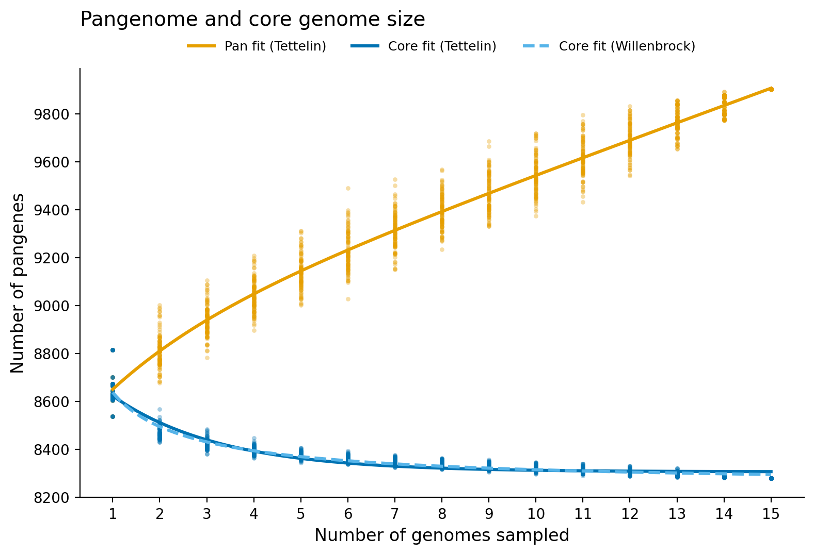

**Pangene occupancy** - how many genomes each pangene is present in. 8,281 pangenes (84%) are core,
111 are in 14 genomes (soft-core), 990 (10%) are in one genome only and 131 in two.

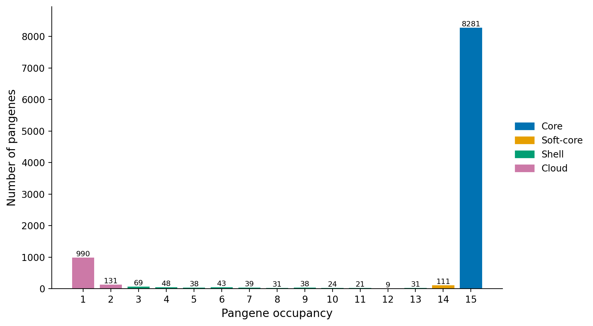

**Singletons per genome** - FOU has the most (128), then RH88 (122); GT1 has the fewest (11).

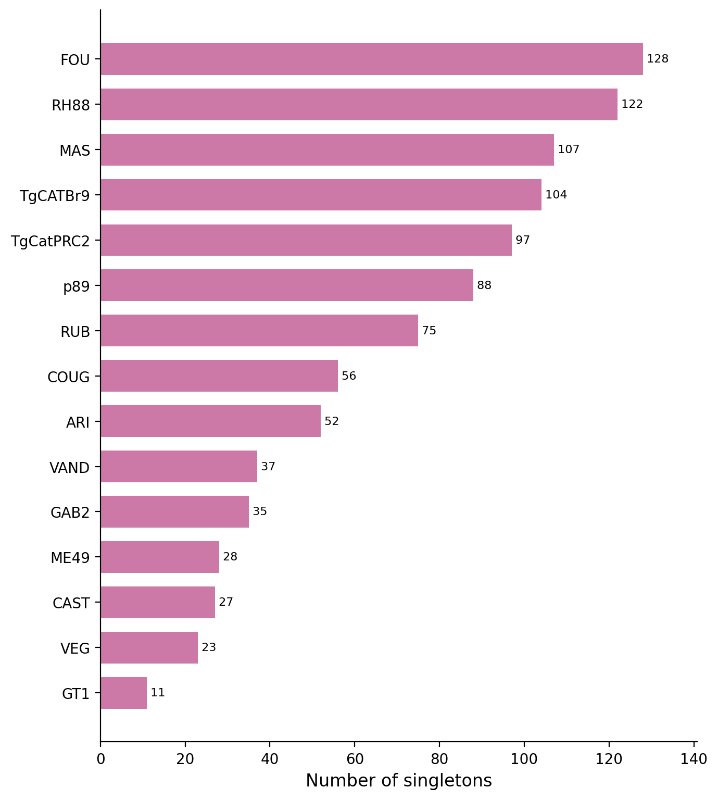

**POCS heatmap** - pairwise percentage of conserved sequences between genomes, clustered (complete
linkage); darker means more similar, and the colour scale covers the values between different
genomes only. Between different genomes POCS is 96.7-98.8. RH88 is the most distant genome (mean
97.4).

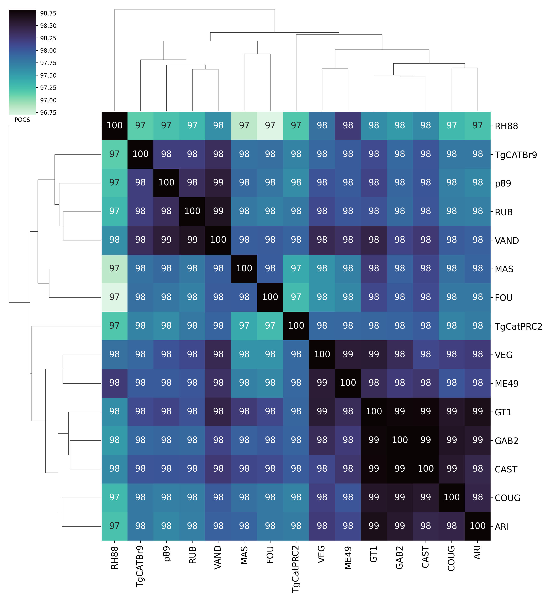

**Gene properties by occupancy** - every pangene is used (9,904), including the ones with more than one
gene in a genome; the occupancy is the number of genomes the pangene is present in. Top: proportion of
genes with an InterPro/PFAM domain, averaged over the pangenes of each occupancy. Bottom: protein
length, one value per pangene (the median over all its genes). A Tukey HSD test compares the four categories on the value of each pangene, and the line joining cloud and core gives its p-value for core against cloud, which treats
genes from different genomes as independent samples, so it is optimistic. The number of pangenes of
each occupancy is written under the axis and is small between 2 and 13 genomes, so those bars are
noisy. Core: 57% of genes with a domain, median 513 aa; cloud: 44% and 240 aa. The `_log` file
shows protein length on a log axis.

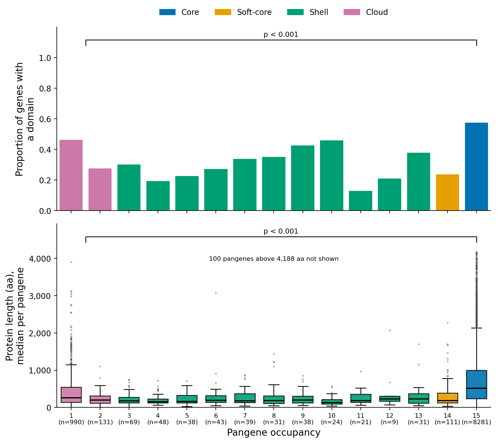

**Contig size by occupancy** - the contigs that carry the pangenes, split into size classes. Every
pangene is used (9,904); each gets one value, the median length of the contigs of all its genes. The bars give the share of the pangenes of
each category in each class. Cloud pangenes sit on short contigs far more often than core ones:
16% of cloud pangenes are on contigs below 200 kb (10% below 50 kb), against 0.4% (0.1%) of core.
Contigs below 10 kb were removed from every genome in step 01, so the smallest class starts at
10 kb.

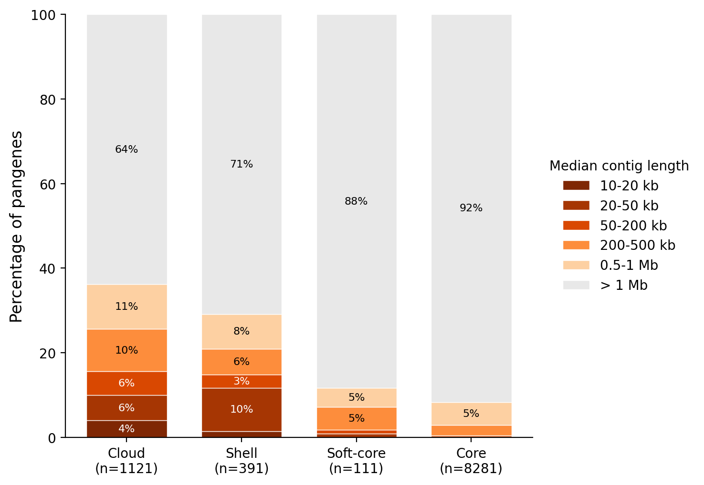

**Invalid ORFs by occupancy** - a gene is invalid when Liftoff found no valid open reading frame
(`valid_ORFs=0`) or the source annotation calls it a pseudogene. A pangene is "mostly invalid" when
more than 50% of its genes are invalid. Genes taken straight from a genome's own annotation have no
ORF result and are only marked by the pseudogene biotype; pangenes with no gene that can be judged
(821) are left out. Every pangene counts, including the ones with more than one gene in a genome.
Two figures: the number of mostly invalid pangenes per occupancy, and their share of the pangenes of
that occupancy (the total per occupancy is in the `.tsv`). Mostly invalid: 50% of cloud pangenes
(190 of 380), 35% of shell, 22% of soft-core and 2.3% of core (187 of 8,269).
Even after the 7a filter, a large share of the cloud pangenes is mostly invalid, so additional filtering could be considered.

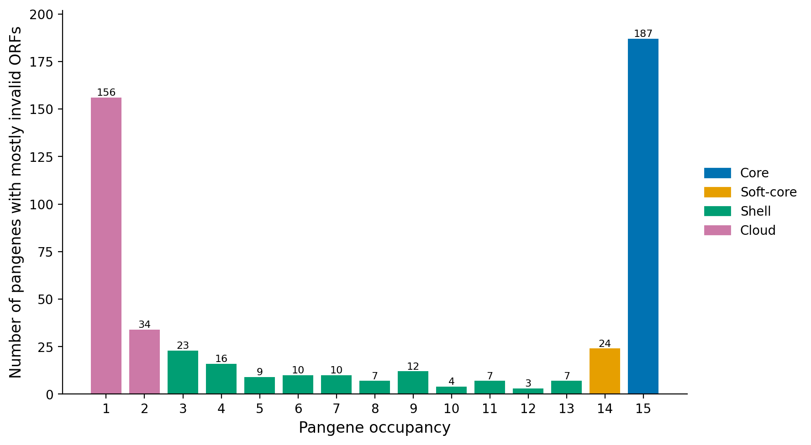

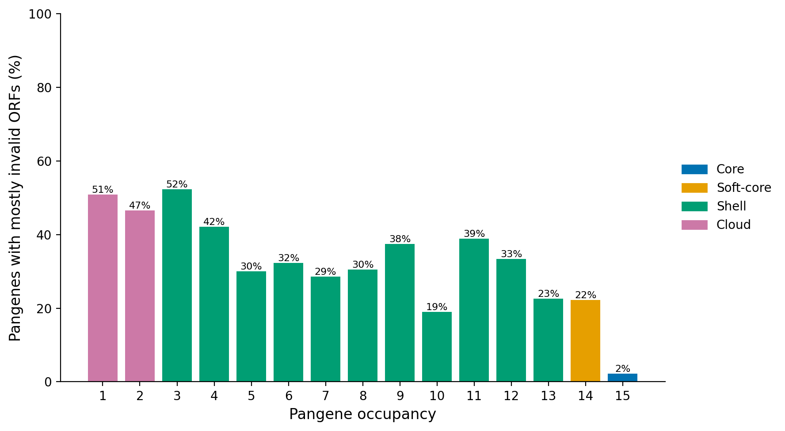

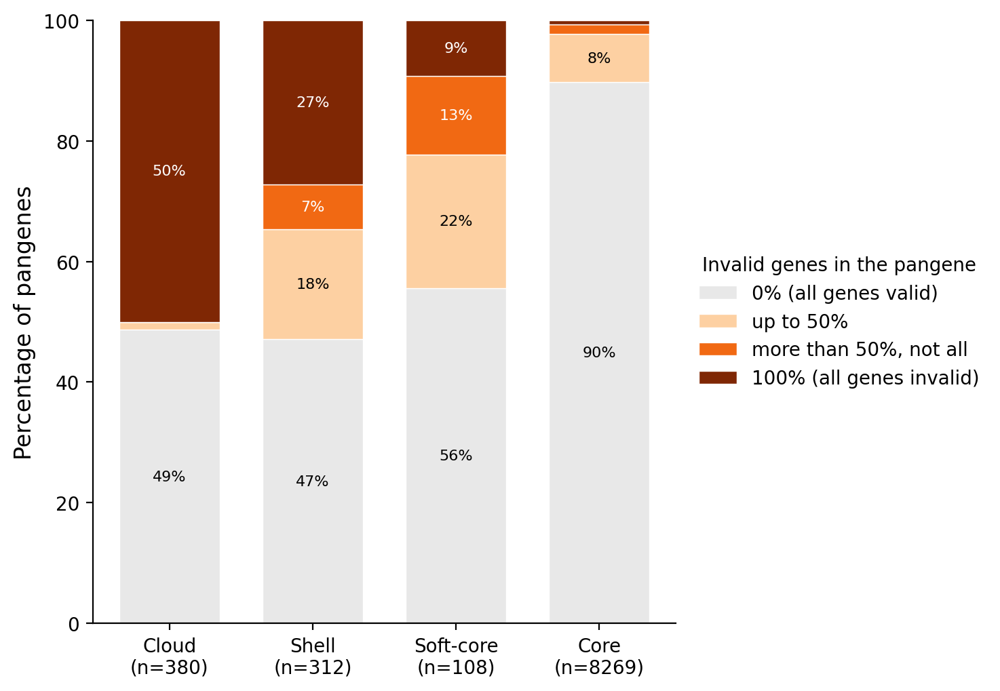

**Share of invalid genes by category** - each bar is one category, from cloud to core, split by how many of the genes of a
pangene are invalid: none, up to half, more than half but not all, or all of them. In the cloud most pangenes have one or
two genes, so a pangene is either all valid or all invalid, and the segment of "all invalid" is about the same as the
share of "mostly invalid" pangenes in the two figures above.

**Where the invalid singletons come from** - of the 990 singleton pangenes, 156 have only invalid genes. As in 7b, none is a gene of
a genome's own annotation: 154 are `rescued_` transfers and 2 are `main`. 152 have no valid ORF and 4 carry the pseudogene
biotype; none is an extra copy. The donor gene is absent from that genome's final GFF in 71 cases, is in a pangene of two or
more genomes that the transfer did not join in 61 (in 35 of them the genome already has a gene in that pangene), and is
another singleton in 24.

The plot of unsupported overlapping genes (not from the reference layer, overlapping another gene, no
domain and no specific description) is only made without filtering, see
[No filtering (7b)](#no-filtering-7b): the 7a filter already removes most of these genes, and the
`intersect=` tag it needs exists only in the 7b GFFs.

**InterPro term enrichment** - for core and cloud pangenes, which InterPro entries are found more
often than in the remaining pangenes (one-sided Fisher test, Benjamini-Hochberg adjusted). Only
pangenes with at least one InterPro entry are counted (4,889 core, 497 cloud), and only entries carried by at
least 5 pangenes are tested (680). Cloud: 70 of 310 entries tested are enriched (adjusted p < 0.05, at
least 3 pangenes); core: 10 of 672, among them methyltransferase, MFS transporter, WD40 repeat,
tetratricopeptide and zinc finger domains. A core pangene collects entries from the genes of up to
15 genomes, which may favour the core side.

The strongest cloud signal, dynein heavy chain (68 of its 78 pangenes are cloud), is most likely an
annotation artefact: its singleton pangenes have a median protein length of 534 aa, against 4,294 aa
in the pangenes present in all genomes, and FOU, p89, TgCATBr9 and MAS carry 29 to 43 genes with the
domain, against about 10 in most other genomes. This fits one very long gene annotated in several
pieces, but the positions on the chromosome were not checked. The other cloud hits include
polyketide synthase domains, acetyl-CoA carboxylase and rhoptry kinase-like.

The cytochrome b/b6 entries are also weaker here (12 of 23 pangenes in the cloud, against 28 of 53
without filtering; see below). Cytochrome b is a mitochondrial gene, and these may be fragments of
mitochondrial DNA inserted in the nuclear genome (NUMTs) or poor transfers of them; this was not
tested.

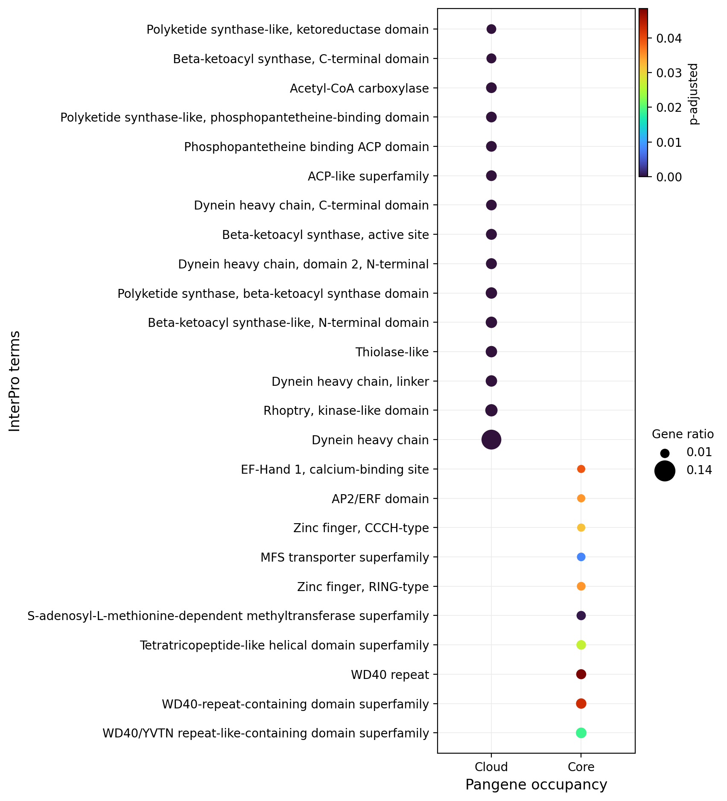

### No filtering (7b)

**Pangenome and core genome size** - the pangenome grows from about 9,200 pangenes (one genome) to
11,031 (all 15), still growing by about 100 per genome at the end. The core falls from about 9,200
to 8,733; the fitted curves put its plateau at 8,770 (Tettelin) and 8,716 (Willenbrock).
`Toxo7b_pancore_separate.png` shows the two curves in separate panels.

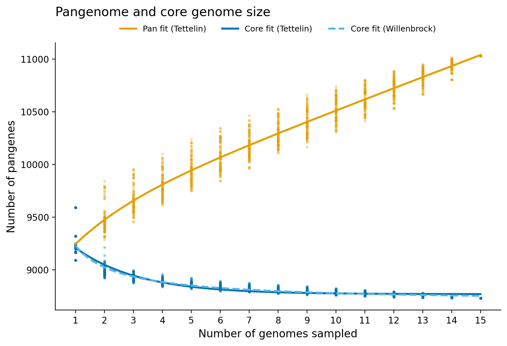

**Pangene occupancy** - 8,733 pangenes (79%) are core, 146 are in 14 genomes (soft-core), 1,448
(13%) are in one genome only and 163 in two.


**Singletons per genome** - RH88 has the most (226), GT1 the fewest (18).

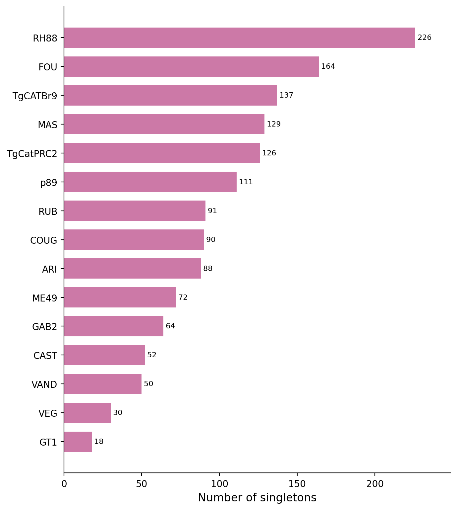

**POCS heatmap** - same as above. Between different genomes POCS is 95.4-98.4. RH88 is the most
distant genome (mean 96.2).

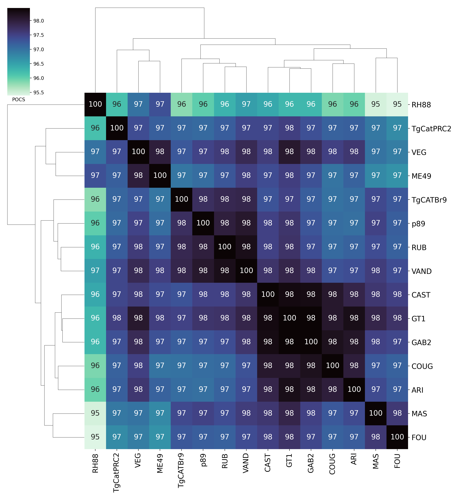

**Gene properties by occupancy** - same method as above, on 11,031 pangenes. Core:
55% of genes with a domain, median 477 aa; cloud: 40% and 212 aa.

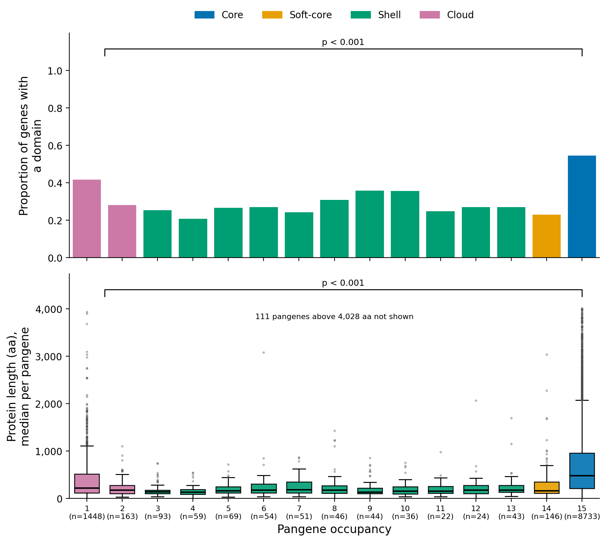

**Contig size by occupancy** - same method as above, on 11,031 pangenes. 19% of cloud pangenes are
on contigs below 200 kb (14% below 50 kb), against 0.4% (0.1%) of core.

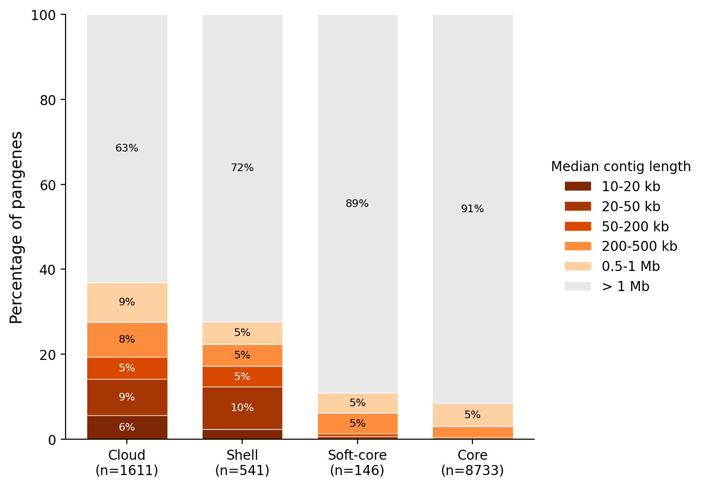

**Invalid ORFs by occupancy** - same method as above. Mostly invalid: 68% of cloud pangenes (510 of
754; 432 of the 623 singletons), 53% of shell, 28% of soft-core and 3.8% of core (335 of 8,722).
Pangenes with no gene that can be judged (903) are left out.

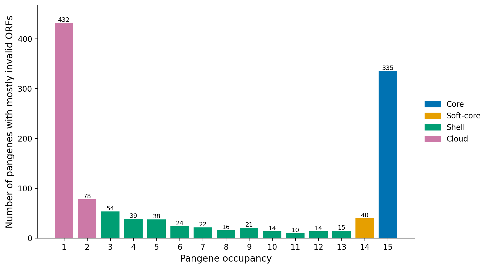

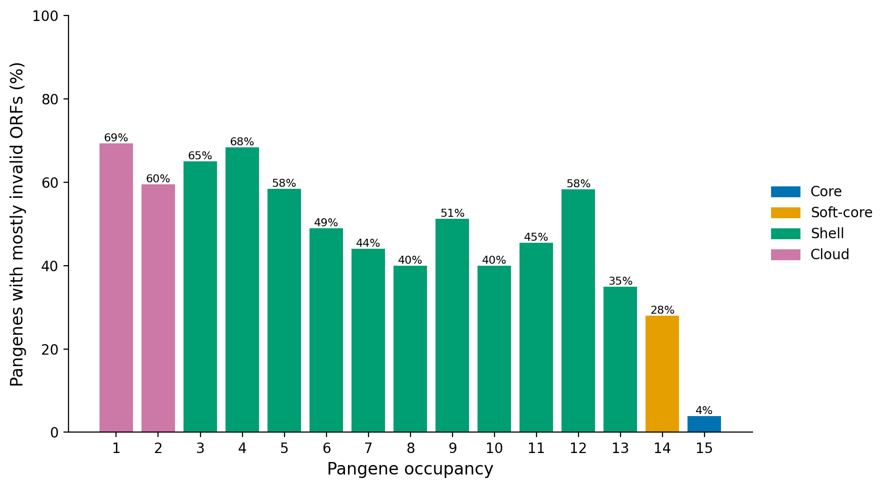

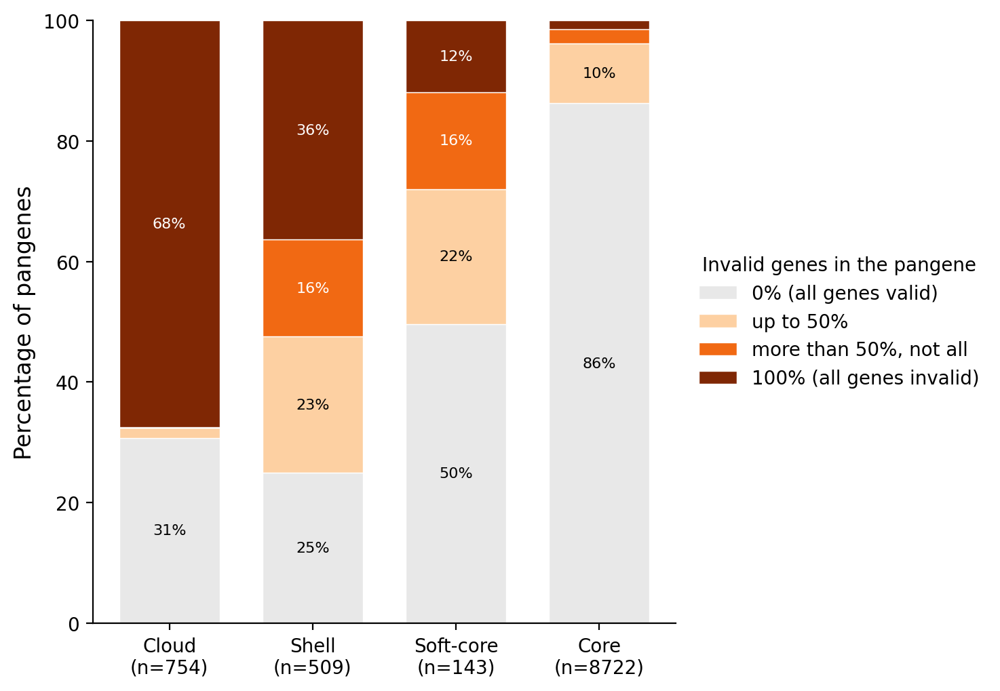

**Share of invalid genes by category** - each bar is one category, from cloud to core, split by how many of the genes of a
pangene are invalid: none, up to half, more than half but not all, or all of them. In the cloud most pangenes have one or
two genes, so a pangene is either all valid or all invalid, and the segment of "all invalid" is about the same as the
share of "mostly invalid" pangenes in the two figures above.

**Where the invalid singletons come from** - of the 1,448 singleton pangenes, 432 have only invalid genes. None is a gene of a
genome's own annotation: 431 are `rescued_` transfers (the lowest-confidence Liftoff transfers) and 1 is `main`. 427 have no
valid ORF and 5 carry the pseudogene biotype; 98 are extra copies. The donor gene, the gene of another genome that was
transferred, is absent from that genome's final GFF in 194 cases, is in a pangene of two or more genomes that the transfer
did not join in 174 (in 62 of them the genome already has a gene in that pangene), and is another singleton in 64. These
transfers may land where the genome has no real copy, or be copies that clustered apart; this was not tested further.

**Unsupported overlapping genes by occupancy** - only possible without filtering, because it needs the
`intersect=` tag. A gene is unsupported when it is not from the reference layer (`main`), overlaps
another gene, has no InterPro/Pfam domain and has no specific description (same list of generic
descriptions as the 7a filter). Main genes and genes with evidence count as good even when they
overlap. A pangene is "mostly unsupported" when more than 50% of its genes are unsupported. Unlike
invalid ORFs, these are not concentrated in the cloud: 4.3% of cloud pangenes (70 of 1,611), 8.3% of
shell, 20% of soft-core and 5.1% of core (443 of 8,733). Leaving out the pangenes with more than one
gene in a genome gives a similar pattern.

The many core pangenes here may not mean these genes are real. A real gene is under selection, and
that constraint also holds the sequence of any gene that overlaps it well. An unsupported gene that
overlaps a conserved real gene would therefore be found in every genome too, and end up in the core,
only because of the gene it overlaps. This was not tested; it would need the overlap partner of each
of these genes (the `_intersect_pairs.tsv` files list them) and how much of the gene the overlap covers.

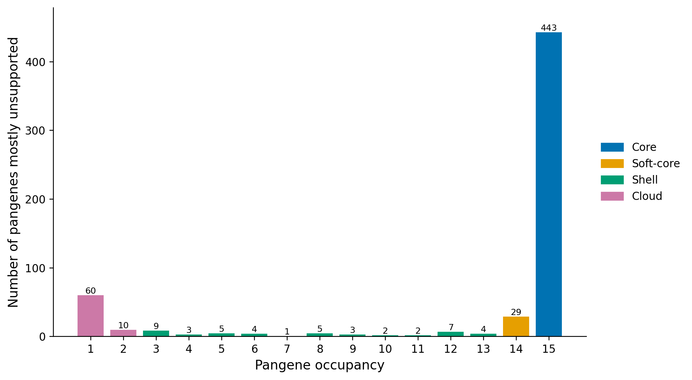

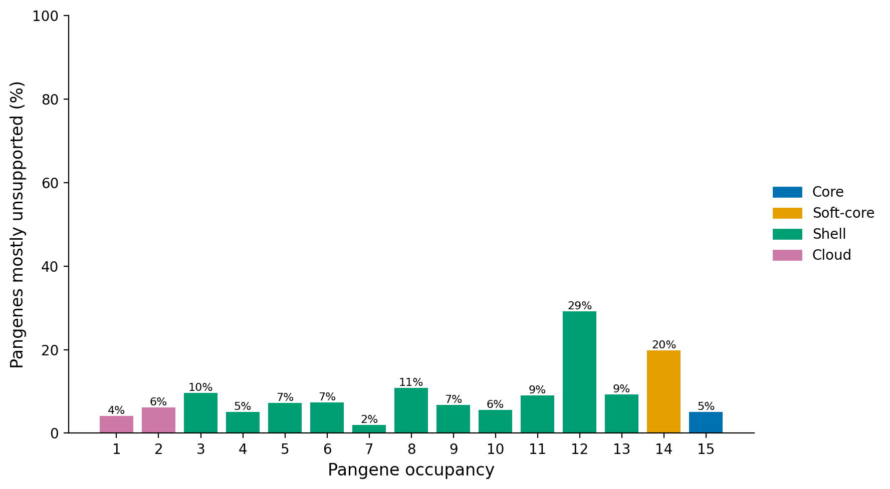

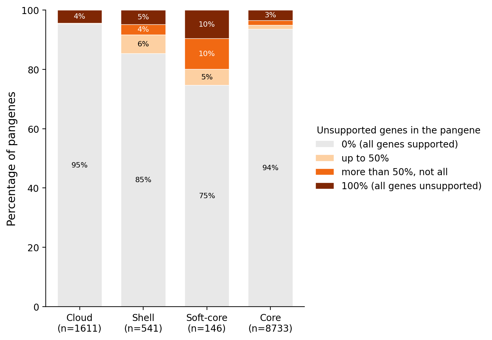

**Share of unsupported genes by category** - same layout as the share figure above, split by how many of the genes of a
pangene are unsupported.

**InterPro term enrichment** - same test as above, 4,910 core and 653 cloud pangenes with an
InterPro entry, and 719 entries tested. Cloud: 84 of 361 entries tested are enriched; core: 15 of 710,
among them methyltransferase, MFS transporter, WD40 repeat and tetratricopeptide domains.

Dynein heavy chain is again the strongest cloud signal (66 pangenes, 10% of the annotated cloud
pangenes) and shows the same artefact: singleton pangenes have a median of 528 aa against 4,294 aa
in the pangenes present in all genomes, and FOU has 44 genes with the domain against about 10 in
most genomes. The other cloud hits include polyketide synthase domains, cytochrome b/b6 and
rhoptry kinase-like.

The cytochrome b/b6 entries (28 of 53 pangenes in the cloud) are probably an artefact too. There
are 231 genes with the cytochrome b N-terminal domain, 12 to 21 per genome, against 103 after
filtering (about 7 per genome). 166 of the 231 (72%) come from the `rescued_` layer, the
lowest-confidence transfers, and only 25 from a genome's own annotation; only 7 are Liftoff extra
copies. Their median Liftoff coverage is 0.81, against 0.93 after filtering. Cytochrome b is a
mitochondrial gene, so several copies per genome fit mitochondrial DNA inserted in the nuclear
genome (NUMTs) or poor transfers of them, but this was not tested: it would need the sequences
aligned to the mitochondrial genome.
```bash
sbatch 08_Pangenome_Visualisation/scripts/plot_domain_enrichment_job.sh
```

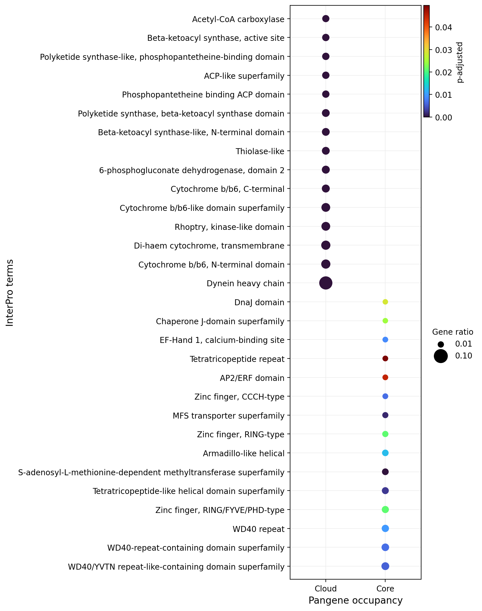

## Redundancy check on the final panel

Long-read assemblies can leave small contigs that are really a duplicated slice of a larger contig
(an uncollapsed repeat or a haplotig-style overlap); their genes would be counted twice and inflate the
pangenome. This is the contig-redundancy screen of [step 01](#01--genome-selection--qc), run at the end
on the genomes without contigs below 10 kb, with the 7b (no filtering) annotation, so the gene counts are
those of the final annotation.

```bash
sbatch 01_Genome_Selection_QC/scripts/contig_redundancy_final.slurm.sh
```

Each genome is aligned against itself (`minimap2 -xasm5 -DP`, the `purge_dups` call). A contig is
**flagged** (`small-redundant`) when it is smaller than 1 Mb and at least 90 % of it aligns, at 95 %
identity or more, to a longer contig of the same assembly. A flag only makes the contig a candidate:
for the contigs that carry genes, every gene is then searched by BLAST in its own assembly, and the
contig is **DROP-OK** when each gene has a copy elsewhere (at least 98 % identity over at least 90 % of the
gene, on an annotated gene) or **REVIEW** when some gene has none. Nothing was removed. Report:
[`REPORT.md`](01_Genome_Selection_QC/contig_redundancy_final/REPORT.md).

#### Per-genome summary

All contigs in this table are at least 10 kb (the shortest is 10,016 bp), because shorter contigs were
removed from every genome in step 01. Contigs are split by length:

- **large**: 1 Mb or more. These are chromosomes or big pieces of them and are never flagged. Several genomes
  have more large contigs than the 14 chromosomes because some chromosomes are split in the assembly.
- **small**: from 10 kb to 1 Mb. Only small contigs can be flagged.

`total Mb` is the size of the whole assembly and `small Mb` the part of it in small contigs. `redundant` and
`unplaced` count the small contigs of that class; the `genes` column beside each is how many annotated genes
sit on them. `small-unplaced` contigs do not map to ME49 and are not duplicated, so they are not candidates.

| Genome | contigs | total Mb | large (≥ 1 Mb) | small (10 kb - 1 Mb) | small Mb | redundant | redundant bp | genes | unplaced | genes |
| :--- | ---: | ---: | ---: | ---: | ---: | ---: | ---: | ---: | ---: | ---: |
| **ME49** | 47 | 63.1 | 14 | 33 | 0.60 | 6 | 94 kb | 22 | – | – |
| **ARI** | 47 | 63.0 | 21 | 26 | 8.20 | – | – | – | 9 | 98 |
| **CAST** | 56 | 63.2 | 23 | 33 | 6.83 | – | – | – | 21 | 253 |
| **COUG** | 58 | 62.7 | 21 | 37 | 10.23 | – | – | – | 18 | 200 |
| **FOU** | 105 | 62.6 | 23 | 82 | 20.44 | – | – | – | 36 | 595 |
| **GAB2** | 84 | 62.0 | 24 | 60 | 13.37 | – | – | – | 31 | 172 |
| **GT1** | 33 | 60.9 | 14 | 19 | 0.28 | – | – | – | 7 | 9 |
| **MAS** | 143 | 61.8 | 16 | 127 | 33.16 | – | – | – | 34 | 270 |
| **p89** | 93 | 62.8 | 22 | 71 | 18.73 | – | – | – | 37 | 390 |
| **RH88** | 135 | 66.6 | 13 | 122 | 2.67 | 100 | 1724 kb | 89 | 18 | 47 |
| **RUB** | 89 | 63.4 | 21 | 68 | 13.82 | – | – | – | 40 | 262 |
| **TgCATBr9** | 93 | 63.0 | 24 | 69 | 15.15 | – | – | – | 37 | 402 |
| **TgCatPRC2** | 103 | 62.6 | 25 | 78 | 16.60 | – | – | – | 29 | 169 |
| **VAND** | 83 | 62.9 | 24 | 59 | 14.22 | – | – | – | 26 | 125 |
| **VEG** | 30 | 63.1 | 14 | 16 | 0.42 | – | – | – | 14 | 25 |

Only ME49 and RH88 have flagged contigs; the other 13 genomes are clean.

#### Flagged contigs that carry genes

`covered by` is the longer contig that holds the copy that would stay. `REVIEW (n)` is the number of genes
on the contig with no copy elsewhere.

| Genome | Contig | Length | % dup | covered by | Genes | Verdict |
| :--- | :--- | ---: | ---: | :--- | ---: | :--- |
| **ME49** | `KE139140` | 20,306 | 99 % | `KE138866`, `TGME49_chrVI` | 9 | DROP-OK |
| **ME49** | `KE139816` | 17,865 | 98 % | `KE138892`, `KE139822`, `KE139843` | 1 | DROP-OK |
| **ME49** | `KE138868` | 16,277 | 100 % | `KE138866`, `KE139140`, `TGME49_chrVI` | 6 | DROP-OK |
| **ME49** | `KE139842` | 15,749 | 99 % | `KE138892`, `KE139822`, `TGME49_chrII` | 2 | DROP-OK |
| **ME49** | `KE139130` | 12,872 | 100 % | `KE138874`, `TGME49_chrXII` | 3 | REVIEW (1) |
| **ME49** | `KE139841` | 11,018 | 96 % | `KE138892`, `KE139817`, `KE139819` | 1 | REVIEW (1) |
| **RH88** | `JAAUHK010000015` | 42,350 | 97 % | `CM023090`, `CM023091`, `CM023092` | 4 | REVIEW (3) |
| **RH88** | `JAAUHK010000023` | 31,785 | 97 % | `CM023087`, `CM023090`, `CM023092` | 4 | REVIEW (1) |
| **RH88** | `JAAUHK010000025` | 30,311 | 100 % | `CM023094` | 13 | REVIEW (3) |
| **RH88** | `JAAUHK010000012` | 28,810 | 92 % | `CM023087`, `CM023091`, `JAAUHK010000002` | 1 | DROP-OK |
| **RH88** | `JAAUHK010000005` | 28,644 | 100 % | `CM023094`, `JAAUHK010000025` | 9 | REVIEW (2) |
| **RH88** | `JAAUHK010000108` | 27,454 | 100 % | `CM023093`, `JAAUHK010000038`, `JAAUHK010000115` | 1 | DROP-OK |
| **RH88** | `JAAUHK010000010` | 26,922 | 90 % | `CM023087` | 10 | REVIEW (2) |
| **RH88** | `JAAUHK010000009` | 26,667 | 100 % | `CM023090`, `JAAUHK010000006`, `JAAUHK010000026` | 1 | DROP-OK |
| **RH88** | `JAAUHK010000019` | 23,363 | 100 % | `CM023090`, `JAAUHK010000006`, `JAAUHK010000009` | 1 | DROP-OK |
| **RH88** | `JAAUHK010000018` | 22,487 | 96 % | `CM023090`, `CM023091`, `JAAUHK010000002` | 2 | REVIEW (1) |
| **RH88** | `JAAUHK010000020` | 22,198 | 100 % | `CM023087`, `CM023090`, `CM023091` | 1 | DROP-OK |
| **RH88** | `JAAUHK010000031` | 19,995 | 100 % | `CM023094`, `JAAUHK010000005`, `JAAUHK010000025` | 9 | REVIEW (1) |
| **RH88** | `JAAUHK010000028` | 19,262 | 94 % | `CM023082` | 6 | REVIEW (2) |
| **RH88** | `JAAUHK010000069` | 18,672 | 100 % | `CM023090`, `CM023091`, `JAAUHK010000002` | 1 | DROP-OK |
| **RH88** | `JAAUHK010000071` | 17,563 | 100 % | `CM023093`, `JAAUHK010000038`, `JAAUHK010000108` | 1 | DROP-OK |
| **RH88** | `JAAUHK010000072` | 16,787 | 99 % | `CM023086`, `CM023087`, `CM023090` | 3 | DROP-OK |
| **RH88** | `JAAUHK010000039` | 16,651 | 100 % | `CM023085` | 3 | DROP-OK |
| **RH88** | `JAAUHK010000057` | 15,666 | 100 % | `CM023091` | 2 | DROP-OK |
| **RH88** | `JAAUHK010000058` | 15,460 | 99 % | `CM023090`, `CM023092`, `JAAUHK010000002` | 1 | DROP-OK |
| **RH88** | `JAAUHK010000063` | 15,308 | 100 % | `CM023092`, `JAAUHK010000002`, `JAAUHK010000014` | 1 | DROP-OK |
| **RH88** | `JAAUHK010000149` | 15,293 | 100 % | `CM023092`, `JAAUHK010000002`, `JAAUHK010000014` | 1 | REVIEW (1) |
| **RH88** | `JAAUHK010000061` | 15,121 | 100 % | `JAAUHK010000032`, `JAAUHK010000033`, `JAAUHK010000034` | 1 | REVIEW (1) |
| **RH88** | `JAAUHK010000081` | 14,965 | 100 % | `CM023093` | 2 | DROP-OK |
| **RH88** | `JAAUHK010000099` | 14,209 | 100 % | `CM023088` | 6 | DROP-OK |
| **RH88** | `JAAUHK010000030` | 13,384 | 99 % | `JAAUHK010000032`, `JAAUHK010000033`, `JAAUHK010000034` | 3 | REVIEW (3) |
| **RH88** | `JAAUHK010000114` | 13,239 | 99 % | `CM023093` | 2 | DROP-OK |

RH88 has 74 more flagged contigs with **no gene** (1.17 Mb, the largest 34 kb): pure duplicated sequence. With no
gene in the final annotation they add nothing to the pangenome, so there is no need to remove them.

Notes:
- **RH88** REVIEW contigs include genes that look like organelle genes (cytochrome b, cytochrome c oxidase
  subunit III, RNA polymerase B and C2, ORF C and D). They are repeated, or have no copy at 98 % identity,
  and belong with the organelle screen more than with this one.
- **ME49** `KE139130`: one gene (a KRUF family protein) has a 99.9 % identical copy on `KE138874`, but it
  covers only 67 % of the gene. `KE139841`: its one gene (hypothetical protein) has no copy above 98 %.
  ME49 is the reference and its genes form the `main` layer.
- In the no-filtering pangenes, 60 of the 88 RH88 genes on flagged contigs are in single-genome pangenes
  (RH88 has 226 singleton pangenes).

#### Contigs just under the cut

The 90 % cut is a line drawn on a continuous value, so contigs at 75-89 % duplicated are probably redundant
too. There are 14 (2 in ME49, 12 in RH88), and 9 of them carry genes (33 in total; the other 5, all in RH88,
have no gene). Their genes have not been checked by BLAST yet.

| Genome | Contig | Length | % dup | covered by | Genes |
| :--- | :--- | ---: | ---: | :--- | ---: |
| **ME49** | `KE138866` | 20,505 | 89 % | `TGME49_chrVI` | 7 |
| **ME49** | `KE139812` | 12,974 | 86 % | `KE139847`, `TGME49_chrVIIa` | 4 |
| **RH88** | `JAAUHK010000004` | 79,187 | 80 % | `CM023083` | 3 |
| **RH88** | `JAAUHK010000011` | 39,556 | 83 % | `CM023086`, `CM023087`, `CM023090` | 4 |
| **RH88** | `JAAUHK010000007` | 39,225 | 82 % | `CM023086`, `CM023087`, `CM023090` | 3 |
| **RH88** | `JAAUHK010000026` | 27,933 | 77 % | `CM023090`, `JAAUHK010000006` | 3 |
| **RH88** | `JAAUHK010000051` | 26,503 | 88 % | `CM023093` | 4 |
| **RH88** | `JAAUHK010000021` | 22,331 | 85 % | `CM023093`, `JAAUHK010000051` | 4 |
| **RH88** | `JAAUHK010000073` | 20,079 | 84 % | `CM023092`, `JAAUHK010000002`, `JAAUHK010000014` | 1 |

#### Decision

Contigs with no gene are not removed: with no gene in the final annotation they add nothing to the pangenome.
All contigs that carry genes are removed, whatever the BLAST verdict: the 32 flagged contigs (DROP-OK and REVIEW)
and the 9 just under the cut, 41 contigs in total (8 in ME49, 33 in RH88, 0.93 Mb, 144 genes). The removal is
step 09 below. The original GFFs and matrices are kept, to compare.

## 09 – Redundant Contig Removal

*Tgondii only.* The genes of the contigs listed in [`redundant_contigs_removed.tsv`](09_Redundant_Contig_Removal/redundant_contigs_removed.tsv)
are taken out of the final GFFs and of the `get_pangenes` matrices, without redoing the annotation. It is done for
the 7a and the 7b set, into new folders (`annotation_7a`, `annotation_7b`, `pangenes_7a`, `pangenes_7b`); the
original GFFs and matrices are not changed, so the two versions can be compared.

```bash
sbatch 09_Redundant_Contig_Removal/scripts/remove_redundant_contig_genes.slurm.sh
mkdir -p pangenome_plots/logs && sbatch 09_Redundant_Contig_Removal/scripts/plot_nonredundant_job.sh
```

1. [`make_removal_list.py`](09_Redundant_Contig_Removal/scripts/make_removal_list.py) lists every small contig that
   carries genes and is flagged (`small-redundant`) or is 75-89 % duplicated.
2. [`remove_redundant_contig_genes.py`](09_Redundant_Contig_Removal/scripts/remove_redundant_contig_genes.py) drops those
   contigs from each GFF (the gene with its children) and the gene IDs from `pangene_matrix_genes.tr.tab`; a pangene left
   with no gene is removed, and `pangene_matrix.tr.tab` is rebuilt from it. The IDs are unique across genomes and each
   GFF holds its own genes, so only the GFFs of ME49 and RH88 change.
3. `plot_nonredundant_job.sh` makes the step-08 plots again, with files starting `Toxo7a_nonredundant` and
   `Toxo7b_nonredundant`, in [`plots/`](09_Redundant_Contig_Removal/plots/). The POCS heatmap is not redone, because
   `POCS.matrix.tab` comes from `get_pangenes` and is not recomputed. The neighbourhoods `get_pangenes` uses around a
   removed gene are not recomputed either; rerunning `get_pangenes` on the new GFFs would make the result exact.

Of the 144 genes, 143 were in the 7b matrix (one was not clustered) and 81 in the 7a matrix.
The 7a filter had already dropped some of the others. What changes:

| | 7a before | 7a after | 7b before | 7b after |
| :--- | ---: | ---: | ---: | ---: |
| Pangenes | 9,904 | 9,847 | 11,031 | 10,922 |
| Singleton pangenes, all genomes | 990 | 941 | 1,448 | 1,353 |
| Pangenes in all 15 genomes (core) | 8,281 | 8,281 | 8,733 | 8,733 |
| of them, RH88 | 122 | 78 | 226 | 145 |
| of them, ME49 | 28 | 19 | 72 | 55 |

A singleton pangene is a pangene present in one genome only; the table counts them for the whole panel and then for RH88 and ME49 alone (the same pangenes, split by genome). The removed pangenes are all cloud: 54 of them in one genome and 3 in two genomes in 7a, 104 and 5 in 7b. The core does not
change. RH88 loses about a third of its singletons (36 % in both sets); the other genomes change by one or two (a pangene that was shared
with RH88 becomes a singleton of the other genome).

The figures are the same as in step 08, for the two sets; the numbers in brackets are the ones before the removal.
Every figure also comes as `.svg`, with the tables of the values.

### With filtering (7a), redundant contigs removed

**Pangenome and core genome size** - the pangenome has 9,847 pangenes (9,904) and still grows by about 67 per genome at
the end (70). The core is 8,281 (same); the fitted curves put its plateau at 8,306 (Tettelin) and 8,262 (Willenbrock),
against 8,307 and 8,264. `Toxo7a_nonredundant_pancore_separate.png` shows the two curves in separate panels.

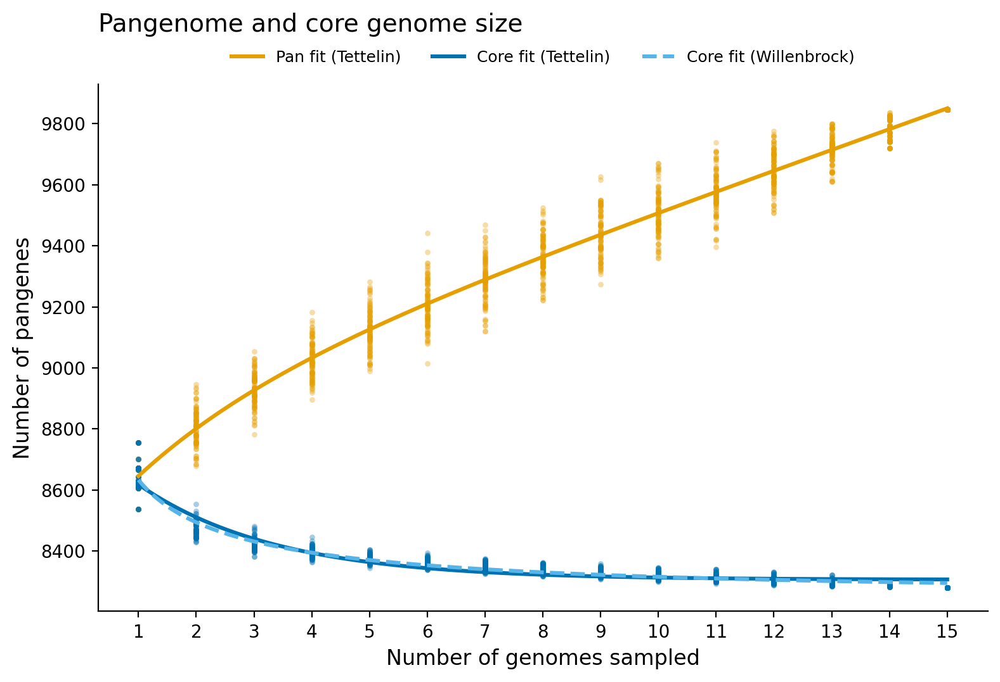

**Pangene occupancy** - 8,281 pangenes are core, 111 are in 14 genomes (both same), 941 are in one genome only (990) and
126 in two (131).


**Singletons per genome** - FOU has the most (128) and GT1 the fewest (11), as before. RH88 goes from 122 to 78 and ME49
from 28 to 19.

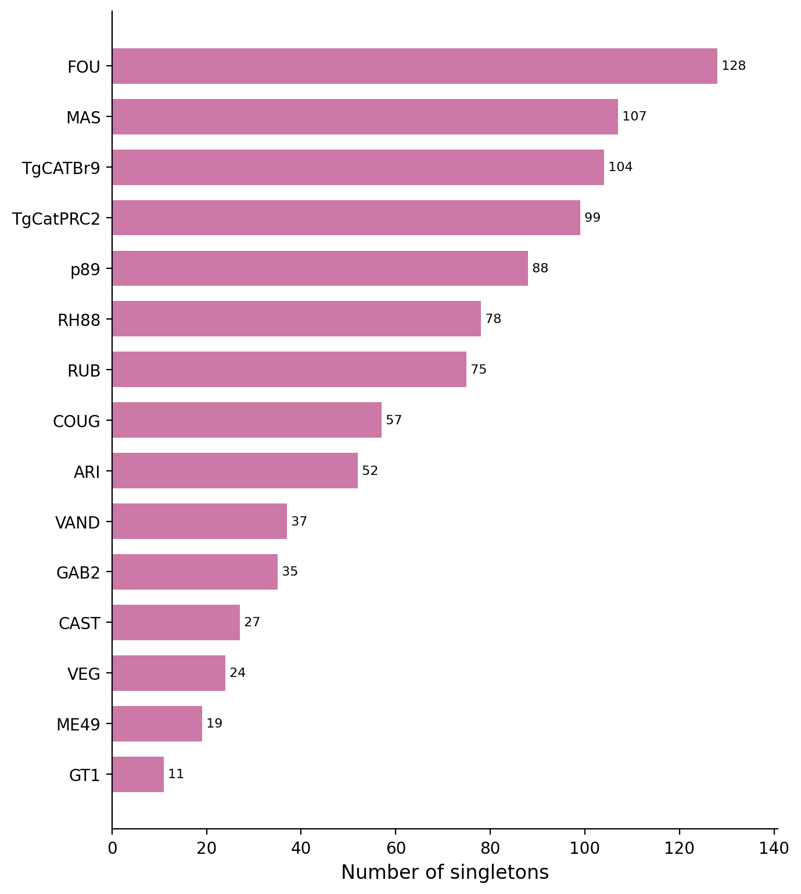

**Gene properties by occupancy** - 9,847 pangenes (9,904). Core: 57 % of genes with a domain, median 513 aa (same);
cloud: 45 % and 241 aa (44 % and 240). The `_log` file shows protein length
on a log axis.

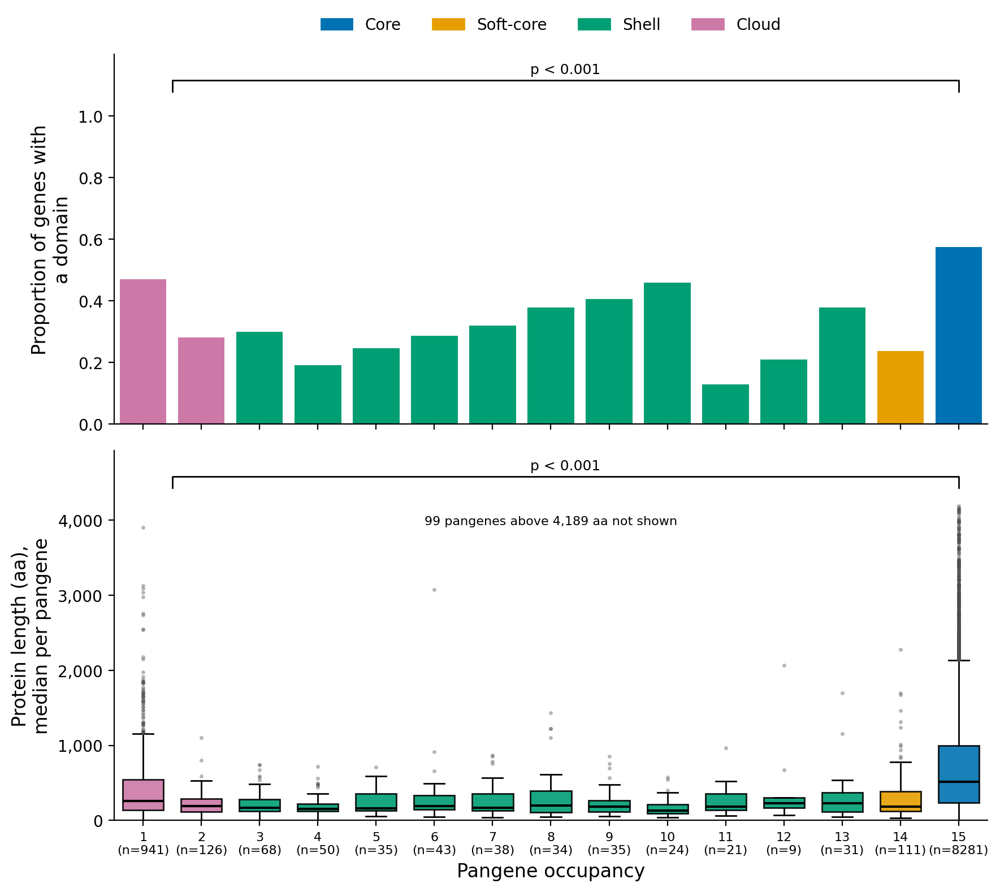

**Contig size by occupancy** - the share of cloud pangenes on contigs below 200 kb falls to 11 % (16 %), and below 50 kb to
5.2 % (10 %). Core stays at 0.4 % and 0.1 %. The cloud is still on short contigs more often than the core, but less.

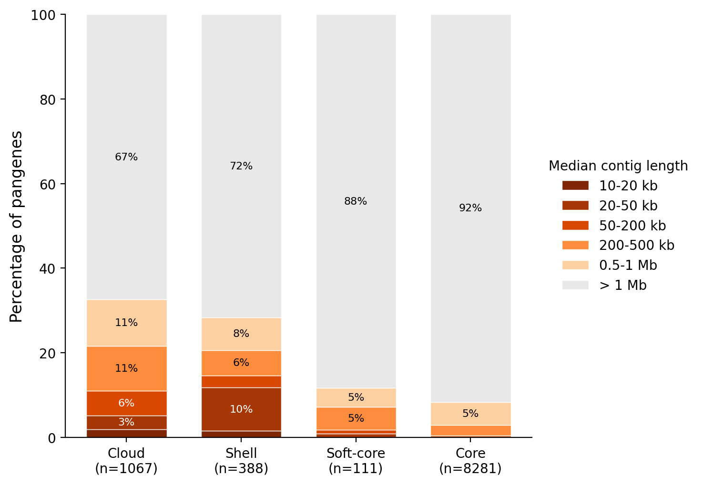

**Invalid ORFs by occupancy** - mostly invalid: 53 % of cloud pangenes (188 of 354; 50 % before), 35 % of shell, 22 % of
soft-core and 2.3 % of core (187 of 8,269).
Additional filtering could still be considered here too.

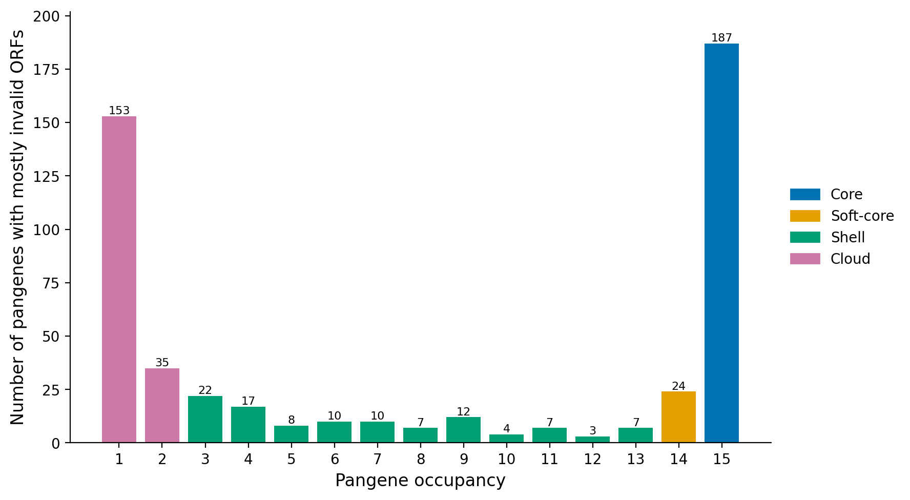

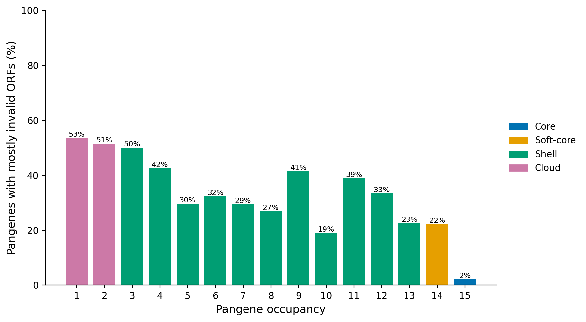

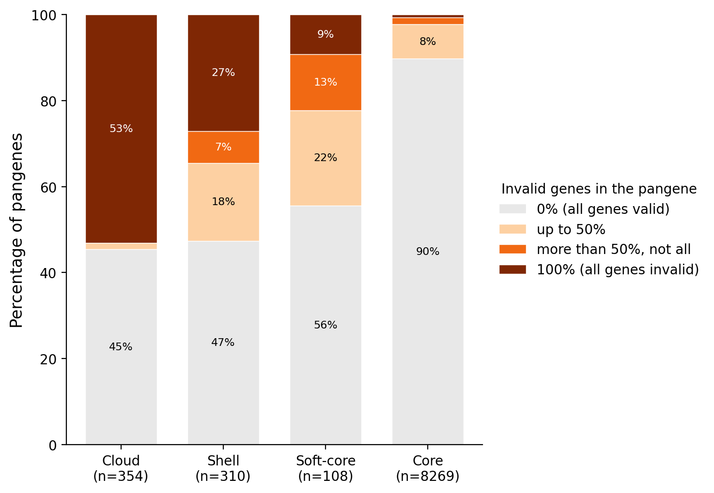

**InterPro term enrichment** - 481 cloud and 4,889 core pangenes with an InterPro entry. Cloud: 67 of 309 entries tested are
enriched (70 of 310); core: 8 of 672 (10 of 672). Dynein heavy chain is still the strongest cloud signal, with the same 68
pangenes, so removing these contigs does not seem to change the pattern discussed in step 08.

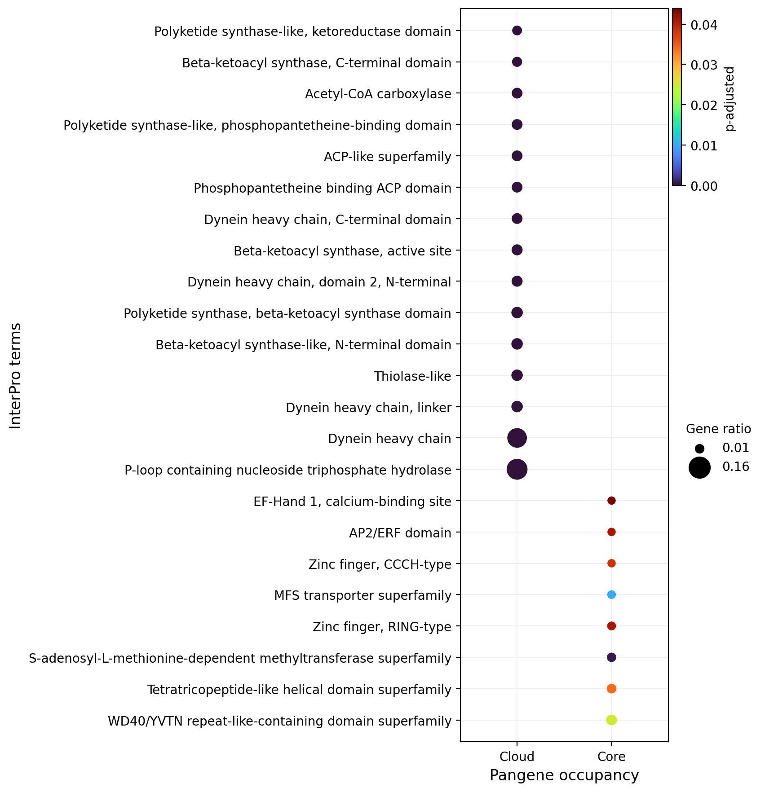

### No filtering (7b), redundant contigs removed

**Pangenome and core genome size** - the pangenome has 10,922 pangenes (11,031) and still grows by about 92 per genome at
the end (98). The core is 8,733 (same); the plateau is 8,768 (Tettelin) and 8,712 (Willenbrock), against 8,770 and
8,716.


**Pangene occupancy** - 8,733 pangenes are core, 146 are in 14 genomes (both same), 1,353 are in one genome only (1,448)
and 155 in two (163).

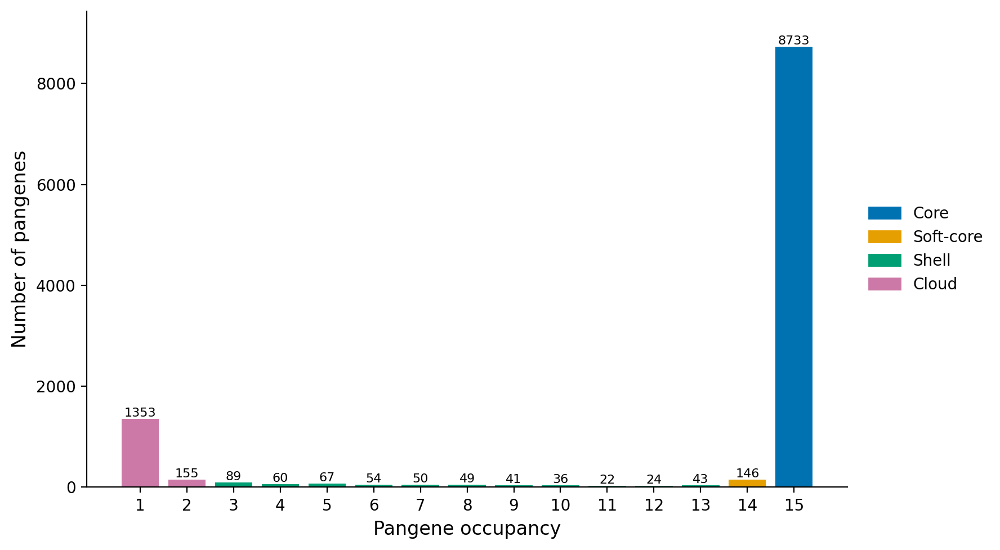

**Singletons per genome** - FOU now has the most (164); RH88 had the most before (226) and goes to 145. GT1 has the fewest
(18). ME49 goes from 72 to 55.

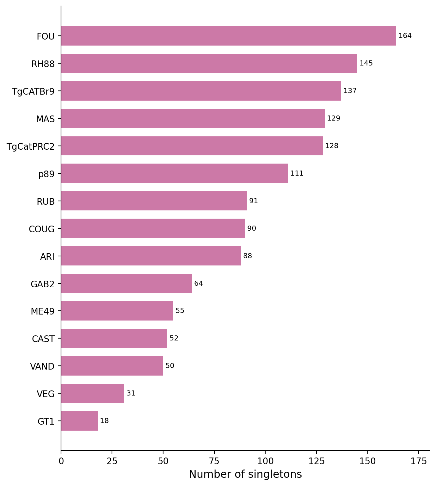

**Gene properties by occupancy** - 10,922 pangenes (11,031). Core: 55 % of genes with a domain, median 477 aa (same); cloud:
40 % and 211 aa (40 % and 212).

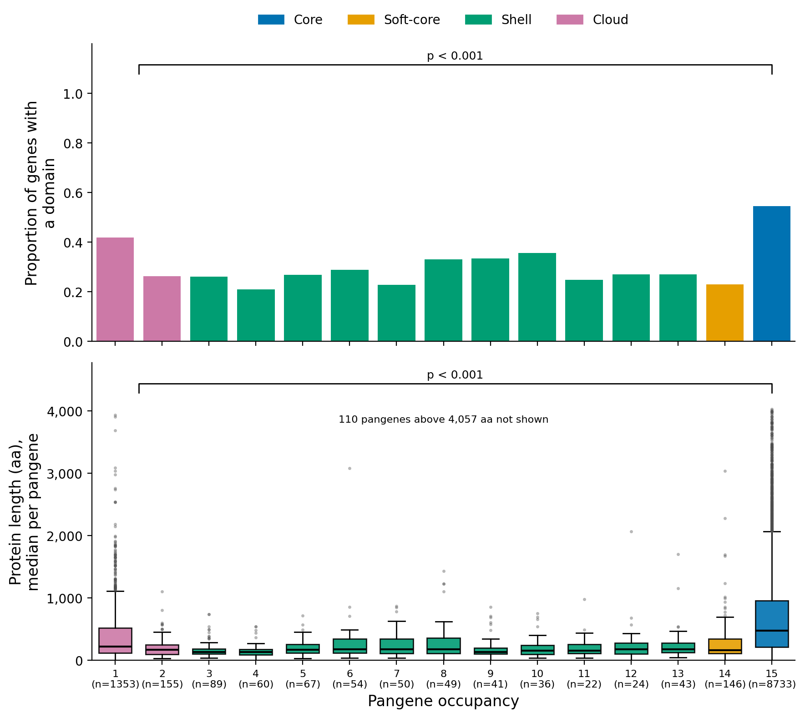

**Contig size by occupancy** - cloud pangenes on contigs below 200 kb: 13.5 % (19.4 %); below 50 kb: 8.2 % (14.2 %). Core
stays at 0.4 % and 0.1 %.

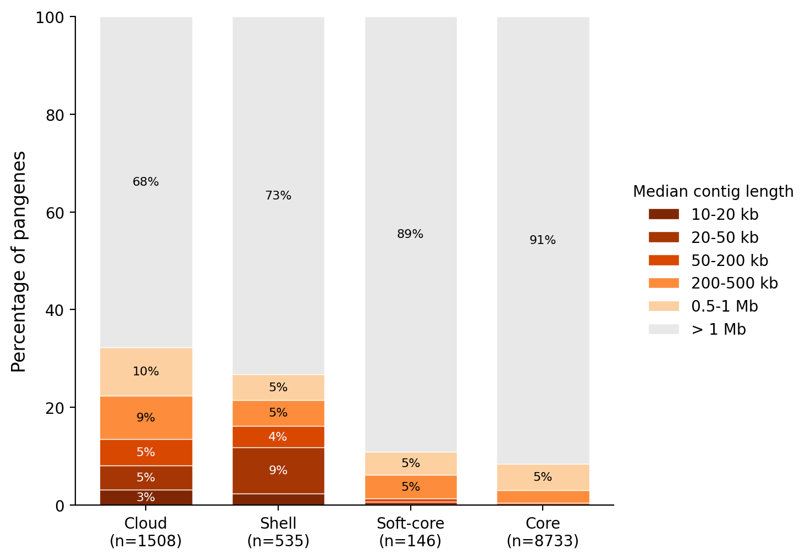

**Invalid ORFs by occupancy** - mostly invalid: 68 % of cloud pangenes (473 of 694; 510 of 754 before), 53 % of shell, 28 %
of soft-core and 3.8 % of core (335 of 8,722). The share hardly changes, so these contigs do not seem to drive this result.

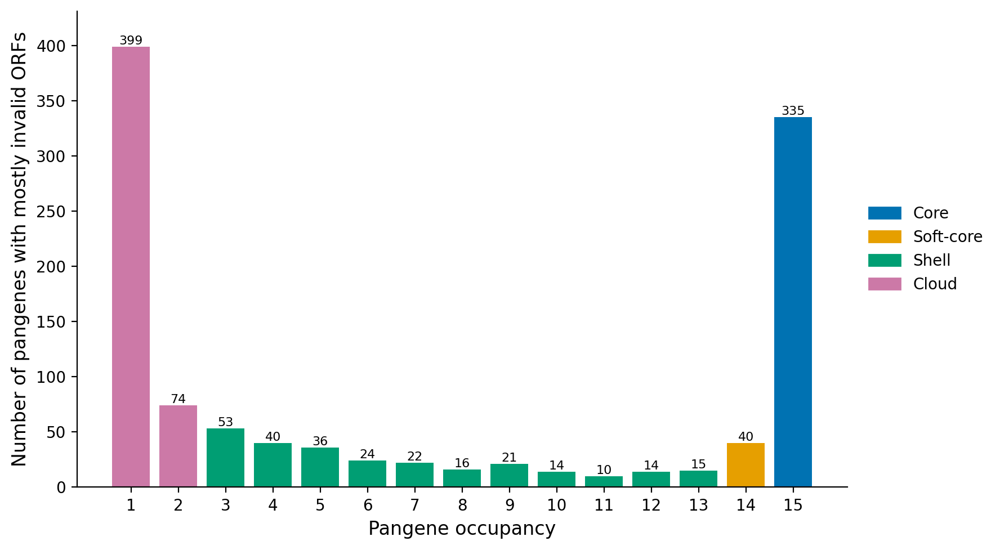

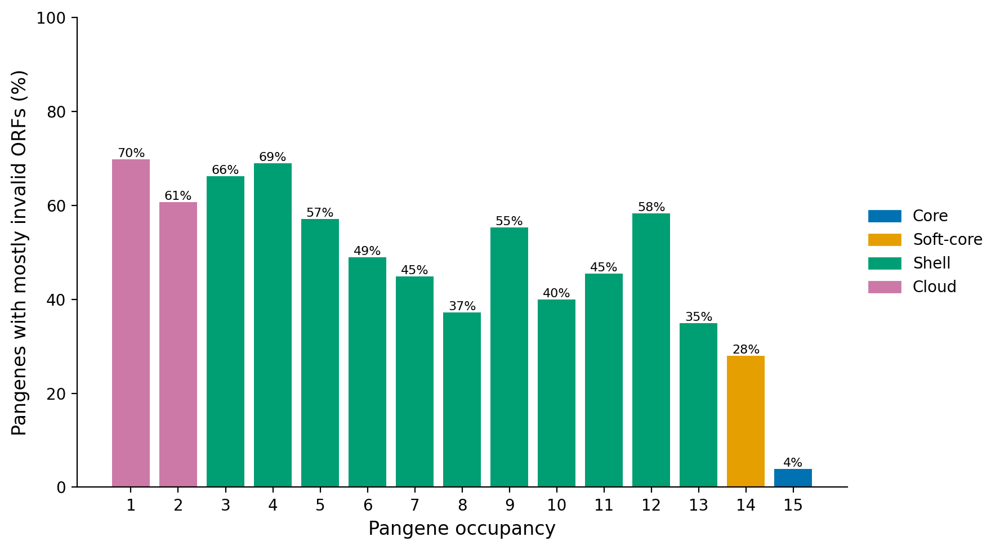


**Unsupported overlapping genes by occupancy** - 4.6 % of cloud pangenes (69 of 1,508; 4.3 % before), 8.4 % of shell, 20 % of
soft-core and 5.1 % of core (443 of 8,733), the same core count as before.


**InterPro term enrichment** - 611 cloud and 4,910 core pangenes with an InterPro entry. Cloud: 77 of 347 entries tested are
enriched (84 of 361); core: 13 of 706 (15 of 710). Dynein heavy chain is still the strongest cloud signal (66 pangenes, same).
Cytochrome b/b6 (N-terminal domain) falls from 28 to 25 cloud pangenes, so most of them do not seem to come from the removed
contigs either.


---

[↑ Back to top](#analysis-steps) &nbsp;|&nbsp; [Back to Pangenome Pipeline](../../README.md)
